# Architecture

---

## 1. Tech Stack Decisions

### 1.1 Graph Database: Neo4j over PostgreSQL

Aviation routing is fundamentally a graph problem — airports are vertices, routes are edges, and every query is a traversal. The database choice should reflect the data's natural shape.

**Why Neo4j:**
- **Native graph storage.** Neo4j stores nodes and relationships as first-class citizens with index-free adjacency — each node physically points to its neighbors. A 3-hop traversal follows 3 pointer chains regardless of total dataset size. In PostgreSQL, the same operation requires recursive CTEs with self-joins that degrade as table size grows.
- **Cypher is purpose-built for this.** Finding "all 2-stop A380 routes from LHR" is one Cypher statement: `MATCH path = (a:Airport)-[:ROUTE*1..3]->(b:Airport)`. The equivalent PostgreSQL recursive CTE is 15+ lines of SQL with manual cycle detection, depth tracking, and array aggregation.
- **Path-aware results.** Cypher returns full path objects with all intermediate nodes and relationships. PostgreSQL recursive CTEs return flat rows that must be reconstructed into paths in application code.
- **Learning value.** Graph databases, Cypher, and graph data modeling are distinct skills from relational SQL — this project teaches both graph thinking and a new query paradigm.

**Why not PostgreSQL:**
- PostgreSQL recursive CTEs work for graph traversal at this scale (~67k routes), but they fight the relational model rather than working with it. The M:N junction table (`route_aircraft`) adds a JOIN on every hop, making multi-stop queries verbose and fragile.
- PostgreSQL's query planner doesn't optimize for graph traversal patterns — it has no concept of "follow this edge 3 times."

**Trade-off acknowledged — Neo4j memory cost:**
Neo4j runs on the JVM. Default heap is 12G, which is unsafe on 24GB shared with local LLM models. We mitigate this by configuring conservative limits (see Section 7). At this dataset size (~14k nodes, ~134k relationships), Neo4j runs comfortably within a 2.5G total budget.

### 1.2 Data Ingestion: Python over Node.js

The ingestion pipeline is a one-time ETL job: read CSVs, clean data, load into Neo4j.

**Why Python:**
- **csv stdlib is sufficient.** OpenFlights files are simple comma-separated data with `<br>` for nulls. No need for streaming parsers or async I/O — the largest file (routes.dat) is 67k rows, under 5MB. Python's `csv.reader` handles this trivially.
- **Neo4j Python driver is mature.** The official `neo4j` Python driver v5 has the cleanest API for batch operations — `session.execute_write()` with `UNWIND` + `MERGE` patterns are well-documented and idiomatic.
- **String manipulation.** Normalizing IATA codes, handling `<br>` nulls, splitting space-separated equipment fields — Python's string handling is more concise than Node.js for this kind of data munging.

**Why not Node.js:**
- Node.js shines at high-concurrency I/O (servers, real-time streams). An ETL script that reads 4 CSV files sequentially doesn't benefit from the event loop. Python is more straightforward for procedural data processing.

### 1.3 API + Engine: Go

The Go server has two responsibilities: expose HTTP endpoints, and run custom pathfinding algorithms in memory.

**Why Go:**
- **Learning target.** This project is explicitly a Go learning exercise. Graph algorithms (BFS, Dijkstra's) require idiomatic structs, interfaces, slices, and maps — Go's core constructs.
- **`container/heap` interface.** Dijkstra's algorithm needs a priority queue. Go's standard library provides `container/heap` as an interface you implement — not a black-box import. Implementing `Len()`, `Less()`, `Swap()`, `Push()`, `Pop()` teaches Go's interface system through a real use case.
- **Performance.** BFS over 134k edges with filtering is CPU-bound. Go's compiled execution and goroutine model make it faster than Node.js and Python for this workload, though at this scale even Python would be fast enough.
- **`net/http` stdlib.** Go's standard HTTP library is production-grade with no framework needed. Four endpoints and a health check don't justify pulling in Gin, Echo, or Fiber.

---

## 2. Neo4j Graph Data Model

### 2.0 Entity Relationship Overview

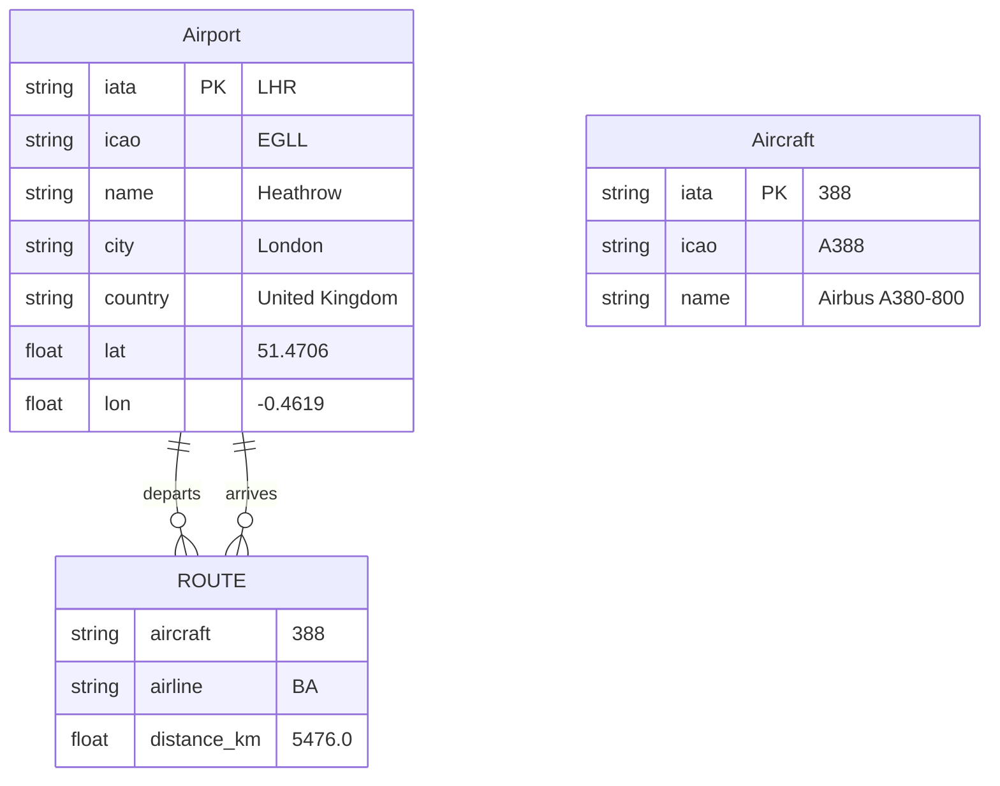

> Aircraft nodes are not connected to ROUTE relationships in Neo4j — they exist solely for search/metadata lookup. The `aircraft` property on each ROUTE relationship is a denormalized copy of the Aircraft IATA code (see Section 2.2 for rationale).

### 2.1 Node Types

```
(:Airport {
    iata: "LHR",           -- IATA 3-letter code (unique constraint)
    icao: "EGLL",          -- ICAO 4-letter code
    name: "Heathrow",
    city: "London",
    country: "United Kingdom",
    lat: 51.4706,          -- latitude (decimal degrees)
    lon: -0.4619           -- longitude (decimal degrees)
})

(:Aircraft {
    iata: "388",           -- IATA equipment code (unique constraint)
    icao: "A388",          -- ICAO type designator
    name: "Airbus A380-800",
    family: "A380",        -- aircraft family (groups variants, e.g., A350-900 + A350-1000)
    aliases: ["A388", "A380-800", "Airbus A380-800"]  -- all known identifiers for search
})
```

**Airport** nodes are the vertices of the route graph. **Aircraft** nodes exist for metadata lookup (search endpoints) — they are not part of the pathfinding traversal.

### 2.2 Relationship Types

```
(:Airport)-[:ROUTE {
    aircraft: "388",       -- single IATA equipment code
    airline: "BA",         -- operating airline IATA code
    distance_km: 5476.0    -- great-circle distance (computed at ingestion)
}]->(:Airport)
```

**One ROUTE relationship per aircraft-route pair.** A real-world route operated by 3 different aircraft types (e.g., Emirates DXB→LHR on A380, 777-300ER, and A350) becomes 3 separate ROUTE relationships in Neo4j. This is a deliberate denormalization:

- **Equality filter, not array contains.** `WHERE r.aircraft = "388"` is a simple property equality check that Neo4j can index. The alternative — storing `aircraft: ["388", "77W", "359"]` as an array and filtering with `"388" IN r.aircraft` — cannot use a standard index and forces a full scan of every relationship property during traversal.
- **Clean variable-length matching.** Cypher's `[:ROUTE*1..3]` with a `WHERE ALL(rel IN relationships(path) WHERE rel.aircraft = "388")` filter reads naturally and performs well when the filter is an indexed equality.
- **Acceptable cost.** With ~67k routes and an average of ~2 aircraft types per route, the denormalization produces ~134k relationships. For Neo4j, this is trivially small — the database is designed for billions of relationships.

### 2.2.1 V2 Schema Evolution (Staging)

For the modern staging pipeline (powered by OpenSky), we evolve the `[:ROUTE]` edge to capture real-world traffic patterns accumulated over a rolling 60-day timeline.

```
(:Airport)-[:ROUTE {
    aircraft: "388",
    airline: "EK",                        -- Retained: derived from callsign prefix (see Section 4.1.4)
    distance_km: 5476.0,
    weekly_frequency: 14,                 -- New: total operating flights found in timeline
    days_of_week: [1, 2, 3, 4, 5, 6, 7], -- New: integer array matching ISO days (1=Mon)
    source: "opensky",                    -- New (2026-09-05): "opensky" | "aerodatabox"
    observations: 42,                     -- New (2026-09-05): records behind weekly_frequency
    days_sampled: 6.0,                    -- New (2026-09-05): observation window, in days
    stale: null                           -- New (2026-09-05): set when the filter rejects it (§4.1.6)
}]->(:Airport)
```

**Provenance (added 2026-09-05).** The graph is now fed by two sources with different collection
methods, cadences and confidence characteristics (Section 4.1.5), so each edge records which one
produced it. This is not cosmetic: `aerodatabox` edges derive from published schedules (a route
is what an airline *intends* to fly) while `opensky` edges derive from observed ADS-B tracks (a
route is what actually flew). Their `weekly_frequency` values are not computed the same way and
should not be compared without accounting for source. The property also makes the merge
reversible — either source can be dropped from the graph with a single `MATCH ... WHERE
r.source = ...` delete — and lets the API surface confidence to clients later.

Deduplication across sources rests on the two source sets being disjoint by ICAO prefix — but
that disjointness is **forward-looking only, and the loader must enforce it explicitly**.
`raw_flights` still holds rows for blackout-region origins collected before 2026-09-05, when
those airports were still in the OpenSky queue. Left alone they produce edges that collide with
the schedules source: 37 such duplicate keys were observed on the first dual-source load
(e.g. `CAN→RGN/7M8/CZ` from both), and because both MERGE onto one edge, whichever source is
written last silently overwrites the other's `observations` and `weekly_frequency`.

`aggregate()` therefore skips blackout-prefix origins outright, making the disjointness real
rather than assumed. This resolves the "route deduplication across merged sources" question in
Section 12.5.5 for the current pair; a future source overlapping an existing one geographically
would reopen it, and could not be handled this way.

By adding these properties to the core relationship rather than creating separate `(:FLIGHT)` edges per instance, we maintain graph query performance and keep within our 2.5G memory budget limit. Cypher queries can still perform rapid array lookups (e.g., `WHERE 3 IN r.days_of_week`) without requiring complex structural traversals.

**Validated 2026-07-05** (Phase 6.3, Section 13.3): the unmodified Go stack runs against this schema. Additional deltas vs V1: `Airport.type` (OurAirports classification), `ROUTE.airline` uses `''` (empty string) instead of null for unresolved airlines — Neo4j cannot MERGE on a null property — and supplement `:Aircraft` nodes exist for post-2014 type designators (A220/neo/MAX families) absent from `planes.dat`.

### 2.3 Constraints and Indexes

```cypher
-- Uniqueness constraints (also create indexes automatically)
CREATE CONSTRAINT airport_iata IF NOT EXISTS
    FOR (a:Airport) REQUIRE a.iata IS UNIQUE;

CREATE CONSTRAINT aircraft_iata IF NOT EXISTS
    FOR (ac:Aircraft) REQUIRE ac.iata IS UNIQUE;

-- Relationship property index for aircraft-filtered traversal
CREATE INDEX route_aircraft IF NOT EXISTS
    FOR ()-[r:ROUTE]-() ON (r.aircraft);

-- Full-text index for search endpoints
CREATE FULLTEXT INDEX airport_search IF NOT EXISTS
    FOR (a:Airport) ON EACH [a.name, a.city, a.iata];

CREATE FULLTEXT INDEX aircraft_search IF NOT EXISTS
    FOR (ac:Aircraft) ON EACH [ac.name, ac.iata, ac.icao, ac.family];
```

The `route_aircraft` relationship property index is the most performance-critical index in the system. Without it, every traversal step must scan all outgoing ROUTE relationships and inspect the `aircraft` property — O(degree) per hop. With the index, Neo4j skips non-matching relationships during traversal.

---

## 3. System Topology

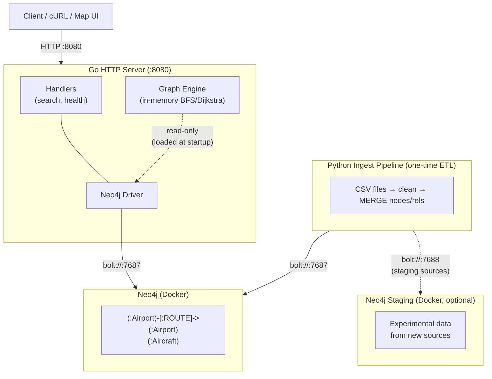

**Two consumers of Neo4j, never concurrent:**
1. Python ingestion pipeline — runs once to populate the database, then exits.
2. Go server — connects at startup to load the graph into memory, then maintains a connection for search queries.

**Staging Neo4j** is an optional second container (`docker-compose.staging.yml`) used for experimenting with new data sources. Go server never connects to it. See Section 12.5 for the full multi-source strategy.

---

## 4. Data Flow

### 4.1 Ingestion Pipeline (Python → Neo4j)

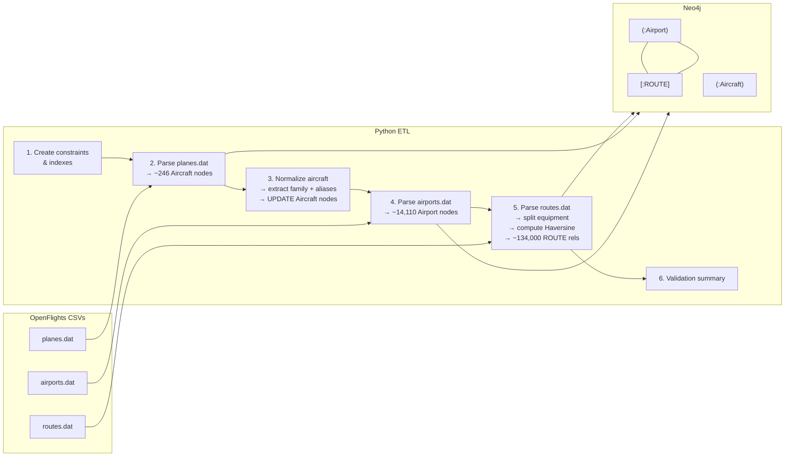

**Haversine distance is computed at ingestion time**, not query time.

#### 4.1.1 Staging Pipeline (Separated Concerns)

The advanced staging data pipeline shifts away from static CSV processing into a robust, SQLite-backed architecture, separating raw fetching from graph structure formation. Sections 4.1.1–4.1.4 hold the implementation details; Section 13.2 maps the original ingestion plan onto them.

1. **Script 1 (Raw Fetcher):** A highly resilient polling script that caches millions of individual flight records into an SQLite DB (`raw_flights` table). Uses a `fetch_log` table for resumability — on restart, skips airports already fetched for the current time window. Airports are fetched in priority order (`large_airport` first, then `medium_airport`) to ensure high-traffic hubs are cached first if rate limits interrupt a run.
2. **Script 2 (Graph Loader):** Analyzes the SQLite cache completely offline through a multi-stage pipeline:
   - **Destination inference** — resolves NULL `estArrivalAirport` values via callsign pattern matching (see Section 4.1.2)
   - **Route aggregation** — `GROUP BY` to collapse individual flights into route patterns with frequency and day-of-week data
   - **Route validity filtering** — dual-threshold filter to exclude one-off diversions and cancelled routes (see Section 4.1.3)
   - **icao24 → aircraft mapping** — maps ADS-B hex codes to IATA equipment codes via the Mictronics/tar1090-db aircraft database (ADS-B Exchange's list is frozen since 2025-09 — see Section 13.1)
   - **Airline code resolution** — derives IATA airline codes from ICAO callsign prefixes (see Section 4.1.4)
   - **Neo4j load** — writes exactly one `[:ROUTE]` relationship per origin-destination-aircraft pair

**SQLite Schema:**

```sql
-- raw_flights: individual flight records from OpenSky
CREATE TABLE raw_flights (
    icao24 TEXT NOT NULL,
    callsign TEXT,
    origin TEXT NOT NULL,            -- ICAO airport code
    destination TEXT,                -- ICAO airport code (nullable — inference target)
    first_seen INTEGER NOT NULL,     -- unix timestamp
    last_seen INTEGER NOT NULL,
    fetched_at TEXT NOT NULL,         -- ISO date of fetch run
    UNIQUE(icao24, first_seen)       -- dedup same flight from overlapping windows
);

-- fetch_log: tracks which airports have been fetched for which windows
CREATE TABLE fetch_log (
    airport_icao TEXT NOT NULL,
    window_begin INTEGER NOT NULL,   -- unix timestamp
    window_end INTEGER NOT NULL,
    status TEXT NOT NULL,            -- 'ok', 'error', 'empty'
    flight_count INTEGER,
    fetched_at TEXT NOT NULL,
    PRIMARY KEY (airport_icao, window_begin)
);
```

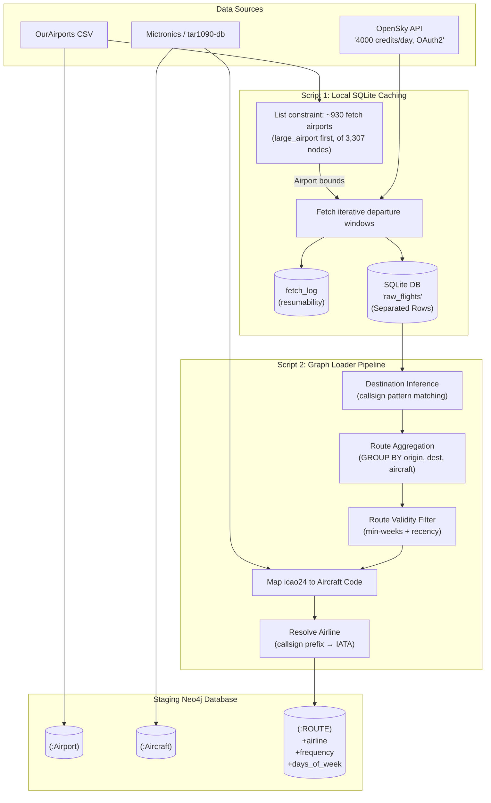

#### 4.1.2 Destination Inference Strategy

OpenSky's `/flights/departure` endpoint returns `estArrivalAirport`, which is estimated from ADS-B landing detection. This field is **NULL for ~30-40% of flights**, creating a significant coverage gap for route extraction.

**Approach: Callsign pattern matching with confidence threshold, then drop.**

1. **Build a callsign → route lookup table** from flights that have complete origin/destination data. For each `(callsign, origin)` pair, record the observed destination(s) and their frequencies.
2. **For flights with NULL destination:** look up the `(callsign, origin)` pair in the pattern table. If the most common destination accounts for ≥80% of complete observations for that pair, assign it as the inferred destination.
3. **Drop flights that cannot be inferred** — callsign not in the pattern table, or no destination reaches the confidence threshold.

```sql
-- Callsign pattern table (materialized from raw_flights where destination IS NOT NULL)
CREATE TABLE callsign_patterns AS
SELECT
    callsign,
    origin,
    destination,
    COUNT(*) AS obs_count,
    ROUND(COUNT(*) * 100.0 / SUM(COUNT(*)) OVER (PARTITION BY callsign, origin), 1) AS confidence_pct
FROM raw_flights
WHERE destination IS NOT NULL AND callsign IS NOT NULL
GROUP BY callsign, origin, destination;
```

**Note:** The pattern table improves as data accumulates over weeks. Early fetch runs will have lower inference rates; the graph loader should be re-run periodically as the table matures.

**Metrics to track after first pass:**
- Raw NULL rate (% of flights with NULL destination)
- Inference success rate (% of NULL flights resolved via callsign matching)
- Final drop rate (% of flights unusable after inference)

#### 4.1.3 Route Validity Filtering

When collapsing 60 days of raw flights into ROUTE edges, not every observed route is worth loading into Neo4j. Seasonal cancellations, one-off diversions, and briefly-operated routes create noise.

**Dual-threshold filter (minimum weeks + recency bias):**

1. **Standard threshold:** A route (origin, destination, aircraft) must appear in **≥3 distinct calendar weeks** out of the observation window to be considered valid. This filters one-off diversions and short-lived charter operations.
2. **Recency exception:** Routes active in the **most recent 2 calendar weeks** only need **≥1 week** of observations. This captures newly launched routes that haven't yet accumulated history.
3. Routes that fail both criteria are **excluded** from the Neo4j ROUTE load.

```sql
WITH weekly_counts AS (
    SELECT
        origin, destination, aircraft_iata,
        COUNT(DISTINCT strftime('%Y-%W', first_seen, 'unixepoch')) AS distinct_weeks,
        MAX(first_seen) AS last_seen_ts
    FROM enriched_flights
    GROUP BY origin, destination, aircraft_iata
)
SELECT * FROM weekly_counts
WHERE distinct_weeks >= 3
   OR (distinct_weeks >= 1
       AND last_seen_ts >= unixepoch('now', '-14 days'));
```

**Revision 2026-09-05 — the 14-day recency window must become per-airport.** `RECENCY_DAYS = 14`
was implicitly calibrated to the single 7.4-day fetch cycle: every airport was re-sampled well
inside 14 days, so the exception always fired and the filter admitted any route with one
observation (the 2026-07-05 run filtered 0 routes). Under the tiered strategy of Section 4.1.5
there is no longer one cycle — hubs run 7 days, the OpenSky tail ~30.7, AeroDataBox ~23 — and a
single constant cannot serve all three. A tail airport would always fall outside a 14-day window
and drop to the `>= 3 distinct weeks` branch, which at a 30.7-day cycle needs 92+ days per
airport; the graph would go sparse and stay sparse.

Rather than hard-code a constant per tier, derive the window from observed behaviour:

```
recency_days(airport) = max(14, 2 × median gap between that airport's successful fetches)
```

This self-calibrates as cadence changes and needs no tier constant in the loader. Airports with
fewer than two successful fetches fall back to their tier's nominal cycle × 2. The `2 ×`
multiplier preserves the original intent — the window is twice the expected resample interval,
so a route seen on the last visit still counts as current.


#### 4.1.4 Airline Code Resolution

OpenSky provides callsigns (e.g., `BAW009`, `UAE512`), not IATA airline codes. The `airline` field on ROUTE edges requires IATA codes (e.g., `BA`, `EK`).

**Two-stage resolution:**

1. **Callsign prefix lookup (primary):** Extract the alpha prefix from the callsign (e.g., `BAW` from `BAW009`) and map it to the IATA airline code via a static ICAO-to-IATA lookup table (`ingest/data/icao_airline_map.json`). Reliable for ~95% of major commercial carriers.

   | Callsign Prefix (ICAO) | IATA Code | Airline |
   |---|---|---|
   | BAW | BA | British Airways |
   | UAE | EK | Emirates |
   | DLH | LH | Lufthansa |
   | AAL | AA | American Airlines |

2. **Aviationstack fallback (secondary):** For callsigns that don't match known ICAO prefixes (charters, regionals), use the Aviationstack `/airlines` endpoint. Reserved for gap-filling only (100 req/month free tier).

3. **Unresolved callsigns:** Routes where airline cannot be determined get `airline: null`. Acceptable — airline is a display/filter field, not a structural requirement.

#### 4.1.5 Dual-Source Fetch Strategy (ADS-B Blackout Mitigation)

**Decision date:** 2026-09-05. Supersedes the single-source, 930-airport breadth strategy
(Section 13.1), which a CODE-phase measurement invalidated.

**Problem.** OpenSky is an ADS-B network fed by volunteer ground receivers, so its coverage is a
map of where those receivers are — not of where aircraft fly. Measured over the first four
production runs (375 fetch attempts, `fetch_log`):

| ICAO prefix | region | attempts | % empty | flights per success |
|---|---|---|---|---|
| Z | China/Mongolia | 91 | **89.0%** | 73 |
| O | Middle East | 24 | 62.5% | 206 |
| M | Mexico/C. America | 12 | 58.3% | 292 |
| U | Russia/CIS | 14 | 42.9% | **9.5** |
| K | USA | 49 | **0%** | 751 |
| E | N. Europe | 38 | **0%** | 411 |

This does not improve with accumulation — there is no receiver density to wait for. Beijing
(ZBAA), rank 2 by traffic, returned 12 flights against Atlanta's 1,913. AeroDataBox's own
coverage page corroborates the mechanism: it reports China at 95% *schedules* coverage but 35%
*live/ADS-B*, and Russia at 100% vs 74%.

**Second constraint.** The fetch queue was capped at 930 of 3,261 eligible airports — a figure
derived from the 7.4-day refresh cycle (125 req/day × 7.44), not from any coverage target. The
other 2,331 airports exist as `:Airport` nodes that can never originate a route.

**Decision: split the graph by source along the coverage boundary.**

| source | airports | selection |
|---|---|---|
| OpenSky (ADS-B) | 2,818 | all eligible except ICAO prefixes `Z`/`U` |
| AeroDataBox (schedules) | 443 | the 14 blackout countries: China 223, Russia 133, Kazakhstan 21, Uzbekistan 12, Mongolia 11, Ukraine 10, Turkmenistan 6, Azerbaijan 5, Belarus/Tajikistan/Georgia/Kyrgyzstan/North Korea 4 each, Armenia 2 |

Removing the blackout airports from the OpenSky rotation also stops spending ~3,810 credits per
cycle on requests that return empty.

**OpenSky cadence — tiered, replacing the flat cycle.** Flat coverage of 2,818 airports at 125
req/day would mean a 22.6-day cycle for hubs as well as the long tail. A tier split keeps hub
freshness while extending reach:

| tier | airports | budget | cycle |
|---|---|---|---|
| hub | top 300 by traffic rank | 300 req/week | **7 days** |
| tail | remaining 2,518 | 575 req/week | **~30.7 days** |

Splits beyond ~500 hubs starve the tail (at 750 the tail cycle is 141 days).

**Queue priority is by last attempt, not last success** (corrected 2026-09-10). Both fetchers
order never-attempted airports first, then longest-unvisited. Ordering on last *success* — the
original design — starves the queue wherever a source has blind spots: an airport the source
cannot see returns `empty` indefinitely, never acquires a success timestamp, and therefore stays
permanently in the never-fetched bucket ahead of every airport that does return data.

Measured after five days of tiered running: 41 hub and 72 tail airports had been retried up to 8
times each with structurally zero yield, consuming ~41 of the hub tier's 43 daily requests, while
KATL, KORD and EGLL went unfetched for 67 days. The schedules fetcher had the same defect — 10
airports, one of them 5-for-5 failures, against a 19-call daily budget.

An `empty` result is a legitimate observation ("no departures in this window"), not a failure to
look, and must advance the airport's scheduling clock. Errors advance it too: a persistently
failing airport then retries on its normal cycle instead of every run, which costs one cycle of
latency on a transient error but is the only bound that prevents starvation. The bug predates
tiering — the 930-airport list had the same `ORDER BY` — but a smaller list of uniformly
well-covered large airports kept the stuck set too small to notice.

**AeroDataBox mechanics** (verified live 2026-09-05 against ZSPD):

- Endpoint `GET /flights/airports/icao/{icao}?offsetMinutes&durationMinutes`, Tier 1 = **1 API unit**
- RapidAPI **Basic: $0/month, 600 units, recurring** (not a trial), 1 req/s
- **Hard 12-hour cap per request** — `durationMinutes=1440` returns
  `HTTP 400 "must not be more than 12 hours in duration"`
- Upstream schedules layer refreshes only **once per 2 weeks per airport**, so a faster cycle
  would buy little even on a paid tier

Budget at 443 airports and 600 units/month:

| approach | units/sweep | cycle |
|---|---|---|
| full day (2 calls/airport) | 886 | ~44.9 days |
| **12h window (1 call/airport)** | **443** | **~23.3 days** at ~19 calls/day |

**Chosen: the 12-hour window, with the offset alternating between day-halves on successive
sweeps.** The graph records route *existence*, aircraft type and frequency — not individual
flights — and route discovery saturates fast: a single 12h window at ZSPD returned 518
departures. Halving temporal coverage to double the sweep rate is the better trade here, and
alternating the offset yields full-day coverage every ~46 days anyway.

**Queue priority within the 443 (2026-09-24):** the schedules queue is no longer round-robin — a
priority tier runs at 2× the tail's rate. See Section 4.1.7.

**What flips the half (amended 2026-09-17).** The next visit takes the other half after any
*resolved* visit, meaning `ok` or `empty` — the same pair that marks a window as already collected. A
failed visit collected nothing, so it retries the same half. A window with no departures comes back
as HTTP **204 No Content** with an empty body, which the API's OpenAPI spec documents for this
endpoint; that is an `empty` observation. Until 2026-09-17 the fetcher parsed that body as JSON,
logged `JSONDecodeError` and recorded an `error`, and the half flipped only after `ok`. An airport
whose sampled half was empty therefore re-queried that same half on every visit and never sampled
the other one. 42 visits were recorded this way, concentrated in the small airports the queue
reaches late (Uzbekistan: 12 errored visits, 0 successes).

**Consequence for `weekly_frequency`.** AeroDataBox-sourced edges observe ~12 of every 24 hours,
so the existing `sampled_days_by_origin` extrapolation (Section 4.1.3) under-counts them by
roughly half. Frequency extrapolation must scale by *sampled hours*, not sampled days, for these
origins. Query `withCodeshared=false` so one physical flight yields one edge, matching OpenSky
ADS-B semantics.

**Cargo flights are excluded (decided 2026-09-14, Sep review L4).** AeroDataBox flags freighter
departures (`isCargo`, stored as `raw_schedules.is_cargo`), and `load_graph.py` skips them: a route
planner should not offer a leg no passenger can book. Measured 2026-09-14: 80 of 6,530 rows, and 76 of
5,919 route combinations are cargo-only (top operators FX, CK, 5Y). OpenSky carries no cargo flag, so
ADS-B-sourced freighter edges remain — an accepted inconsistency between the two sources, not an
oversight. Edges already loaded leave through the §4.1.6 mark-and-sweep rather than a delete; the
first run after the change (2026-09-14) marked 68 AeroDataBox edges stale.

**Sampling resolution and `weekly_frequency` (measured 2026-09-05).** A 12h visit gives
`days_sampled = 0.5`, so the smallest rate the extrapolation can express is `1 / 0.5 x 7 = 14`
per week — and 2,340 of the first 2,548 schedule edges landed on exactly 14. Two distinct errors
sit underneath that:

- **Coarseness.** After *k* visits the floor is `14/k` per week. At the 23.3-day cycle that is
  3.6/wk by day 90, 1.8/wk by day 180, 0.9/wk by day 365 — it resolves itself on the cadence
  already planned.
- **Intra-day bias.** Extrapolating 12h to 24h assumes flights spread evenly across the day. The
  10:00 IST run maps to roughly local `[00:30-12:30]` and `[12:30-00:30]` for China, so a route
  caught in-window reads ~2x its true rate and a route flying entirely in the unsampled half is
  absent rather than under-counted. Alternating halves cancels this in expectation over any even
  number of visits.

**Decision: store the sample behind the number.** `ROUTE.observations` and `ROUTE.days_sampled`
are recorded alongside `weekly_frequency` (Section 2.2.1), so a consumer can distinguish a
well-supported rate from one extrapolated off a single sighting. This was chosen over the
alternatives because it makes the uncertainty visible instead of picking a different way to be
confidently wrong, and it costs nothing in cadence.

Alternatives considered, with costs, should this need revisiting:

| option | gains | costs | verdict |
|---|---|---|---|
| **Store `observations` + `days_sampled`** | consumer can judge confidence | two extra edge properties | **adopted** |
| Document only, change nothing | zero work | a bare `14` misleads the first consumer to read it | rejected |
| Widen each visit to 24h (2 calls) | removes intra-day bias per visit | cycle 23→46d, maturity Mar→Sep 2027, recency window 46→93d, no data until day 46 — **and no resolution gain at all**: 189 observed hours/airport/year either way, since the unit budget is fixed | rejected on measurement |
| Suppress frequency until k>=4 visits | never publishes an unsupported number | no China/Russia frequency until ~Dec 2026 | rejected |
| AeroDataBox Pro tier, $5.35/mo | 6,000 units → **4.5-day cycle at full 24h** | leaves the free-tier constraint | deferred — this is the only real lever on resolution; window width is not |

Deriving frequency from repeating flight numbers was also tested and does not work: distinct
flight numbers are ~1:1 with departures (2,128 of 2,548 routes have one flight and one number),
so they carry no information the count does not already have.

**Field mapping — no new aircraft infrastructure required.** The response carries the Mode-S
address, which is the same `icao24` key the tar1090-db table already indexes:

| AeroDataBox field | example | maps to |
|---|---|---|
| `aircraft.modeS` | `78051B` | existing `aircraft_types` lookup → `B738` → Section 4.2 normalization |
| `aircraft.model` | `Boeing 737-800` | fallback when the hex is absent from the table |
| `movement.airport.iata` | `ZUH` | ROUTE destination |
| `airline.iata` | `HO` | ROUTE airline — **direct, no callsign inference** |
| `number` | `HO 7516` | flight identity for dedup |

`78051B` → `B738` / reg `B-5421` resolves against the existing 496,832-row table, and the
returned registration cross-checks. 6,691 Chinese-registered aircraft were already present — the
registry was never the gap. Aircraft data covered 490/518 flights (94.6%).

Note this path is *better* than the OpenSky one for airlines: Section 4.1.4 infers IATA codes
from callsign prefixes and leaves ~13% unresolved as the `''` sentinel, whereas AeroDataBox
returns `airline.iata` directly.

**Script topology.** The Section 4.1.1 fetch/load separation extends to a second fetcher rather
than a branch inside the first. Two independent collectors, one shared loader:

| script | source | writes | scheduled |
|---|---|---|---|
| `ingest/sources/fetch_flights.py` | OpenSky | `raw_flights` | existing launchd agent, daily 09:00 |
| `ingest/sources/fetch_schedules.py` | AeroDataBox | `raw_schedules` (new) | new launchd agent, daily 10:00, ~19 calls/day |
| `ingest/sources/load_graph.py` | both tables | Neo4j staging | invoked by the chain; independently runnable by hand |
| `ingest/sources/refresh.py` | — (chain entry point) | Neo4j staging + restarts servers | launchd agent `com.aircraft-route-planner.refresh`, daily 11:00 — *Refresh chain* below |

Airport selection is `airports_oa.blackout_list()`, derived from the ICAO prefix rule rather than a
hard-coded list, so the set tracks OurAirports as it changes.

Separate agents mean independent failure domains: an expired RapidAPI key or an OpenSky credit
stall takes down one collector, not both, and each reports its own outcome. A single script
serving two APIs with different auth, rate limits, window semantics and failure modes would
couple them for no gain.

**Refresh chain — decided 2026-09-12.** Collecting data changes nothing a client can see until two
further links run: the graph rebuild, and the served graph picking it up. Both were manual, so the
effective staleness of the served graph was not one day but "since someone last remembered to run
the loader". The chain is therefore `fetch_flights` 09:00 → `fetch_schedules` 10:00 →
`load_graph` **11:00** → restart the running API servers.

The rebuild slot moved from 10:30 to 11:00 on 2026-09-13. launchd fires an overdue agent late rather
than skipping it, and an observed 10:45 start left only ~7 minutes of margin over the schedules fetch
instead of 22; 11:00 restores ~50 minutes. Widening the quiet window was the alternative and was
rejected as trading a rare risk for frequent deferrals.

**Sampling maturity, as of 2026-09-13.** 282 of 443 blackout airports have never been fetched, so the
queue is still serving first visits and **no airport has yet had a second visit — half 1 has never been
sampled**. AeroDataBox `observations` and `weekly_frequency` therefore reflect a single 12-hour window
per airport rather than the full 24 hours the alternating design provides. The first sweep completes
around 2026-09-28 at 19 calls/day; read those two fields as lower bounds until then.

- **Freshness SLA: one day.** At that budget a process restart is sufficient, so there is no reload
  endpoint, no atomic pointer swap and no mutex. Section 9's "loaded once, immutable, read-only"
  invariant is preserved *unchanged* — that is the payoff for accepting a 24-hour budget, and it is
  why this diverges from the `/admin/reload` design Section 12.1 sketches. That design is correct
  for a tighter SLA and more machinery than this one needs.
- **An ordering gate, not wall-clock trust.** launchd schedules on wall-clock only and has no
  dependency graph, so `load_graph.py` reads the fetchers' own logs (`fetched_at` in `fetch_log` /
  `schedules_fetch_log`) instead of trusting the 30-minute gap. Two conditions, reported
  differently on purpose. A log written within the last few minutes means a fetcher may still be
  mid-run, so the rebuild is **skipped quietly**: launchd fires every overdue agent at once on wake
  from sleep, in no guaranteed order, so an unfinished upstream is routine rather than exceptional,
  and alarming on it would cry wolf on a schedule and train the alarm to be ignored. The rebuild is
  idempotent, so a skipped day is harmless; rebuilding from a half-written SQLite day is not.
  Silence from both fetchers for well over a day is the opposite case: it does **not** block the
  rebuild, which stays safe and still reconciles, but it **does alarm** — an independent check that
  the collection layer has stopped, which is the blind spot that went unnoticed for 57 days.
- **The loader becomes an unattended job, so it needs the guard.** `load_graph.py` currently has no
  `runner.run_guard`; its only failure signal is a human reading its output. Unattended it must
  classify its own outcomes: zero edges written from a non-empty cache is a fault, an empty cache is
  quiet, and an unreachable staging Neo4j fails with a named stage rather than a driver traceback.
- **Restart must not fail worse than staleness.** Only servers already listening are restarted; one
  deliberately stopped stays stopped. `/health` gained `graph_loaded_at` and `graph_age_seconds`
  (Section 12.2's freshness requirement) and the restart step *verifies against them*: a server is
  accepted only once it answers **and** reports a snapshot strictly newer than the one it served
  before, because a server that comes back on the old graph looks healthy while still hiding the
  reconciliation. Two details the implementation forced: `run-server.sh` execs `go run`, whose
  compiled child is the real listener, so the whole process group is signalled — stopping one and
  not the other either orphans the parent or leaves the port bound, and the restart would then
  "succeed" while a stale server kept answering; and the port must be observably free before
  rebinding, since the replacement would otherwise fail to bind and exit. A server that does not
  return alarms: replacing a stale-but-serving server with no server is worse than the problem.
- **TCC constraint.** Full Disk Access is granted per binary and the repo lives under `~/Desktop`,
  so the new agent must invoke the same CommandLineTools `python3` the fetchers use. A shell wrapper
  would need its own grant for `zsh` and would fail with `[Errno 1] Operation not permitted` — the
  signature of the 57-day silent outage.

Implementation is tracked as PLAN.md Phase 6.6; this closes ARCH-1 from the 2026-07-05 review.

**Separate tables, not a coerced shared one.** `raw_flights` is shaped around ADS-B observation
(`icao24`, `callsign`, nullable `destination`, `first_seen`/`last_seen` observed timestamps).
AeroDataBox records carry a resolved destination, a direct `airline.iata`, a flight number and
*scheduled* times. Forcing them into `raw_flights` would discard the airline code — the field
Section 4.1.4 spends inference effort reconstructing at ~87% success — and would blur observed
against scheduled timestamps under one column name. `raw_schedules` keeps each source in its
native shape; `load_graph.py` aggregates both and unions the results, tagging each edge with the
`source` property from Section 2.2.1. This also means the destination-inference step (Section
4.1.2) and the callsign-to-airline step (Section 4.1.4) simply do not run for schedule-sourced
rows — they have nothing to infer.

**`fetch_schedules.py` inherits the operational hardening already proven on the OpenSky fetcher**
(see `RUNBOOK.md` §4), which was built in response to real failures and should not be rediscovered:
line-buffered stdout so a hung run is diagnosable; `--- run started/OK/UNPRODUCTIVE/FAILED ---`
markers with a non-zero exit and desktop notification on the latter two; `except OSError` rather
than `TimeoutError` around network calls (on Python 3.9 `socket.timeout` is a sibling of
`TimeoutError`, not an alias, and the naive form lets one slow response abort an entire run); and
a `fetch_log`-equivalent for resumability. Its unproductive-run threshold differs from OpenSky's:
a zero-quota month is the expected end state near the 600-unit ceiling, not a fault, so quota
exhaustion should report distinctly from an outright collection failure.

**Maturity is now tier-dependent** (8 samples/airport):

| tier | cycle | matures |
|---|---|---|
| OpenSky hub (300) | 7 d | ~Nov 2026 |
| AeroDataBox (443) | 23.3 d | ~Mar 2027 |
| OpenSky tail (2,518) | 30.7 d | ~May 2027 |

This enables a phased Phase 6.4: the hub subgraph can be promoted on the original timeline
without waiting for the long tail.

#### 4.1.6 Edge Reconciliation — Mark and Sweep

**Decision date:** 2026-09-05.

**Problem.** `load_graph.py` writes with `MERGE` and never deletes, so the validity filter
(Section 4.1.3) only governs which edges are *created*. It has no authority over edges already in
the graph. Measured on 2026-09-05: 25,314 edges the filter had just rejected — single-observation
routes ~63 days stale, stranded by the July fetch outage — were still present and still being
served, because an earlier run had loaded them. Load semantics were additive when they needed to
be authoritative.

**Decision: mark in the loader, delete in a separate service, filter on read.** Three parts, and
the third is what makes the first two safe:

1. **The loader marks, in a single transaction.** After computing the valid set it stamps `stale`
   (a timestamp) on ROUTE edges absent from that set, and clears `stale` on edges present in it.
   The loader never deletes — it stays a single-purpose, idempotent write.

   **Atomicity is required, not incidental** (corrected 2026-09-12). The first implementation
   marked every edge in one transaction and then cleared the valid ones across ~20 more. For the
   duration of a load *every* ROUTE edge was therefore marked, and because the read path filters
   `WHERE r.stale IS NULL` (below), a server starting in that window loaded a graph with **zero
   routes** and served empty results with no error. Both passes now run inside one
   `execute_write`, so a reader observes either the before- or the after-state. The loader reports
   the resulting counts (edges served / edges marked) rather than a difference between the mark
   and clear passes: those count different populations — the mark pass sees only previously
   unmarked edges while the clear pass touches every valid edge — and their difference went
   negative (-19,546) once the graph grew past the initial load.
2. **The read path filters.** `internal/graph/loader.go` gains `WHERE r.stale IS NULL` on its
   startup query. Without this, marking changes nothing a client can observe: the Go engine loads
   every edge, so stale routes keep being served until the sweeper happens to run, and the
   sweeper's schedule silently becomes a correctness dependency. With it, deletion becomes pure
   housekeeping.

   **Caveat, recorded 2026-09-10 — bounded by decision 2026-09-12.** This is a *startup* filter,
   not a read filter. The graph is loaded once and held read-only in memory, so a mark applied while
   a server is running does not reach that server's clients — it takes effect at the next restart.
   The reconciliation guarantee therefore depends on refresh cadence rather than on the sweeper,
   which is a weaker property than this section originally claimed. Rather than add the reload path
   Section 12.1 anticipates, the decision of 2026-09-12 *bounds that cadence*: a daily chain
   rebuilds the graph and restarts the running servers (Section 4.1.5, *Refresh chain*), so the
   guarantee becomes "visible within one day" instead of "visible whenever someone restarts". The
   filter stays startup-only by design and the Section 9 invariant is preserved. This was ARCH-1 in
   the 2026-07-05 review, passed over by Phases 6.2, 6.3 and 6.5.
3. **A separate sweeper deletes.** An independent script removes edges whose `stale` timestamp is
   older than a grace period, scheduled on its own cadence. Keeping it out of the load path means
   the destructive step is separately reviewable, separately schedulable, and can be paused
   without stopping ingestion.

**Grace period: 60 days**, i.e. roughly twice the longest tier cycle (30.7d). A route that stops
being observed for one tail cycle is not necessarily gone — the next sweep may simply not have
reached it yet. Re-observing an edge inside the grace period clears the mark, so a route that
reappears is un-marked rather than deleted and re-created, preserving its identity and history.
Section 4.1.7 (2026-09-24) tiers the schedules queue and restates this rationale as *at least ~1.5
visits of the longest tier cycle*; at the adopted 2× that cycle is 31.2 days, and the constant is
revisited if any tier cycle passes ~40 days.

#### 4.1.7 Queue Priority Within the Blackout Set

**Decision date:** 2026-09-24. Amends Section 4.1.5 (the flat schedules queue) and restates the
rationale of Section 4.1.6's grace period without changing its value. Closes Sep review M6.

**The question asked.** M6 observed that `config.BLACKOUT_ICAO_PREFIXES = ("Z","U")` routes 443 airports
to AeroDataBox permanently, that `load_graph.aggregate()` discards OpenSky rows for those origins, and
that the partition — derived once from ~375 fetch attempts — is therefore self-sealing: no data path
exists by which the system could produce evidence against it.

**What measurement found.** The partition is substantively correct, and the coarse prefix rule was
right for reasons its 14-attempt `U` sample did not show:

| check | result |
|---|---|
| Were the 14 `U` attempts small airports? | No — ranks 3, 12, 16, 32, 33, 35, 40, 43, 46, 50 and 51 of the 443. UUDD Domodedovo returned 4 departures in a 2-day window, UUEE 20, ULLI 6, UUWW 26 |
| Is low `U` yield an ADS-B effect or a traffic effect? | Both. `schedules_fetch_log`: `Z` 155 visits, 125 ok, **43.0 rows per ok**; `U` 135 visits, 86 ok, **16.6**. Russia is thinner in *both* sources |
| Independent corroboration | AeroDataBox's coverage page (Section 4.1.5): China 95% schedules / **35%** live, Russia 100% / **74%** — two different phenomena under one prefix rule |

Moscow's three main airports returning 4, 20 and 26 departures across two full days is genuine
receiver darkness. `U` stays in the blackout set.

**The defect is observability, not staticness.** Re-deriving the partition today returns `("Z","U")`.
What was missing is not a feedback loop but any way to *see* that the answer still holds without an
ad-hoc query. The fix is to stop freezing derived quantities as constants wherever the data to derive
them already arrives for free — and to separate that free evidence from the evidence that costs credits.

**Decision 1 — tier the schedules queue; do not evict.** The 443 airports differ widely in yield but
are scheduled round-robin, so hub cadence is pinned to tail cadence. Section 4.1.5 already solved this
shape on the OpenSky side with a hub/tail split, without evicting anyone; the schedules queue inherits
it. A priority tier of about 150 airports is served at **2× the tail's per-airport rate**, within the
same 600 units/month. Maturity below is 8 samples, counted from scratch:

| approach | priority tier | remainder | Russia stays observable |
|---|---|---|---|
| flat round-robin (before) | 23.3-day cycle / 187 days | same | yes |
| **tiered 2× (adopted)** | **15.6 / 125** | **31.2 / 250** | **yes** |
| tiered 3× | 13.0 / 104 | 39.1 / 313 | yes |
| evict `U` from AeroDataBox | 12.5 / 100 | — | **no** — 205 airports move to the source that measured 4 departures at Domodedovo |

**2×, not 3×, on the scarcity argument.** Extra hub cadence buys frequency precision more than new
routes: route discovery at a hub saturates fast (one 12h window at ZSPD returned 518 departures). A thin
`U` airport at 16.6 rows per ok needs the opposite — more visits, both to keep an intermittent route
inside its recency window between sightings and to accumulate the three distinct calendar weeks that
keep it valid beyond that window (Section 4.1.3). It also has no alternative source if AeroDataBox
under-samples it. Scarcity buys cadence rather than losing it.

**Decision 2 — tier membership is re-derived every run.** A hard-coded list of priority airports would be
the same object M6 complained about, in new wording. The ranking key follows the evidence available:

- once an airport has **at least two successful visits**, its own measured **rows per ok** from
  `schedules_fetch_log` — yield from a single half-0 visit is too noisy to rank on;
- before that, the median rows per ok of its traffic-rank band (bands of 50 ranks): the traffic rank
  expressed in the same unit, so measured and unmeasured airports compete on one scale. With no
  successful visit anywhere, the tier is simply the busiest airports by traffic rank.

The merge rule was settled during implementation (2026-09-24). Ranking each group by its own
percentile was rejected: with five measured airports, a strong hub could leave the tier merely for
coming third of five. **Tiering also waits for the first sweep to complete** — every airport attempted
at least once. Its purpose is revisit cadence, and splitting the budget earlier would only slow first
coverage of the airports not yet visited; until then the queue stays round-robin.

Accepted cost: the traffic rank derives from 2014 OpenFlights data until an airport crosses the
two-visit threshold. Two numbers do stay fixed, deliberately: the tier size (~150) and the 2×
multiplier. Unlike the partition, they are budget policy rather than claims about the world — no
measurement can show them wrong, only that another split serves better. They are revisited at the
Decision 5 checkpoint and when the first full sweep changes the yield picture.

**Decision 3 — the 60-day grace period stays; its rationale is restated.** Tiering does not threaten it.
An edge is marked stale only once it falls out of validity — fewer than three distinct weeks *and*
unseen within its airport's recency window, `max(14, 2 × median gap)` (Section 4.1.3,
`load_graph.shape_valid`) — so an edge its recency window still counts as current is never marked, and
never swept. The grace only runs after that, and its job is narrower: to give a marked route at least
one more visit in which to reappear before deletion. At 2× the longest cycle is the schedules tail's
31.2 days, so 60 days covers about 1.9 visits, against 2.0 before. The rationale is therefore restated
as *at least ~1.5 visits of the longest tier cycle*, and the constant is revisited if any tier cycle
passes ~40 days. An earlier draft of this decision made the grace a derived quantity, on the claim that
tiering could sweep edges still inside their recency window; the code shows it cannot, so the constant
stays.

**Decision 4 — separate what is observed for free from what costs credits.** M6 conflated two signals:

| signal | source | cost | answers |
|---|---|---|---|
| regional yield drift | `schedules_fetch_log`, 19 visits/day across the blackout set | **free, always on** | does traffic still exist there, and is it changing? |
| ADS-B receiver coverage | an OpenSky request to a blackout airport | **30 credits each**, taken from the tail cycle | can OpenSky see it *now*? |

Only the second can detect what M6 actually worried about, and it has the lower base rate. The free
signal runs continuously; the paid one runs only at the checkpoint below.

**Decision 5 — observe continuously, act only at a reviewed checkpoint.** No automatic loop. The
partition has just measured correct; receiver-density change in Russia and China has a low base rate on
the horizon that matters; and observing carries no risk — a probe reads `status` and `flight_count` from
the log and creates no edges, so it cannot touch the Section 2.2.1 dedup invariant or the Section 4.1.6
sweeper. Acting is where the risk lives. A moved airport's old edges age out within about two of its
old cycles plus the grace period, while the incoming source re-establishes a route only when it first
sees it — one sighting inside the recency window makes an edge valid (Section 4.1.3). For a genuinely
dark region that sighting never comes: moving Russia to OpenSky would retire its schedule-derived edges
and replace them with almost nothing, which is the outcome Decision 1 exists to avoid.

The gate:

1. **Mandatory before `promote.py --yes` (Phase 6.4).** A manual, paid OpenSky probe of **10–15
   airports**: each blackout country's top hubs plus a rotating few, so a fixed sentinel set cannot be
   dark while its region is not.
2. **Rule to move a region out of the blackout set:** its flights-per-success reaches a stated share of
   the non-blackout median **across two probe rounds**. Requiring two rounds is the hysteresis that
   keeps the partition from flapping during the run-up to 6.4.
3. **Early trigger:** the checkpoint also fires ahead of schedule if the free signal (Decision 4) shows a
   region's yield shifting sharply across two consecutive sweeps.

**Open parameters, deliberately unset.** Fixing these without data would repeat M6's error: the *stated
share* of the non-blackout median in rule 2, and the definition of a *sharp shift* in rule 3. Both are
to be set from `schedules_fetch_log` once the first full sweep completes and half-1 sampling has begun,
and recorded here when set.

**Consequence for Phase 6.4, stated plainly.** No multiplier makes China mature by November 2026. At 2×
the priority tier reaches 8 samples around late January 2027 counted from scratch — somewhat earlier in
practice, since half-0 visits already count (211 of 443 airports visited and 290 of 600 monthly units
used as of 2026-09-19). **Chinese and Russian routes therefore promote after the OpenSky hub subgraph**,
where every hub has been visited at least once (300/300) and hub *maturity* is the ~Nov 2026 milestone.
PLAN Phase 6.4 is already staged this way; this record makes the reason explicit.

**Residual risk.** Decision 2's ranking key changes basis when an airport reaches its second successful
visit, so tier membership can move as evidence accumulates — an airport can drop out of the priority
tier mid-accumulation. That is intended, since it is what makes the ordering self-correcting, but it
should be watched once the first sweep completes. If churn proves disruptive, the remedy is a rank
buffer or a minimum dwell time, not a return to a frozen list.

**Section 12.5.5** ("Route deduplication — Resolved 2026-09-05") stays valid: Decision 5 keeps the
partition static in practice, so the disjointness the dedup fix relies on is undisturbed. If a region is
ever moved at a checkpoint, that bullet reopens and needs the source-priority rule it sketches.

### 4.2 Aircraft Code Normalization

Different data sources identify the same aircraft differently. The normalization step runs after aircraft loading and enriches each `:Aircraft` node with `family` and `aliases` properties.

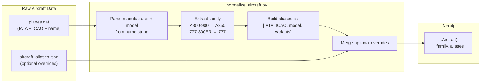

**Family extraction rules:**
- Airbus: strip manufacturer prefix + variant suffix → `"Airbus A350-900"` → `"A350"`
- Boeing: strip manufacturer prefix + variant suffix → `"Boeing 777-300ER"` → `"777"`
- Embraer: use ICAO-style prefix → `"Embraer 190"` → `"E190"`
- Other: use ICAO code as family fallback

**Extensibility:** The optional `aircraft_aliases.json` file allows manual overrides and additions (e.g., mapping engine variants like `"A350-941"` to IATA `"359"`). This is the integration point for future data sources (Mictronics/tar1090-db, OpenSky).

**Haversine distance is computed at ingestion time**, not query time. Each ROUTE relationship carries a pre-computed `distance_km` property. This avoids redundant trigonometric calculations during pathfinding.

### 4.2 Query Request Flow (Client → Go → Response)

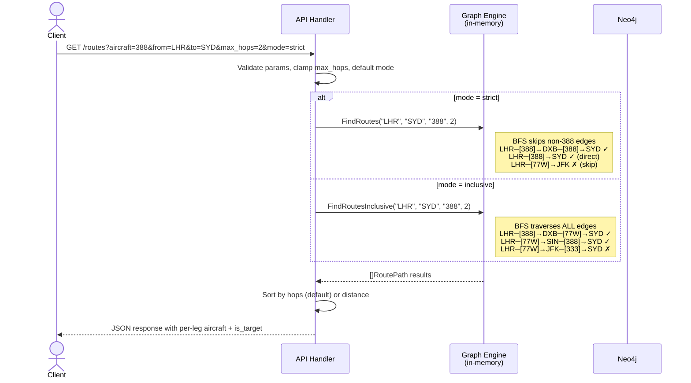

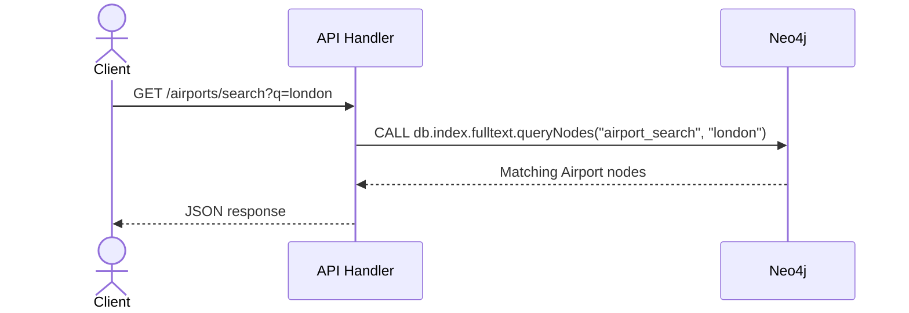

> Search endpoints (`/airports/search`, `/aircraft/search`) query Neo4j directly via full-text indexes. They don't touch the in-memory graph — they are metadata lookups, not traversals.

---

## 5. Query Architecture

### 5.1 What Goes to Neo4j (Cypher)

| Query | Why Neo4j |
|---|---|
| Airport search by name/city/IATA | Full-text index (`CALL db.index.fulltext.queryNodes`) |
| Aircraft search by name/IATA | Full-text index |
| "What aircraft operate between LHR and DXB?" | Single-hop `MATCH`, no traversal needed |

These queries are simple lookups that Neo4j handles natively. No reason to replicate this logic in Go.

### 5.2 What Goes to the Go In-Memory Engine

| Query | Why Go |
|---|---|
| All routes from A to B on aircraft X (multi-hop) | Custom BFS with aircraft filtering and hop bounding — the core learning goal |
| Shortest path by distance on aircraft X | Custom Dijkstra's with `container/heap` — teaches Go's interface system |
| All destinations reachable from A on aircraft X | BFS without a target — explores until max hops exhausted |
| All direct routes between two countries | Single-edge scan with country filter on source/destination airports — purely in-memory, no traversal needed |
| Country name search | Substring match on pre-built sorted country list — trivial in-memory operation |

The Go engine loads the full route graph into memory at startup as an adjacency list. This is the project's core algorithmic component — implementing BFS and Dijkstra's from scratch in Go is the primary learning objective.

### 5.3 Why Both (Not Just One)

Using only Neo4j Cypher would work but hides the algorithms behind `MATCH path = (a)-[:ROUTE*1..3]->(b)`. The user doesn't learn BFS — Cypher does it internally.

Using only Go in-memory would work but forces reimplementation of text search, fuzzy matching, and metadata storage. That's infrastructure work with no learning value.

The split gives the best of both: **learn graph algorithms in Go, learn graph modeling and Cypher in Neo4j.**

### 5.4 Query Modes: Strict vs Inclusive

The engine supports two modes of aircraft filtering, selectable per request via the `mode` query parameter.

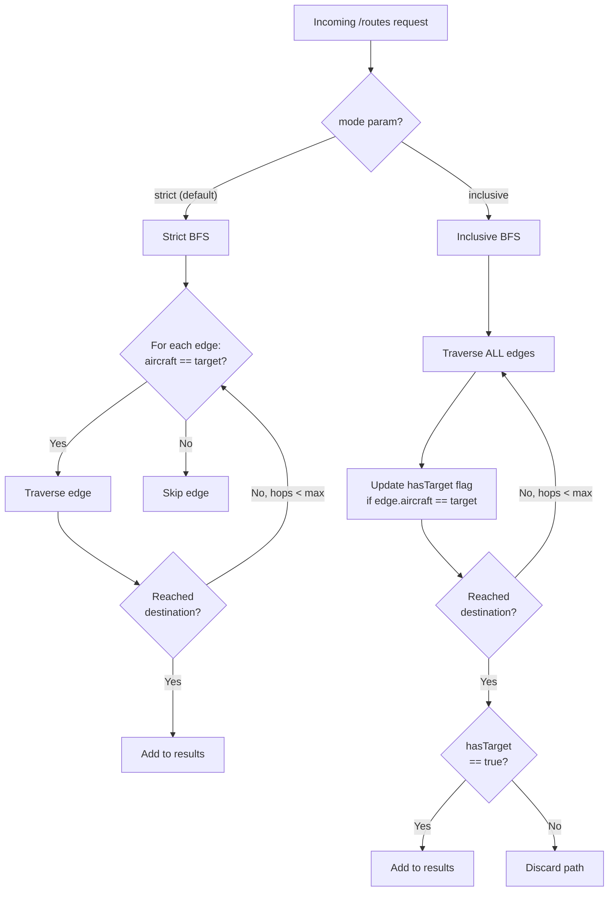

#### Strict Mode (`mode=strict`, default)

Every leg of the route must be operated by the specified aircraft type.

```
LHR ──[388]──▶ DXB ──[388]──▶ SYD   ✓ all legs are A380
LHR ──[388]──▶ DXB ──[77W]──▶ SYD   ✗ second leg is not A380
```

The BFS skips edges where `edge.Aircraft != target`. This prunes the search space aggressively — for an A380 query, only ~300 edges (out of 134k) are traversable.

**Use case:** "I want to fly exclusively on an A380."

#### Inclusive Mode (`mode=inclusive`)

At least one leg of the route must be operated by the specified aircraft type. Other legs can use any aircraft.

```
LHR ──[388]──▶ DXB ──[77W]──▶ SYD   ✓ first leg is A380
LHR ──[77W]──▶ DXB ──[388]──▶ SYD   ✓ second leg is A380
LHR ──[77W]──▶ DXB ──[333]──▶ SYD   ✗ no leg is A380
```

The BFS traverses ALL edges without filtering, but carries a `hasTarget` boolean flag per path. A path is only accepted as a result when it reaches the destination AND `hasTarget == true`.

**Use case:** "I want to experience an A380 at least once on my journey."

#### Performance Comparison

| Mode | Search Space (2 hops) | Reason |
|---|---|---|
| Strict | ~300 edges (A380 sub-graph) | Prunes non-matching edges at every hop |
| Inclusive | ~134k edges (full graph) | No pruning during traversal, filter at path completion |

Inclusive mode explores significantly more states. With ~14k airports and avg degree ~10, a 2-hop inclusive BFS visits ~1.4M states. This is still sub-second at this dataset size, but the `GRAPH_MAX_HOPS` ceiling (default 3) is critical — at 3 hops the state space grows to ~14M, which remains feasible but is the practical upper bound.

#### Strict BFS Algorithm

```
FindRoutes(src, dst, aircraftCodes []string, maxHops):
  aircraftSet = set(aircraftCodes)                       ← resolved via AliasToIATA
  queue = [{node: src, path: [src], edges: []}]
  results = []

  while queue not empty:
    state = dequeue()
    for each edge in graph.Adj[state.node]:
      if edge.Aircraft not in aircraftSet: continue      ← skip non-matching

      if edge.Dst == dst:
        results.append({path + [dst], edges + [edge]})
        continue
      if len(path) < maxHops+1 AND edge.Dst not in path:
        enqueue({path + [edge.Dst], edges + [edge]})

  return results sorted by hop count
```

#### Inclusive BFS Algorithm

```
FindRoutesInclusive(src, dst, aircraftCodes []string, maxHops):
  aircraftSet = set(aircraftCodes)                       ← resolved via AliasToIATA
  queue = [{node: src, path: [src], edges: [], hasTarget: false}]
  results = []

  while queue not empty:
    state = dequeue()
    for each edge in graph.Adj[state.node]:
      newHasTarget = state.hasTarget OR (edge.Aircraft in aircraftSet)

      if edge.Dst == dst:
        if newHasTarget:                                ← accept only if aircraft appeared
          results.append({path + [dst], edges + [edge]})
        continue
      if len(path) < maxHops+1 AND edge.Dst not in path:
        enqueue({path + [edge.Dst], edges + [edge], newHasTarget})

  return results sorted by hop count
```

The only structural difference is: strict mode **filters edges** during traversal, inclusive mode **filters paths** at completion.

The pseudocode shows each state carrying its path for readability. The implementation does not copy paths: a state holds its parent's index and a pointer to the edge that reached it, and a path is rebuilt only for a result (Phase 6.8, `internal/graph/path_arena.go`). The per-tier result cap and expansion gating are also left out here — see Section 8.2.

### 5.5 Country-to-Country Routes

Country-to-country queries find all **direct flights** between airports in two countries. This is not a graph traversal — it's a filtered edge scan.

#### Algorithm

```
FindCountryRoutes(fromCountry, toCountry, aircraftCodes []string):
  aircraftSet = set(aircraftCodes)                // empty/nil ⇒ no filter
  fromAirports = Graph.ByCountry[fromCountry]   // []string of IATA codes
  results = map[(src,dst)] → []route

  for each srcIATA in fromAirports:
    for each edge in Graph.Adj[srcIATA]:
      dstAirport = Graph.Airports[edge.Dst]
      if dstAirport.Country != toCountry: continue
      if aircraftSet not empty AND edge.Aircraft not in aircraftSet: continue

      key = (srcIATA, edge.Dst)
      results[key] = append(results[key], {edge.Aircraft, edge.Airline, edge.Distance})

  return results sorted by distance of first route in each pair
        // Each pair's routes ascend by distance, and the *pairs* ascend by their
        // own first route. Enforced in the handler after grouping: the scan order
        // that builds the pair list is not itself sorted (review L1).
```

**Complexity:** O(E_from) where E_from = total outgoing edges from airports in the origin country. For a large country like the US (~500 airports, ~20k outgoing edges), this completes in microseconds.

**Why direct flights only:** Two large countries could produce hundreds of thousands of origin-destination pairs. Running multi-hop BFS across all combos is combinatorially explosive. Users can drill into specific airport pairs via `GET /routes` for multi-hop pathfinding.

---

## 6. Go In-Memory Data Structures

### 6.1 Types

```go
type Airport struct {
    IATA    string
    ICAO    string
    Name    string
    City    string
    Country string
    Lat     float64
    Lon     float64
}

type Edge struct {
    Dst      string   // destination airport IATA code
    Aircraft string   // IATA equipment code for this specific edge
    Airline  string   // operating airline IATA code
    Distance float64  // pre-computed Haversine distance in km
}

type Aircraft struct {
    IATA    string
    ICAO    string
    Name    string
    Family  string     // aircraft family grouping (e.g., "A350")
    Aliases []string   // all known identifiers
}

type Graph struct {
    Airports       map[string]*Airport    // IATA code → Airport
    Adj            map[string][]Edge      // source IATA → outgoing edges
    ByCountry      map[string][]string    // country name → list of airport IATA codes
    Countries      []string               // sorted distinct country names (for search)
    AircraftByIATA map[string]*Aircraft   // "359" → Aircraft struct
    AliasToIATA    map[string][]string    // any identifier → canonical IATA code(s)
    Families       map[string][]string    // family name → IATA codes (e.g., "A350" → ["359", "351"])
}
```

`ByCountry` and `Countries` are built at startup when loading airports — no additional Neo4j query needed. `Countries` is sorted alphabetically for binary-search-friendly substring matching.

**Key design choice:** `Edge.Aircraft` is a single string, not a slice. This mirrors the Neo4j model — one relationship per aircraft-route pair. A route operated by 3 aircraft types produces 3 `Edge` entries in the adjacency list. This keeps the BFS filter as a simple `==` check instead of a slice scan.

### 6.2 Memory Estimate

| Component | Count | Approx Size |
|---|---|---|
| Airport structs | ~14,110 | ~2 MB |
| Edge structs | ~134,000 | ~8 MB |
| Country index (`ByCountry` + `Countries`) | ~240 countries | <1 KB |
| Map overhead | — | ~2 MB |
| **Total** | | **~12 MB** |

Negligible on any modern machine.

### 6.3 Startup Load Query

```cypher
MATCH (src:Airport)-[r:ROUTE]->(dst:Airport)
RETURN src.iata AS src, dst.iata AS dst,
       r.aircraft AS aircraft, r.airline AS airline, r.distance_km AS distance
```

Single query, streaming every served relationship into Go's adjacency list. Airport metadata loaded in a separate query.

The live query adds `WHERE r.stale IS NULL` (§4.1.6). **Measured 2026-09-13** on the staging graph at
52,504 total / 50,718 served relationships: **107 ms, 371,218 db hits**, once per server start.

**No index on `ROUTE.stale`, deliberately** (2026-09-10 review M4, which offered "accept and
re-measure at maturity" as one of its options). A `RANGE` index would trade this once-per-start 107 ms
for a write cost on every reconciliation — `mark_stale` stamps `stale` onto thousands of edges per run,
and each write would then maintain an index entry. The property exists to be bulk-written and read
once, which is the opposite of what an index rewards.

**Re-measure when** the served graph passes ~150k relationships (roughly 3x today), or if startup load
time becomes noticeable — whichever comes first. Maturity projections put the graph an order of
magnitude larger by ~May 2027 (§4.1.5), so this will need revisiting, just not yet.

---

## 7. Neo4j Memory Configuration

**Constraint:** M4 Pro with 24GB unified memory, shared with OS and local LLM models.

```
NEO4J_server_memory_heap_initial__size=1G
NEO4J_server_memory_heap_max__size=2G
NEO4J_server_memory_pagecache_size=512M
```

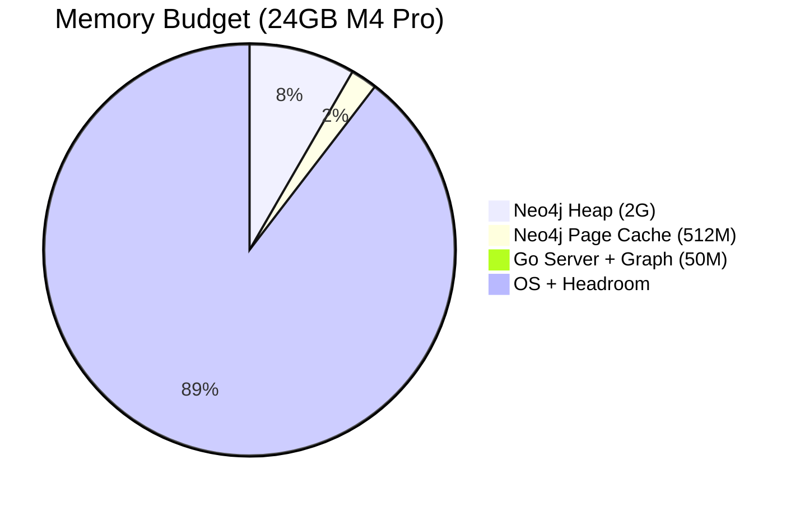

| Budget | Allocation |
|---|---|
| Neo4j heap | 1–2G |
| Neo4j page cache | 512M |
| **Neo4j total** | **~2.5G** |
| Neo4j staging (optional) | ~1.25G |
| Go server + in-memory graph | ~50M |
| Python ingestion (transient) | ~100M |
| OS + headroom | ~21G (~20G when staging active) |

At 14k nodes and 134k relationships, the entire graph fits in page cache with room to spare. No disk I/O during queries.

> **Staging memory note:** The staging Neo4j container uses `docker-compose.staging.yml` and is not started by default. When active (`docker compose -f docker-compose.staging.yml up`), total Neo4j memory budget is ~3.75G — still safe on 24GB M4 Pro.

---

## 8. API Contract

### 8.1 Endpoints

#### `GET /routes`
Find routes between two airports for a specific aircraft type or family.

| Param | Required | Type | Description |
|---|---|---|---|
| `aircraft` | yes | string | Aircraft identifier — IATA code (`388`), ICAO code (`A388`), or family name (`A380`). Resolved via alias/family lookup to one or more canonical IATA codes. Case-insensitive, surrounding whitespace trimmed. |
| `from` | yes | string | Origin airport IATA code (e.g., `LHR`). Case-insensitive, whitespace trimmed. |
| `to` | yes | string | Destination airport IATA code (e.g., `SYD`). Case-insensitive, whitespace trimmed. |
| `max_hops` | no | int | 0–3, default `2`. A value above the server ceiling (`GRAPH_MAX_HOPS`, itself capped at 3 — §10) is clamped. A malformed or negative value returns `400 INVALID_PARAM` rather than defaulting silently. |
| `sort` | no | string | `hops` (default) — return **all** matching routes, ordered by hop count then total distance. `distance` — return **only the single shortest route** by total distance, computed with Dijkstra (§5.2), so `data` holds at most one entry and `meta.count` is 0 or 1. Honours `mode`: under `mode=inclusive` it is the shortest route containing at least one leg on the requested aircraft. |
| `mode` | no | string | `strict` (default) — all legs must use the aircraft. `inclusive` — at least one leg must use the aircraft. See Section 5.4. |

#### `GET /routes/from`
Find all destinations reachable from an airport on a specific aircraft type.

| Param | Required | Type | Description |
|---|---|---|---|
| `aircraft` | yes | string | Aircraft IATA code. Case-insensitive, whitespace trimmed. |
| `from` | yes | string | Origin airport IATA code. Case-insensitive, whitespace trimmed. |
| `max_hops` | no | int | 0–3, default `2`. Above the server ceiling is clamped; malformed or negative returns `400 INVALID_PARAM`. |
| `mode` | no | string | `strict` (default) or `inclusive`. See Section 5.4. |

#### `GET /airports/search`
Search airports by name, city, or IATA code.

| Param | Required | Type | Description |
|---|---|---|---|
| `q` | yes | string | Search query (e.g., `london`, `LHR`). Matched as literal text: Lucene metacharacters (`* ? ( ) : " ~ ^ + - ! [ ] { } & | \ /`) are escaped, so `*` is not a wildcard. Previously a stray `(` or `/` produced a 500 (review M1). |

#### `GET /aircraft/search`
Search aircraft types by name, IATA code, ICAO code, or family. Returns results with family grouping.

| Param | Required | Type | Description |
|---|---|---|---|
| `q` | yes | string | Search query (e.g., `A380`, `388`, `A350`). Matches against name, IATA, ICAO, and family fields. Matched as literal text — Lucene metacharacters are escaped, so operators and wildcards are not supported. |

#### `GET /routes/countries`
Find all direct routes between airports in two countries, optionally filtered by aircraft type.

| Param | Required | Type | Description |
|---|---|---|---|
| `from` | yes | string | Origin country name (exact match from `/countries/search`) |
| `to` | yes | string | Destination country name |
| `aircraft` | no | string | Aircraft identifier (IATA, ICAO, or family). Resolved via alias/family lookup to a *set* of canonical IATA codes, all of which match. Case-insensitive, whitespace trimmed. |

> Direct flights only (0 hops). For multi-hop routes between specific airport pairs, use `GET /routes`.

`meta.aircraft` follows the same shape rule as `/routes` (§8.2): a single object for a one-code match,
an array plus `aircraft_query` when the identifier resolves to a family, and `null` when unfiltered.
It was previously always `null` for a family, which was indistinguishable from no filter (review M6).

#### `GET /countries/search`
Search country names from loaded airport data.

| Param | Required | Type | Description |
|---|---|---|---|
| `q` | yes | string | Search query — case-insensitive substring match on country names |

> Served from in-memory `Graph.Countries` slice. No Neo4j query.

#### `GET /health`
Service health and graph statistics. No parameters.

### 8.2 Response Format

All endpoints return a consistent envelope:

```json
{
  "data": [ ... ],
  "meta": {
    "took_ms": 4,
    "count": 3
  }
}
```

#### Result bounds

Two independent limits apply to every traversal (2026-07-05 review H1, built in Phase 6.7):

- **A per-hop-tier result cap.** At most `graph.MaxRoutesPerHopTier` (250) routes per hop count, so a
  3-hop query returns at most 1,000. Per tier rather than flat: a flat cap filled in traversal order
  could return 1,000 arbitrary two-stop routes and crowd the direct ones out entirely, whereas per
  tier the best direct routes always survive.

  **Expansion is gated on the same counters, which is what makes this bound work and not only
  response size.** A state that can only contribute to tiers which are already full is never
  enqueued. A state at hop depth
  *h* yields a destination match in tier *h* and each further descent lands one tier deeper, so its
  reachable tiers are exactly *h..maxHops*; when all of those are full it is pruned. This is
  output-preserving: a pruned subtree could only have produced results the cap would have rejected,
  which the unchanged baseline tests in `internal/graph/traversal_test.go` verify.

  An earlier version pruned only when *every* tier was full. Measurement on 2026-09-13 showed that
  exit to be nearly unreachable — low tiers are naturally sparse (a pair may have exactly one direct
  route), so a tier that can never reach 250 kept the walk running to exhaustion. Measured on a
  400-edge hub feeding 100-edge spokes at maxHops=3 (M4 Pro, one iteration; byte figures are
  cumulative allocations, not peak RSS):

  | traversal | all-tiers-full only | with expansion gating |
  |---|---|---|
  | `FindRoutesFromInclusive` | 27.3 s / 124 GB / 808M allocs | **0.37 s** / 2.66 GB / 8.1M allocs |
  | `FindRoutesInclusive` | 5.0 s / 2.66 GB / 8.1M allocs | **0.69 s** / 2.65 GB / 8.1M allocs |
  | `FindRoutes` (strict) | 0.43 s / 1.54 GB / 10.0M allocs | **0.026 s** / 96 MB / 0.52M allocs |

  Both 3-hop mega-hub queries now finish well inside the time budget, where before one took 27 s and
  would have returned 503 — so `max_hops=3` is usable again rather than nominal.

  **The gain is uneven, by construction.** For the destination-less variants every child is a
  candidate result, so tiers fill quickly and gating engages early: ~74x faster with ~100x fewer
  allocations. For destination-*seeking* queries a tier only fills on a destination *hit*, which is
  rare in a large graph, so gating engages late — time improves ~7x while allocation volume is
  essentially unchanged. That residue was the per-state path/edge deep-copying the 2026-07-05 review
  named, removed in Phase 6.8.

  **States no longer copy their paths (Phase 6.8, 2026-09-15).** Each BFS state used to carry its own
  copy of the path and edge list, made on every expansion. States now live in one slice per traversal
  and hold only their predecessor's index plus a pointer to the adjacency entry that reached them
  (`internal/graph/path_arena.go`); a path is rebuilt only for a state that becomes a result, of which
  there are at most 1,000. The pointer is sound only because the graph is immutable after load. Output
  is unchanged: the baseline tests pass unmodified, and 144 queries across all four BFS variants on the
  benchmark fixture returned identical routes, distances and `truncated` flags before and after. Same
  400-edge-hub fixture at maxHops=3, M4 Pro, mean of 3 runs, both columns measured 2026-09-15:

  | traversal | before (path copies) | after (parent-indexed states) |
  |---|---|---|
  | `FindRoutesInclusive` | 0.38 s / 2.65 GB / 8.05M allocs | **0.10 s** / 338 MB / 1,134 allocs |
  | `FindRoutesFromInclusive` | 0.38 s / 2.66 GB / 8.08M allocs | **0.10 s** / 338 MB / 1,817 allocs |
  | `FindRoutes` (strict) | 0.022 s / 87 MB / 302K allocs | **0.010 s** / 14.5 MB / 2,608 allocs |

  Nearly all of the remaining bytes are the state slice regrowing: Go grows a large slice by about 25%
  and copies it each time, so cumulative allocation comes to roughly five times the final size of the
  states themselves. A block-allocated arena would remove that if it ever matters. One small query got
  slower: a destination-seeking inclusive walk at maxHops=1 measured ~5% slower (429 → 450 µs,
  back-to-back, 10 runs each), because loop detection now follows parent pointers into the adjacency
  data instead of scanning a two-element slice in place. Every other benchmarked query measured faster.
  `FindShortestRoute` still copies paths: its heap items are a different structure, and its only bound
  is the time budget.
- **A time budget.** Each traversal runs under a 10s context deadline, stated relative to the
  server's 30s `WriteTimeout`, because the two are easily confused: `WriteTimeout` closes the
  *connection* but does **not** cancel the request context, so without an explicit budget an
  abandoned query keeps burning CPU to completion. Exceeding it returns `503 QUERY_TOO_EXPENSIVE`
  (§8.3) rather than a partial answer — a half-enumerated result ordered by traversal accident is
  more misleading than an error.

When the cap is reached, route and country responses carry `truncated` in `meta`:

```json
"meta": { "took_ms": 812, "count": 1000, "truncated": true }
```

`truncated` means *a tier reached its cap*, not *more results exist*: the traversal stops once every
tier is full and therefore cannot know whether more existed. The conservative reading is deliberate —
the first implementation flagged truncation only when a result was *rejected*, which meant a walk
that stopped exactly at the cap reported a capped result set as complete. The field is omitted when
false, so an untruncated response is byte-identical to before the cap existed.

**Route response example — strict mode (`GET /routes?aircraft=388&from=LHR&to=SYD&max_hops=2`):**

```json
{
  "data": [
    {
      "path": ["LHR", "SYD"],
      "hops": 0,
      "legs": [
        { "from": "LHR", "to": "SYD", "distance_km": 16993, "airline": "QF", "aircraft": "388", "is_target": true }
      ],
      "total_distance_km": 16993
    },
    {
      "path": ["LHR", "DXB", "SYD"],
      "hops": 1,
      "legs": [
        { "from": "LHR", "to": "DXB", "distance_km": 5476, "airline": "EK", "aircraft": "388", "is_target": true },
        { "from": "DXB", "to": "SYD", "distance_km": 12036, "airline": "EK", "aircraft": "388", "is_target": true }
      ],
      "total_distance_km": 17512
    }
  ],
  "meta": {
    "aircraft": { "iata": "388", "name": "Airbus A380-800" },
    "from": { "iata": "LHR", "name": "Heathrow", "city": "London" },
    "to": { "iata": "SYD", "name": "Kingsford Smith", "city": "Sydney" },
    "mode": "strict",
    "took_ms": 4,
    "count": 2
  }
}
```

**Route response example — inclusive mode (`GET /routes?aircraft=388&from=LHR&to=SYD&max_hops=2&mode=inclusive`):**

```json
{
  "data": [
    {
      "path": ["LHR", "DXB", "SYD"],
      "hops": 1,
      "legs": [
        { "from": "LHR", "to": "DXB", "distance_km": 5476, "airline": "EK", "aircraft": "388", "is_target": true },
        { "from": "DXB", "to": "SYD", "distance_km": 12036, "airline": "EK", "aircraft": "77W", "is_target": false }
      ],
      "total_distance_km": 17512
    }
  ],
  "meta": {
    "aircraft": { "iata": "388", "name": "Airbus A380-800" },
    "from": { "iata": "LHR", "name": "Heathrow", "city": "London" },
    "to": { "iata": "SYD", "name": "Kingsford Smith", "city": "Sydney" },
    "mode": "inclusive",
    "took_ms": 12,
    "count": 1
  }
}
```

In both modes, every leg includes `aircraft` (which aircraft actually operates that leg) and `is_target` (whether that leg matches the queried aircraft). In strict mode, `is_target` is always `true`. In inclusive mode, it highlights which legs are the reason this route was returned.

**Aircraft resolution in meta:** When the `aircraft` query param resolves to multiple variants (e.g., family search `A350` → `[359, 351]`), `meta.aircraft` becomes an array and includes `aircraft_query`:

```json
"meta": {
    "aircraft": [
        { "iata": "359", "name": "Airbus A350-900", "family": "A350" },
        { "iata": "351", "name": "Airbus A350-1000", "family": "A350" }
    ],
    "aircraft_query": "A350",
    ...
}
```

When a single variant is matched (e.g., `aircraft=388`), `meta.aircraft` remains a single object (not an array) and `aircraft_query` is omitted.

**Aircraft search response example (`GET /aircraft/search?q=A350`):**

```json
{
  "data": [
    { "iata": "359", "icao": "A359", "name": "Airbus A350-900", "family": "A350" },
    { "iata": "351", "icao": "A351", "name": "Airbus A350-1000", "family": "A350" }
  ],
  "meta": { "took_ms": 1, "count": 2 }
}
```

**Country route response example (`GET /routes/countries?from=United Kingdom&to=Australia&aircraft=388`):**

```json
{
  "data": [
    {
      "from": { "iata": "LHR", "name": "Heathrow", "city": "London", "country": "United Kingdom" },
      "to": { "iata": "SYD", "name": "Kingsford Smith", "city": "Sydney", "country": "Australia" },
      "routes": [
        { "aircraft": "388", "airline": "QF", "distance_km": 16993 },
        { "aircraft": "388", "airline": "EK", "distance_km": 16993 }
      ]
    },
    {
      "from": { "iata": "LHR", "name": "Heathrow", "city": "London", "country": "United Kingdom" },
      "to": { "iata": "MEL", "name": "Tullamarine", "city": "Melbourne", "country": "Australia" },
      "routes": [
        { "aircraft": "388", "airline": "QF", "distance_km": 16898 }
      ]
    }
  ],
  "meta": {
    "from_country": "United Kingdom",
    "to_country": "Australia",
    "aircraft": { "iata": "388", "name": "Airbus A380-800" },
    "pair_count": 2,
    "route_count": 3,
    "took_ms": 5
  }
}
```

When `aircraft` is omitted, `meta.aircraft` is `null` and all direct routes between the two countries are returned regardless of aircraft type.

**Country search response example (`GET /countries/search?q=united`):**

```json
{
  "data": ["United Arab Emirates", "United Kingdom", "United States"],
  "meta": { "took_ms": 0, "count": 3 }
}
```

### 8.3 Error Responses

```json
{
  "error": {
    "code": "INVALID_AIRCRAFT",
    "message": "Aircraft code 'XYZ' not found"
  }
}
```

HTTP status codes: `400` for bad input, `404` for not-found entities, `500` for server errors, and
`503` with code `QUERY_TOO_EXPENSIVE` when a traversal exceeds its time budget (§8.2 *Result bounds*).
`503` rather than `500` because nothing is broken — the query was too expensive to finish, and the
remedy is to narrow it.

Codes in use: `MISSING_PARAM`, `INVALID_PARAM`, `INVALID_MODE`, `INVALID_SORT`, `INVALID_AIRCRAFT`,
`INVALID_AIRPORT`, `QUERY_TOO_EXPENSIVE`. `INVALID_PARAM` was added 2026-09-13 for a malformed or
negative `max_hops`, which previously defaulted silently to 2 while every other malformed parameter
on the same endpoint returned 400 (2026-07-05 review L2). A well-formed but oversized value is still
clamped rather than rejected — see §8.1.

---

## 9. Go Server Startup Sequence

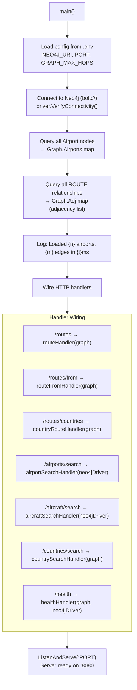

The graph is loaded once into an immutable `*Graph`. All HTTP handlers receive it as a read-only reference. Go's memory model guarantees that reads of fully initialized data from multiple goroutines are safe without a mutex — no locking overhead on the hot path.

Refresh is by **process restart, not in-place reload**: a daily chain rebuilds the graph in Neo4j and restarts the running servers (Section 4.1.5, *Refresh chain*). That keeps this invariant intact — each process still loads once and never mutates — at the cost of a one-day freshness SLA. Section 12.1 records the `/admin/reload` plus atomic-pointer-swap design for the day a sub-day SLA justifies it.

---

## 10. Configuration

All configuration via environment variables:

```env
NEO4J_URI=bolt://localhost:7687
NEO4J_USER=neo4j
NEO4J_PASSWORD=            # required — no fallback; the server refuses to start without it
PORT=8080
GRAPH_MAX_HOPS=3           # capped at api.AbsoluteMaxHops = 3 regardless of value
```

`NEO4J_PASSWORD` deliberately has no default (2026-07-05 review S4). It previously fell back to the
literal `aviation`, so a missing `.env` produced a working connection using a credential published in
this repository; `internal/graph/loader.go` now fails to start instead. The Python side mirrors this
for `NEO4J_STAGING_PASSWORD` (2026-09-10 review L2). Whatever value you set must match the credential
the Neo4j container itself was created with, which lives in `docker-compose.yml` /
`docker-compose.staging.yml`.

`GRAPH_MAX_HOPS` is a ceiling on the `max_hops` query parameter, enforced at the API handler level — a request asking for more is clamped to it, not rejected.

**The env var is itself capped** at `api.AbsoluteMaxHops` = 3 (corrected 2026-09-13). Until then it was accepted verbatim, so `GRAPH_MAX_HOPS=8` made 8 a legitimate request depth and this paragraph's "hard ceiling" was untrue — that was M4 in the 2026-07-05 review. CLAUDE.md makes 3 absolute, so `NewServer` clamps on the way in and logs any reduction. The Phase 6.7 benchmarks are why it has to be a constant rather than a default: traversal work grows roughly 100x per hop (§8.2 *Result bounds*), so an 8 is not a tuning choice but an outage.

Clamping is applied in `NewServer` rather than at startup in `main.go`, which the review suggested, because CLAUDE.md specifies handler-level enforcement and `main.go` is not the only possible caller — tests construct servers directly.

---

## 11. Map UI

### 11.1 Technology Choice

| Library | Why |
|---|---|
| **Leaflet.js** | Lightweight (~40KB), zero config, free OpenStreetMap tiles, no API key. Best fit for a learning project. |
| **Vite** | Dev server + bundler for vanilla JS. No framework overhead. |

Not using Mapbox (requires API key), Cesium (overkill 3D globe), or deck.gl (data-viz focused, steeper learning curve). Leaflet does everything this project needs.

### 11.2 Map Rendering

The map consumes the same `/routes` API response that any client would. No special backend changes required — the response already contains everything the UI needs:

- **Airport coordinates** — `lat`, `lon` from the `meta.from` / `meta.to` fields and from each leg's airport data (fetched via `/airports/search` or included in an enriched response)
- **Route arcs** — drawn between airport coordinates using great-circle interpolation (`leaflet-arc` plugin)
- **Color coding** — driven by the `is_target` field on each leg
- **Aircraft icons** — resolved from the `aircraft` field on each leg

### 11.3 Color-Coded Route Arcs

Each leg of a route is rendered as a curved arc on the map. The arc style is determined by `is_target`:

```
is_target: true   →  Solid arc, highlight color (e.g., #2563eb blue)
                     Weight: 3px, opacity: 0.9
                     Represents: this leg uses the queried aircraft

is_target: false  →  Dashed arc, muted color (e.g., #9ca3af grey)
                     Weight: 2px, opacity: 0.6, dashArray: "8,6"
                     Represents: this leg uses a different aircraft (inclusive mode only)
```

In strict mode, all arcs are solid highlight color. In inclusive mode, the visual contrast immediately shows which legs match and which are connecting flights on other aircraft.

### 11.4 Aircraft Silhouette Icons

Two layers per leg: a top-down silhouette on the map, rotated to the leg's bearing, and a side-profile
image in the sidebar popover. Both are keyed by ICAO type designator, while the API returns IATA
equipment codes, so every lookup goes IATA → ICAO first.

**Bundle** — `web/public/assets/aircraft_shapes.json`, generated by `tools/build_shapes.py`:

| Key | Contents | Source |
|---|---|---|
| `iataToIcao` | IATA code → ICAO type | `:Aircraft` nodes in **both** graphs, plus two fixed tables in the script: sub-variant codes (`73H` → `B738`, from Wikipedia's list of aircraft type designators) and family codes (`777` → `77W`) |
| `icaoToShape` | ICAO type → [shape name, scale] | tar1090's own selection rules (below) |
| `shapes` | shape name → SVG, width, height | tar1090 `html/markers.js`, rendered as tar1090's `svgShapeToSVG` renders it, with the fill left for the map to set |
| `defaultShape` | `airliner` | drawn for a code with no ICAO type, or a type with no shape |

**Shape choice** follows tar1090's `getBaseMarker` for a live aircraft: its type-designator table,
then the type's description with wake category (from Mictronics `icao_aircraft_types.json` — an ATR 72
is `L2T-M` → `twin_large`), then the description alone, then its first letter. Only the ADS-B emitter
category is skipped, since a route has nothing equivalent. Size follows tar1090 too: a shape's width
times the type's scale, relative to tar1090's 32 px standard, so an A380 draws larger than a Dash 8.

**Side profile** — `web/public/assets/aircraft/details/{ICAO}.bmp` from `rikgale/VRSOperatorFlags`,
dropped from the popover when the file is absent.

**Coverage, measured 2026-09-16** over every aircraft code on live routes, and checked against
tar1090's `getBaseMarker` and `svgShapeToSVG` executed from `markers.js` itself (261 lookups, 0
mismatches): staging (OpenSky) — 100% of edges get a type-specific shape and a side profile; production
(OpenFlights 2014) — 93%. The other 7% carry IATA **group** codes (`CRJ`, `ERJ`, `DH8`, `M80`, `32S`, …)
that name a family rather than one type. No source consulted maps them, so they draw the default
rather than a guessed representative.

**Failure is loud.** A failed or empty download of either shape source aborts the build and leaves the
existing bundle untouched, and `shapes.js` logs a console warning before falling back to its three
built-in silhouettes when the bundle cannot load. Both exist because the previous build logged a 404
for tar1090's retired `aircraft_shapes.js`, wrote an empty shapes table with exit status 0, and the map
ran on fallback icons unnoticed.

**Placement:** each icon sits on its arc, rotated to the arc's bearing at that point — at the midpoint
for a leg only one route uses, and spread across the middle 80% of a leg several routes share so the
icons never stack (`iconTForLeg` in `web/src/map.js`).

### 11.5 UI Layout

```
┌────────────────────────────────────────────────────────────────────────┐
│  ┌─ Controls ───────────────────────────┐  ┌─ Map ──────────────────┐ │
│  │                                       │  │                        │ │
│  │  Aircraft: [A380________] (autocomplete)│  │     ✈ ─── ─ ─ ─ ✈    │ │
│  │  From:     [LHR_________]             │  │    /                \  │ │
│  │  To:       [SYD_________]             │  │   ● LHR          SYD ● │ │
│  │                                       │  │    \      ✈       /   │ │
│  │  Max Hops: [0] [1] [2] [3]           │  │     ── ● DXB ────     │ │
│  │  Mode:     [Strict] [Inclusive]       │  │                        │ │
│  │                                       │  │  ── solid = A380 leg  │ │
│  │  [ Search ]                           │  │  - - dash = other leg │ │
│  │                                       │  │                        │ │
│  ├─ Results ────────────────────────────┤  │                        │ │
│  │                                       │  │                        │ │
│  │  Route 1: LHR → SYD (direct)        │  │                        │ │
│  │    ✈388 LHR→SYD  16,993km           │  │                        │ │
│  │                                       │  │                        │ │
│  │  Route 2: LHR → DXB → SYD           │  │                        │ │
│  │    ✈388 LHR→DXB  5,476km            │  │                        │ │
│  │    ✈77W DXB→SYD  12,036km           │  │                        │ │
│  │                                       │  │                        │ │
│  └───────────────────────────────────────┘  └────────────────────────┘ │
└────────────────────────────────────────────────────────────────────────┘
```

### 11.6 Interaction Flow

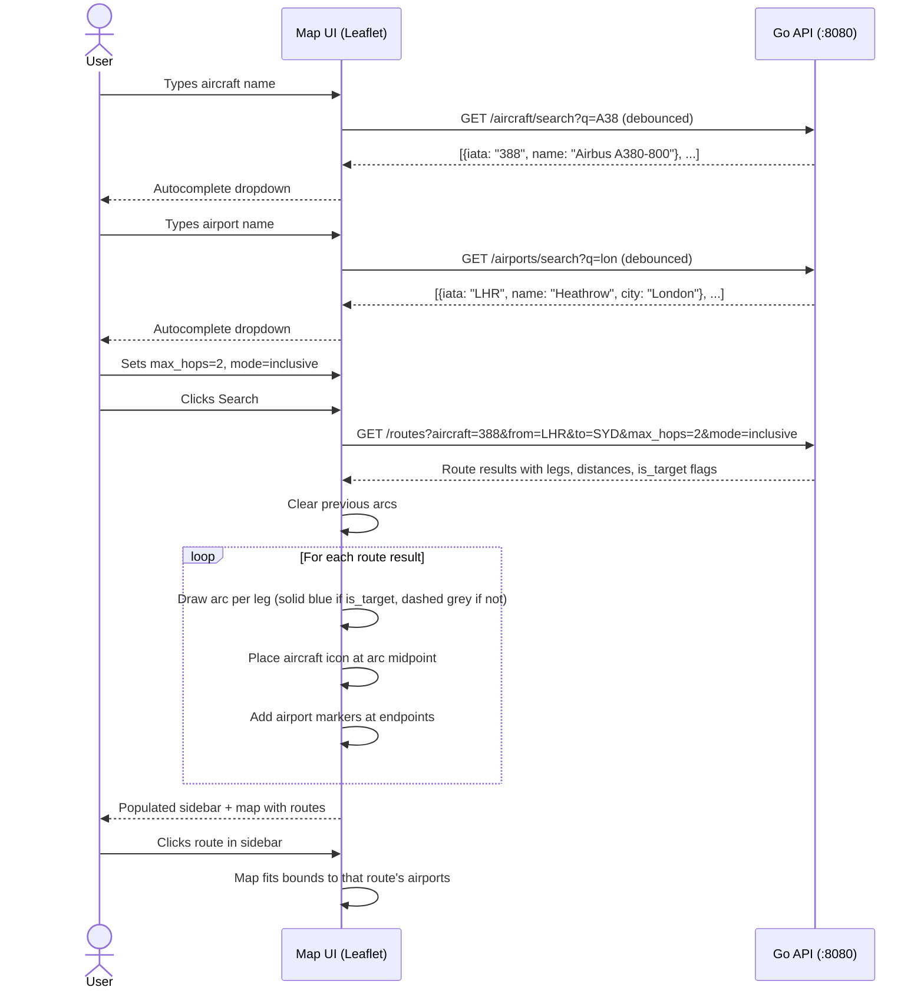

---

## 12. Known Extension Points

These are scaling and feature concerns identified during design. None are needed for the prototype — they are documented here so future work can be scoped against concrete constraints.

### 12.1 Live Data Ingestion

**Current state:** One-time Python ETL from static OpenFlights CSVs (June 2014 snapshot).

**Trigger:** Swapping in a live data source (OAG, Cirium, FlightAware) that updates routes on a schedule or in real-time.

**Key tensions:**
- The Go in-memory graph becomes stale the moment Neo4j is updated. Need a reload mechanism — full reload (~2s for 134k edges, acceptable with atomic pointer swap) vs. incremental delta (complex, error-prone at graph level).
- "Ingest once" becomes "ingest continuously." Python ETL would need to become a long-running service or scheduled job, not a one-shot script.
- Frequency matters: daily batch (cron + `/admin/reload` endpoint) is trivially different from the current design. Real-time (seconds) likely requires a message queue (NATS, Kafka) between the ingestion pipeline and Go server(s).

**Design surface:** ingestion pipeline architecture, graph reload strategy, data freshness SLA.

**Decided for the current pipeline (2026-09-12):** the OpenSky/AeroDataBox pipeline adopted a
one-day freshness SLA met by a daily rebuild-and-restart chain (Section 4.1.5, *Refresh chain*), so
none of the mechanisms above were built — no reload endpoint, no pointer swap, no delta logic. This
section stays the design surface for a **tighter** SLA: the reload endpoint and atomic swap become
necessary once restart downtime, sub-day freshness, or multiple instances (Section 12.2) matter.

### 12.2 Horizontal Scaling (Multiple Go Instances)

**Current state:** Single Go server, graph loaded once into memory (~12MB), serves all requests.

**Trigger:** Throughput demands (thousands of concurrent users) or availability requirements (zero-downtime deploys, instance failure recovery).

**Key tensions:**
- Each Go instance loads its own copy of the graph — 12MB per instance is negligible, but **coordination** is the real problem: when the graph data changes, all instances must reload.
- Options range from simple (each instance polls Neo4j on a timer) to complex (push notification via Redis pub/sub or a message broker).
- Load balancer in front of instances — stateless API makes this straightforward since no session affinity is needed.
- Health endpoint already exists; needs to report graph freshness (last-loaded timestamp) so the balancer can drain stale instances.

**Design surface:** deployment topology, graph reload coordination, load balancing strategy.

### 12.3 User State (Persistence Beyond the Graph)

**Current state:** No concept of users, sessions, or saved data. Every request is anonymous and stateless.

**Trigger:** Features like saved searches, favorite routes, trip planning, route alerts, or user accounts.

**Key tensions:**
- This data doesn't belong in Neo4j (it's not graph-shaped) or in the Go heap (it must survive restarts).
- A second data store is needed. Candidates depend on the shape and scale of user data:
  - **SQLite** — simplest, embedded, no infra. Good for single-instance with modest user counts.
  - **PostgreSQL** — proven for relational user data, good if user state grows complex (accounts, permissions, sharing).
  - **Redis** — if state is mostly ephemeral (sessions, recent searches, rate limiting) rather than durable.
- Authentication and session management become concerns — currently zero auth surface.

**Design surface:** user data model, auth strategy, store selection, migration from anonymous to authenticated.

### 12.4 Analytics and Aggregation Queries

**Current state:** All queries are lookups (search) or traversals (pathfinding). No aggregation endpoints.

**Trigger:** Questions like "top 10 most connected countries," "airlines with the most A380 routes," "busiest hub airports by aircraft type," route trend analysis.

**Key tensions:**
- Simple aggregations (count routes by country) can run as Cypher queries against Neo4j — acceptable at this dataset size but slow if queries become complex or frequent.
- Pre-computed aggregations at ingestion time are cheap and fast to serve, but stale if data changes (see 12.1).
- Heavy analytics at scale might warrant a materialized view layer or a dedicated analytics store — but at 134k edges, this is premature. Neo4j Cypher or Go in-memory scans will handle any aggregation in milliseconds.

**Design surface:** aggregation endpoint contracts, pre-compute vs. on-demand, caching strategy.

### 12.5 Data Source Upgrade

**Current state:** All data comes from OpenFlights (June 2014 snapshot) — `airports.dat`, `routes.dat`, `planes.dat`. Static CSVs, one-time ingestion.

**Trigger:** Need for current 2026 data. OpenFlights is missing new airports (BER, Navi Mumbai), retired routes, and new aircraft types. The architecture supports swapping data sources without changing the graph model or query engine.

**Planned sources (validated by Phase 6.1 research, 2026-07 — see Section 13.1):**

| Layer | Current | Upgrade | Format |
|---|---|---|---|
| Airports (nodes) | OpenFlights `airports.dat` | **OurAirports.com** | CSV, updated daily |
| Routes (edges) | OpenFlights `routes.dat` | **OpenSky Network** (primary) + **FlightAware AeroAPI** (validation only) | JSON APIs |
| Aircraft (metadata) | OpenFlights `planes.dat` | **Mictronics / tar1090-db aircraft database** | CSV |

**OurAirports.com** — industry-standard open airport data. ~86k entries including heliports and closed facilities. Filter `type IN (large_airport, medium_airport) AND scheduled_service = 'yes'` → 3,307 airports. Includes IATA/ICAO codes, GPS coordinates, elevation, airport type classification. Note: `iso_country` is a 2-letter code — needs `countries.csv` mapping to the full country names the Go engine indexes on.

**Route sources:**
- **OpenSky Network** (primary; OAuth2-only since 2026-03, credit system: 4,000 credits/day for `/flights/*`, flat 30 credits per request — live-verified, 2-day max window) — ADS-B surveillance data via `/flights/departure`. **Requires route derivation pipeline:** destination inference, validity filtering, icao24 mapping, airline resolution (Section 4.1.1). Budget sustains ~930 airports sampled one 2-day window per ~7.4-day rotating cycle. ToU restricts "operational" use — clarify before continuous operation.
- **FlightAware AeroAPI** (validation only; $5/mo free credit, $0.02 per 15-record result set) — `/schedules` provides the richest record (aircraft_type, times, flight numbers) but bulk extraction exceeds hobbyist budget. Used to spot-validate equipment on top OpenSky-derived routes before promotion.
- ~~**Aviationstack API**~~ — rejected by 6.1 research: `/routes` is paid-only ($49.99/mo) and carries no equipment field at any tier. At most a free-tier `/airlines` lookup fallback for airline-code resolution (Section 4.1.4, unverified).

**Mictronics / tar1090-db aircraft database** (replaces ADS-B Exchange Master List, which is frozen since 2025-09) — 621k records mapping icao24 → ICAO type designator + manufacturer/model; ~99.7% commercial-traffic coverage; ODC-By license; updated weekly.

**Key challenges:**
- **Route validation.** OpenSky is the single bulk route source; AeroAPI spot-checks equipment on the highest-traffic derived routes before promotion (conflict → AeroAPI wins, it reads published schedules).
- **OpenSky flight-to-route derivation.** Raw surveillance data → routes is a non-trivial ETL step. Requires airport proximity matching, diversion handling, and track completeness validation.
- **Rate limit management.** OpenSky's credit system (4,000/day, flat 30 credits per `/flights` request) allows ~133 requests/day → ~930 airports on a weekly rotating-sample cycle. Ingestion pipeline needs OAuth2 token refresh, backoff on 429, credit-floor stop, and incremental fetching.
- **IATA code mapping.** Some sources use ICAO equipment codes (A388) while the graph uses IATA (388). OpenFlights `planes.dat` (or the Mictronics/tar1090-db list) provides the mapping table.
- **Airport reconciliation.** New airports from route data that don't exist in the airport dataset must be added. Airports with zero routes after ingestion should be pruned.

**Design surface:** multi-source ingestion pipeline architecture, deduplication/reconciliation logic, rate limit orchestration, incremental vs. full refresh strategy.

### 12.5.1 Development Strategy: OpenFlights-First, Parallel Source Exploration

OpenFlights data is stale (~2014 snapshot) but structurally complete — airports, routes, and aircraft with IATA/ICAO codes. This makes it ideal for bootstrapping the full system while better sources are researched in parallel.

**Rationale:**
- Stale data is acceptable for building and validating the complete pipeline (graph engine, API, UI). The system should be validated on **structural correctness** (BFS finds paths, Dijkstra returns shortest, API returns well-formed JSON), not absolute route counts.
- The Neo4j schema and Go engine are data-source-agnostic — they operate on Airport/Aircraft/ROUTE structures regardless of origin.
- Better sources (Aviationstack, AeroAPI, OurAirports, OpenSky, ADS-B Exchange) have API limitations (rate limits, cost, data derivation complexity) that require research and experimentation before committing.
- Strategy: **build the complete system with OpenFlights → validate end-to-end → swap data sources without changing the graph model or query engine.**

**Parallel development workflow:**

```mermaid
gantt
    title Parallel Development Workflow
    dateFormat X
    axisFormat %s

    section Core System (OpenFlights)
    Phase 0 — Infrastructure + Staging Neo4j   :p0, 0, 1
    Phase 1 — OpenFlights Ingest (Python ETL)   :p1, after p0, 2
    Phase 2 — Go Graph Engine (BFS/Dijkstra)    :p2, after p1, 3
    Phase 3 — HTTP API (Go net/http)            :p3, after p2, 2
    Phase 4 — Polish (errors, edge cases)       :p4, after p3, 1
    Phase 5 — Map UI (Leaflet.js)               :p5, after p4, 3

    section Data Source Exploration (Staging Neo4j)
    Research OurAirports (airports)             :s1, after p1, 2
    Research Aviationstack API (routes)         :s2, after p1, 3
    Research AeroAPI / FlightAware (routes)     :s3, after p1, 3
    Research OpenSky Network (ADS-B → routes)   :s4, after p2, 4
    Research ADS-B Exchange (aircraft metadata) :s5, after p1, 2
    Prototype best-fit ingest → staging Neo4j   :s6, after s2, 3
    Validate staging data vs production schema  :s7, after s6, 2
    Promote: swap production to new source      :s8, after s7, 1
```

**Data flow — main track vs exploration track:**

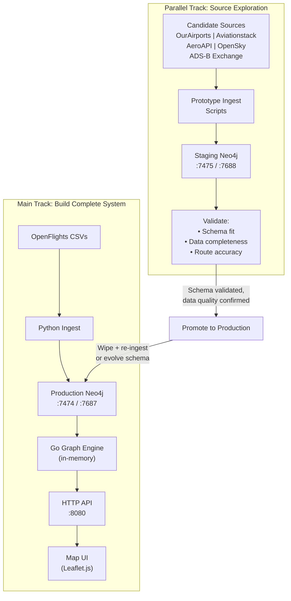

Source exploration begins after Phase 1 (once the OpenFlights ingest establishes the baseline schema) and runs in parallel with Phases 2–5.

### 12.5.2 Staging Isolation Pattern

New data sources are developed and validated against a **separate Neo4j staging container**, fully isolated from production.

- **Two-container architecture:** production (`neo4j`, ports 7474/7687) and staging (`neo4j-staging`, ports 7475/7688).
- **Staging is optional.** Uses Docker Compose `docker-compose.staging.yml` — started only via `docker compose -f docker-compose.staging.yml up`. Zero memory cost when not in use.
- **Separate Docker volumes** — staging data can be wiped independently without affecting production: `docker volume rm aircraft-route-planner_neo4j_staging_data`.
- **Connection targeting:** ingest scripts read `NEO4J_URI` from environment. To target staging: `NEO4J_URI=bolt://localhost:7688 python ingest/main.py`.
- **Go server never connects to staging** — staging is exclusively a Python-side concern for data experimentation.
- **Promotion workflow:** once staging data is validated (schema fit, completeness, accuracy), either wipe production and re-ingest from the new source, or evolve the schema if the new source justifies new node/relationship types.

### 12.5.3 Schema Evolution Expectations

The current schema (Airport, Aircraft, ROUTE) is the **minimum viable graph**. Future sources may introduce:

- **New properties on existing nodes** — e.g., `elevation`, `runway_length` on Airport (from OurAirports), `frequency`, `codeshare`, `seasonal` on ROUTE relationships.
- **New node types** — e.g., `:Airline` if a source provides rich airline metadata worth modeling as nodes rather than a string property on ROUTE.
- **New relationship types** — e.g., `:SCHEDULE` for time-based route data, `:CODESHARE` for airline partnerships.

**Backward compatibility:** Neo4j is schema-optional. New properties can be added to existing nodes/relationships without migration. Go `loader.go` reads known properties and ignores unknown ones — adding properties to Neo4j doesn't break the Go server until the server is explicitly updated to use them. New node types or relationship types require an ARCHITECTURE.md update before implementation.

### 12.5.4 Flight Schedule / Time Data (Future Enhancement)

**Problem:** The current data model stores one `ROUTE` relationship per airline-aircraft-route pair. In reality, one airline can operate the same aircraft on the same route multiple times per day (e.g., BA operates 3 daily A380 flights LHR→JFK). The current model collapses all of these into a single relationship — users cannot see individual flight times, flight numbers, or daily frequency.

**Blocked on:** OpenFlights `routes.dat` has no schedule data. This enhancement requires a data source that provides departure/arrival times and flight numbers (candidates per 6.1 research: OpenSky-derived frequency (free), FlightAware AeroAPI `/schedules`, AeroDataBox (free–$15/mo); Aviationstack rejected).

**Data model options when schedule data becomes available:**

- **Option A: Properties on ROUTE.** Add `flight_count` (integer) and `flights` (list of `{flight_number, departure_utc, arrival_utc}` maps) as properties on the existing ROUTE relationship. Simple to implement, no schema change. Limitation: Neo4j list properties are opaque to Cypher — cannot efficiently query "flights departing after 14:00."
- **Option B: Separate `:FLIGHT` relationships.** Create `(:Airport)-[:FLIGHT {flight_number, departure_utc, arrival_utc, aircraft, airline}]->(:Airport)` — one relationship per scheduled flight. Enables time-based queries in Cypher. Trade-off: relationship count explodes (~134k routes × avg flights/day), increases Neo4j memory and Go in-memory graph size.
- **Option C: `:SCHEDULE` node.** `(:ROUTE)-[:HAS_SCHEDULE]->(:Schedule {flight_number, departure_utc, arrival_utc, days_of_week})` — keeps ROUTE as the traversal edge, adds schedule as metadata. Balances queryability and graph size.

**Final Decision (`Option A` Modified):**
We have officially selected **Option A** for the staging schema evolution by mapping schedule metadata via `weekly_frequency: int` and `days_of_week: []int` on the `[:ROUTE]` edge. Relying on an intermediate **SQLite** database caching layer enables us to instantly pre-aggregate mathematical anomalies offline. This keeps the core relationship single-layered for performance, respects the M4 Pro footprint, and completely bypasses Cypher query opaqueness by permitting integer array lookup filtering natively (`WHERE 3 IN r.days_of_week`).

**Impact on existing code when implemented:**
- `ingest/fetch_raw.py` — New Python script running continuously to insert flight API data into SQLite. Uses `fetch_log` table for resumability (Section 4.1.1). Fetches airports in priority order (`large_airport` first).
- `ingest/load_graph.py` — New offline script replacing the OpenFlights logic. Multi-stage pipeline: destination inference (Section 4.1.2) → route aggregation → validity filtering (Section 4.1.3) → icao24 mapping → airline resolution (Section 4.1.4) → Neo4j load.
- `ingest/data/opensky_cache.db` — SQLite database with `raw_flights` + `fetch_log` tables (schema in Section 4.1.1).
- `ingest/data/icao_airline_map.json` — Static ICAO callsign prefix → IATA airline code lookup table.
- `internal/graph/types.go` — Add `DaysOfWeek []int` to the existing `Edge` struct.
- `internal/models/response.go` — Emulate array mapping onto response schemas.
- `web/` — Display "Days" filters and frequency metadata in the results sidebar.

### 12.5.5 Key Challenges for Source Migration

Challenges identified during design that future source work must address:

- **Data staleness vs accuracy trade-off.** OpenFlights ~2014 data gives plausible graph structure but wrong route counts (A380 routes will differ significantly from 2026 reality). The system is validated on structural correctness, not absolute numbers.
- **API rate limits.** Aviationstack (100 req/month free, `/routes` paid-only with no equipment field — rejected), AeroAPI (pay-per-result-set, validation only), OpenSky (credit system: 4,000 credits/day registered, 2-day max window), AeroDataBox (**adopted 2026-09-05** for the ADS-B blackout regions — free tier 600 units/month recurring, 1 unit per airport call, hard 12-hour window cap; see Section 4.1.5). Each requires different ingestion strategies — bulk dump, incremental fetch, or flight-to-route derivation.
- **Schema shape uncertainty.** Until a source is actually prototyped against the staging Neo4j, we don't know what new properties or node types it might justify. The staging container exists precisely for this experimentation.
- **Route deduplication.** ~~Reconciliation strategy TBD~~ **Resolved 2026-09-05** for the OpenSky + AeroDataBox pair by partitioning airports between sources, with the loader dropping blackout-prefix origins from `raw_flights` so historical rows cannot collide with the schedules source (Section 2.2.1). Note this works only because the sources partition cleanly by geography; a future source overlapping an existing one would reopen this and need the source-priority rule originally sketched here.
- **IATA/ICAO code mapping.** Different sources use different code systems. The `aircraft_aliases.json` override mechanism (Section 4.2) is the integration point for resolving cross-source code mismatches.

---

## 13. Research and Validation Record

The working notes behind the data-source decisions — source research, the original ingestion plan,
staging validation and two code reviews — are kept outside the repository (`data_planning/` is
gitignored). This section records what they established, so nothing in the repository depends on them.

### 13.1 Data Source Research

Phase 6.1, 2026-07-05: documentation first, then live tests with registered credentials. The fetch
strategy chosen here was superseded on 2026-09-05 by Section 4.1.5.

| Source | Layer | Verdict | What was established |
|---|---|---|---|
| OurAirports | Airports | GO | 85,696 records. `type IN (large_airport, medium_airport) AND scheduled_service = 'yes'` gives **3,307** airports; type alone gives 5,276, beyond the fetch budget. 395 scheduled IATA airports are missing from OpenFlights (including BER and NMI), and there are 0 duplicate IATA codes, so `:Airport` can key on IATA. `iso_country` is a 2-letter code, mapped to full names via `countries.csv`. |
| wiedehopf/tar1090-db (Mictronics data) | Aircraft: icao24 → type | GO, replacing ADS-B Exchange | ADS-B Exchange's list stopped updating on 2025-09-02. tar1090-db has 621,281 rows under ODC-By (attribute Mictronics); a live sample of 467 aircraft near JFK resolved 99.7% of airliner hexes. Mapping stays two-step: icao24 → ICAO type designator → IATA equipment code. |
| OpenSky Network | Routes (ADS-B) | GO, reduced scope | OAuth2 client credentials only since 2026-03-18 (30-minute tokens). Credits rather than request counts: 4,000/day for `/flights/*`, and `/flights/departure` accepts at most a 2-day window. **Live-verified:** every request costs a flat 30 credits whatever its window or age (the documented 4-credit tier never appeared), so 133 requests/day; 60-day-back queries succeed; the arrival airport is NULL for 5.0–11.7% of flights, not the assumed 30–40%. The terms restrict "operational" use, which is worth clarifying with OpenSky before long-term continuous running. |
| Aviationstack | Routes | NO-GO | `/routes` is paid-only ($49.99/month) and carries no aircraft field at any tier. Free-tier `/airlines` returns 403, so there is no API fallback for airline resolution. |
| FlightAware AeroAPI | Validation | GO for spot-checks only | `/schedules` has the ideal record (aircraft type, times, flight numbers) at $0.02 per 15 records, which is unaffordable in bulk. The $5/month free credit is reserved for validating top routes. |
| AeroDataBox | Schedules | Found during research; adopted 2026-09-05 | Not in the original plan. Free tier of 600 units/month. Now the source for the ADS-B blackout regions (Section 4.1.5). |

**Fetch strategy chosen 2026-07-05 (superseded):** breadth — ~930 airports, each fetched one 2-day
window per ~7.4-day cycle (~125 requests/day), so the sampled weekdays rotate. Depth (~260 airports
with full history) and a hybrid were rejected in favour of covering secondary-city routes.

### 13.2 Original Ingestion Plan

The first design for the OpenSky pipeline. What survived is documented in Section 4.1:

| Plan topic | Now documented in |
|---|---|
| Separate fetch and load scripts; `raw_flights` and `fetch_log` in SQLite; resumable runs | 4.1.1 |
| Destination inference from callsign patterns (≥80% confidence) | 4.1.2 |
| Route validity filter (history length, with a recency exception) | 4.1.3 |
| Airline resolution from ICAO callsign prefixes | 4.1.4 |
| Rotating-sample accumulation within the credit budget | 13.1, then 4.1.5 |

Planning assumptions that measurement overturned: a 7-day request window (2 days is the maximum);
~3,500 fetchable airports (the budget fitted ~930, since replaced by tiers); 30–40% NULL destinations
(5–17% measured); up to 10% unmapped aircraft (1.6% on day 1); an Aviationstack fallback for airlines
(it returns 403).

### 13.3 Staging Validation

**Schema — passed 2026-07-05 (Phase 6.3).** The unmodified Go stack (loader, engine, all 7 endpoints)
ran against staging without a code change: `/health` reported 3,274 airports, 25,419 edges, 222
aircraft and 234 countries, and strict and family aircraft resolution, `/routes/from`, country mode,
aircraft search and an unknown-route query all returned correct results. The schema deltas are
recorded in Section 2.2.1.

**Day-1 comparison with OpenFlights** (indicative only; to be re-run at maturity):

| | OpenFlights (2014) | OpenSky staging, day 1 |
|---|---|---|
| Airports | 6,072 | 3,274 (scheduled large and medium only, by design) |
| ROUTE edges | 92,451 | 25,419 (102 of 930 airports sampled) |
| Aircraft types | 220 | 222 (including A220, neo and MAX) |
| Data age | ~12 years | ≤3 days |
| DXB A380 routes | include long-cancelled routes | 39 destinations matching the current Emirates network |

Day-1 pipeline metrics: 16.4% of destinations NULL, with inference resolving 6.7% of those; 1.6%
unmapped aircraft (business jets and helicopters); ~13% of airlines unresolved, stored as `''`.

**Per-source split — first dual-source load, 2026-09-05:**

| | OpenSky (ADS-B) | AeroDataBox (schedules) |
|---|---|---|
| Airports covered | 2,818 | 443 |
| Destination known | 83.0% | 100% (given by the source) |
| Aircraft type resolved | 97.9% | 90.7% |
| Airline resolved | ~87% | 99.1% |
| Routes served after the validity filter | 9,960 | 2,548 |

AeroDataBox avoids OpenSky's two lossiest steps (destination inference and callsign → airline), but its
`weekly_frequency` is quantized to multiples of 14 while `days_sampled` is small, so frequencies are not
comparable across sources without it (Section 4.1.5). The split added 2,299 edges in China and 249 in
Russia, where no current source had any.

**Deduplication:** `MERGE` on `(src, dst, aircraft, airline)` within a source; across sources, see
Section 12.5.5. If AeroAPI spot-checks contradict derived data, AeroAPI wins.

**Deferred to dataset maturity** (OpenSky hub tier ~Nov 2026, AeroDataBox ~Mar 2027, OpenSky tail
~May 2027): re-run the comparison and the inference-rate measurement, re-measure schedule-source
frequency, spot-validate the top ~100 routes with AeroAPI, and take the Phase 6.4 cut-over decision.

### 13.4 Code Reviews

Finding IDs throughout PLAN.md come from two internal code reviews: **Jul** (2026-07-05) and **Sep**
(2026-09-10). The prefix gives severity — H high, M medium, L low — plus S for the July review's
structural and hygiene items, so "Sep L6" is the September review's sixth low-severity finding. The
review notes are not in the repository; each finding's fix, decision and verification is recorded in
the PLAN.md section that closed it (6.5.9 and 6.7 onwards).
