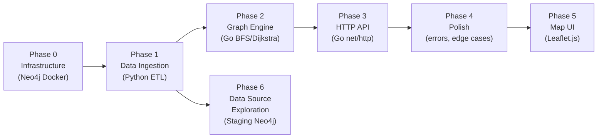
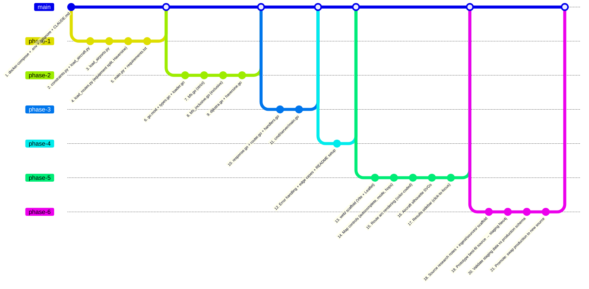

# Plan

Implementation phases for the Aircraft Route Planner. Each phase builds on the previous one. Technical details and design rationale are in [ARCHITECTURE.md](ARCHITECTURE.md).

## Phase Dependencies



---

## Implementation Checklist

Status markers per `.claude/rules/design-plan-checklist.md`: `[x]` done · `[ ]` pending · `[~]` blocked · `[>]` deferred. Each phase below carries its own entries.

### Phase 0: Infrastructure

**Goal:** Neo4j running in Docker, project scaffolding in place.

- [x] `docker-compose.yml` — Neo4j Community Edition with memory limits (see Architecture Section 7)
- [x] `.env` / `.env.example` — Neo4j credentials, port config
- [x] `.gitignore` — raw data files, env, build artifacts
- [x] Project `CLAUDE.md` — coding standards for this project
- [x] Verify: Neo4j browser accessible at `http://localhost:7474`
- [x] `docker-compose.staging.yml` — separate compose file for staging Neo4j (ports 7475/7688, half memory budget, separate volumes)
- [x] `.env.example` — add staging-specific variables (`NEO4J_STAGING_URI`, ports, credentials)
- [x] Verify: `docker compose -f docker-compose.staging.yml up` starts staging, browser at `http://localhost:7475`, production unaffected

**Depends on:** Nothing.

---

### Phase 1: Data Ingestion (Python)

**Goal:** Repeatable `python ingest/main.py` that populates Neo4j from OpenFlights CSVs.

- [x] Download OpenFlights data files into `ingest/data/` (gitignored)
- [x] `ingest/constraints.py` — create uniqueness constraints and indexes (see Architecture Section 2.3)
- [x] `ingest/load_aircraft.py` — parse `planes.dat` → MERGE `:Aircraft` nodes
- [x] `ingest/normalize_aircraft.py` — enrich Aircraft nodes with `family` and `aliases` properties:
  - Extract family from name (e.g., "Airbus A350-900" → "A350")
  - Build aliases list (IATA, ICAO, name without manufacturer, known variants)
  - Merge optional overrides from `ingest/data/aircraft_aliases.json`
  - UPDATE Aircraft nodes in Neo4j (Architecture Section 4.2)
- [x] `ingest/load_airports.py` — parse `airports.dat` → MERGE `:Airport` nodes, filter non-airport entries
- [x] `ingest/load_routes.py` — parse `routes.dat`:
  - Split equipment field on space → one ROUTE relationship per aircraft code
  - Compute Haversine distance from airport coordinates
  - MERGE `:ROUTE` relationships with `aircraft`, `airline`, `distance_km` properties
- [x] `ingest/main.py` — orchestrate all steps in order, print summary
- [x] `ingest/config.py` — shared config function reading `NEO4J_URI`/`NEO4J_USER`/`NEO4J_PASSWORD` from env with defaults. All scripts use this instead of hardcoded values.
- [x] `requirements.txt` — `neo4j` driver dependency
- [x] Verify:
  ```cypher
  MATCH ()-[r:ROUTE {aircraft: "388"}]->() RETURN count(r)
  ```
  Returns 214 (A380 routes — actual OpenFlights count; estimate was 300–500).

**Depends on:** Phase 0 (Neo4j running).

---

### Phase 2: Go Graph Engine

**Goal:** Load graph from Neo4j into memory. Run BFS and Dijkstra's as standalone tests.

- [x] `go.mod` — initialize module, add `neo4j-go-driver/v5` dependency
- [x] `internal/graph/types.go` — `Airport`, `Aircraft`, `Edge`, `Graph` structs including `AircraftByIATA`, `AliasToIATA`, `Families` maps (see Architecture Section 6.1)
- [x] `internal/graph/loader.go` — connect to Neo4j, load airports + edges + aircraft (with aliases/family), build adjacency list and alias/family indexes, log stats
- [x] `internal/graph/haversine.go` — great-circle distance function (used to validate pre-computed distances)
- [x] `internal/graph/bfs.go` — strict BFS: accept `[]string` aircraft codes (resolved via AliasToIATA), filter edges using set membership (Architecture Section 5.4)
- [x] `internal/graph/bfs_inclusive.go` — inclusive BFS: accept `[]string` aircraft codes, traverse all edges, carry `hasTarget` flag using set membership (Architecture Section 5.4)
- [x] `internal/graph/dijkstra.go` — implement `container/heap` interface, distance-weighted shortest path, accept `[]string` aircraft codes (supports both modes)
- [x] Build `ByCountry` and `Countries` indexes during airport loading in `loader.go` (Architecture Section 6.1)
- [x] `internal/graph/country.go` — `FindCountryRoutes(fromCountry, toCountry, aircraft string)`: scan adjacency list for direct edges between airports in two countries, optionally filtered by aircraft (Architecture Section 5.5)
- [x] Verify with a throwaway `main.go`:
  ```
  Strict:    FindRoutes("LHR", "SYD", "388", 2)         → paths where every leg is A380
  Inclusive: FindRoutesInclusive("LHR", "SYD", "388", 2) → paths where at least one leg is A380
  ```

**Depends on:** Phase 1 (Neo4j populated with data).

---

### Phase 3: HTTP API (Go)

**Goal:** Expose the graph engine and Neo4j search over HTTP.

- [x] `internal/api/router.go` — `net/http` mux, middleware (CORS, logging, timing)
- [x] `internal/api/handlers.go`:
  - `GET /routes` — resolve `aircraft` param via `AliasToIATA` (supports IATA, ICAO, family), route to strict or inclusive BFS; uses Dijkstra's when `sort=distance`
  - `GET /routes/from` — routes to strict or inclusive BFS with no target, based on `mode` param
  - `GET /routes/countries` — validates countries exist in `Graph.ByCountry`, calls `FindCountryRoutes`, groups results by airport pair (Architecture Section 5.5, 8.1)
  - `GET /countries/search` — case-insensitive substring search on `Graph.Countries` (Architecture Section 8.1)
  - `GET /airports/search` — calls Neo4j full-text index
  - `GET /aircraft/search` — calls Neo4j full-text index
  - `GET /health` — graph stats + Neo4j connectivity check
- [x] `internal/models/response.go` — JSON response envelope structs (see Architecture Section 8.2)
- [x] `cmd/server/main.go` — startup sequence: config → Neo4j connect → graph load → wire routes → serve (Architecture Section 9)
- [x] Verify:
  ```
  curl "localhost:8080/routes?aircraft=388&from=LHR&to=SYD&max_hops=2"
  → JSON response with paths, distances, metadata
  ```

**Depends on:** Phase 2 (graph engine working).

---

### Phase 4: Polish

**Goal:** Production-quality project ready to demo.

- [x] README.md — fill in "Running the Project" section with actual setup steps
- [x] Error handling audit — confirm all endpoints return structured error responses (Architecture Section 8.3)
- [x] Edge case testing — `internal/api/handlers_test.go` (table-driven, no Neo4j needed) covers:
  - Unknown aircraft code → 404
  - Unknown airport code → 404
  - No routes found → empty `data` array, not an error
  - `max_hops=0` → direct flights only
  - `max_hops` > `GRAPH_MAX_HOPS` → clamped silently
  - `mode=inclusive` with `max_hops=0` → only direct flights on that aircraft (same as strict for direct)
  - `mode=inclusive` with no matching aircraft on any leg → empty `data` array
  - `mode=invalid_value` → 400 error
  - `is_target` is `true` on all legs in strict mode, mixed in inclusive mode
  - Live `scripts/verify.sh` re-runs the same matrix against a running server.
- [x] Verify all success criteria from README.md (via `scripts/verify.sh`):
  - A380 LHR→SYD returns valid paths (64 paths)
  - A380 from LHR returns 20+ destinations (1367)
  - Pathfinding p50 < 50ms (measured ~1ms)
  - Ingestion < 30s (Phase 1 verified)
  - Neo4j + Go server < 4GB combined (Neo4j ~1.4GiB)

**Depends on:** Phase 3 (API functional).

---

### Phase 5: Map UI (Leaflet.js)

**Goal:** Interactive world map showing routes as arcs between airports, color-coded by aircraft match, with aircraft-specific icons.

- [x] **Backend retroactive enrichment (Phase 4 patch):**
  - `internal/models/response.go` — added `Lat`, `Lon`, `ICAO` to `AirportMeta`; added `Airports map[string]AirportMeta` to `RouteMeta` + `CountryRouteMeta`
  - `internal/api/handlers.go` — `buildAirportsFromLegs` / `buildAirportsFromCountryGroups` populate the airports map for `/routes`, `/routes/from`, `/routes/countries`
  - `internal/api/handlers_test.go` — `TestAirportsMapInRouteMeta` asserts every IATA in legs appears in the map with lat/lon
- [x] `web/index.html` + `web/src/main.js` — Vite + vanilla JS scaffold (`web/package.json` pinning `leaflet@1.9.4`, `leaflet-arc@1.0.2`)
- [x] Leaflet.js + OpenStreetMap tile layer (free, no API key)
- [x] **Map controls panel** (`web/src/controls.js`):
  - Aircraft type autocomplete (calls `GET /aircraft/search`, debounced 220ms, AbortController)
  - Origin / destination airport autocomplete (calls `GET /airports/search`)
  - Max hops selector (0, 1, 2, 3) as a segmented control
  - Mode toggle: strict / inclusive
  - Search button → calls `GET /routes` (with `to`) or `GET /routes/from` (without)
- [x] **Route rendering** (`web/src/map.js`):
  - Airport markers as `L.circleMarker` dots at lat/lon coordinates with IATA tooltips
  - Route legs drawn as `L.Polyline.Arc` great-circle paths (96 vertices)
  - Color-coded by `is_target`:
    - **Target leg** → solid `#2563eb`, weight 3, opacity 0.9
    - **Non-target leg** → dashed `#9ca3af`, weight 2, opacity 0.6, `dashArray:"8,6"`
  - Click a route card → `fitRoute(coords)` zooms the map to its bounds
- [x] **Aircraft silhouette icons (two-layer model):**
  - **Map marker (top-down, rotates with bearing):**
    - Single merged JS lookup at `web/public/assets/aircraft_shapes.json` (served from `/assets/aircraft_shapes.json` in both dev and prod)
    - Sources: `wiedehopf/tar1090` (GPL-2.0+) + `RexKramer1/AircraftShapesSVG` (GPL-3.0)
    - `shapes.js` resolves `leg.aircraft` (IATA) → `iataToIcao` → `shapes[ICAO]`, applies bearing rotation unless `noRotate` flag set
    - Built-in generic-arrow fallback when bundle is absent (dev pre-build) or code is unknown
  - **Detail popover (side-profile, static):**
    - `web/public/assets/aircraft/details/{ICAO}.bmp` from `rikgale/VRSOperatorFlags` (GPL-3.0)
    - Triggered on sidebar leg hover; popover positioned next to cursor
    - `` gracefully drops the image when the BMP is absent
  - **Build:** `tools/build_shapes.py` — fetches all three upstream sources, queries Neo4j for IATA→ICAO, writes `aircraft_shapes.json` + extracts `Silhouettes.zip` to `details/`. Idempotent.
  - **Attribution:** generated `web/public/assets/aircraft/ATTRIBUTION.md` lists upstream URLs and bundle stats; merged asset set is GPL-3.0, Go/Python code unaffected.
  - **Superseded 2026-09-16 (6.18):** tar1090 no longer publishes `aircraft_shapes.js`, so no top-down shape had been bundled. The bundle is now built from tar1090 `markers.js` with tar1090's own type → shape rules, `RexKramer1/AircraftShapesSVG` is dropped, and `shapes.js` reads `icaoToShape` (ARCHITECTURE.md §11.4)
- [x] **Route results sidebar** (`web/src/sidebar.js`):
  - List of returned routes with hop count, total distance, per-leg breakdown
  - Each leg row: top-down silhouette + aircraft IATA + airline + distance
  - Non-target legs rendered in muted italic
  - Clicking a card calls `map.fitRoute(coords)`; hovering a leg shows the popover with side-profile BMP + airline/aircraft/distance
- [x] **Country-to-country mode:**
  - Scope tabs at top of left panel toggle between `airport` and `country` modes (controls re-rendered)
  - Country autocomplete inputs hit `GET /countries/search` (debounced)
  - Optional aircraft filter reuses the airport-mode aircraft autocomplete
  - `renderCountryGroups` draws one solid arc per airport-pair group; sidebar renders cards grouped by pair with one row per aircraft
  - Clicking a pair card calls `fitRoute(coords)`
- [x] **Single-binary prod serving:** `cmd/server/main.go` conditionally mounts `http.FileServer(http.Dir("web/dist"))` for non-API paths when the directory exists. API paths (`/routes`, `/airports`, `/aircraft`, `/countries`, `/health`) keep going to the JSON handler. Dev unaffected — Vite on `:5173` proxies API calls to `:8080` (`web/vite.config.js`).
- [x] **Verified in Chrome 2026-09-19** against the OpenFlights graph (:8080) with the Vite dev server,
      after `npm run build` for the single-binary pass:
  - A380 LHR→SYD strict → every leg drawn in the target colour. The colours are blue `#2563eb` solid and
    grey dashed, not the "green" this checklist was written with (ARCHITECTURE §11.3 is authoritative)
  - A380 LHR→SYD inclusive → mixed solid-blue and dashed-grey arcs, each leg carrying its own silhouette
    (77W, 346, 333 grey; 388 blue)
  - Silhouettes are type-specific and rotate to the arc bearing, and size with the aircraft — A380 and 747
    quads are visibly distinct from 777/330 twins. The default is now an airliner outline, not the arrow
    this checklist named (6.18)
  - Sidebar hover → popover with the side-profile BMP, airline, distance and `77W (B77W)`. **Not
    exercised:** the missing-BMP path, since every type served has one
  - Clicking a route card zooms the map to that route and fades the others
  - Country mode UK→Australia returns "No routes found" — correct, not a fault: the API itself returns 0
    pairs, because the 2014 data has no direct UK–Australia flight. UK→United States returns grouped pairs.
    **Not exercised:** clicking a group to zoom, since the filtered result held a single pair
  - `http://localhost:8080/` serves the built UI and a DXB→JFK inclusive search works there, so the
    production bundle carries the 6.18 icon code
- Two defects found while verifying, both in 6.20

**Depends on:** Phase 4 (API polished, all edge cases handled).

---

### Phase 6: Data Source Exploration (Parallel Track)

**Goal:** Research, prototype, and validate better data sources against staging Neo4j. Runs in parallel with Phases 2–5 (see Architecture Section 12.5).

#### 6.1 Research (can begin after Phase 1) — findings summarised in ARCHITECTURE.md §13.1

- [x] **OurAirports** (airports) — evaluated 2026-07-05: 85,696 records; correct filter is `large/medium + scheduled_service=yes` → 3,307 (type-only gives 5,276, over OpenSky budget). BER + NMI present, 0 duplicate IATA. **GO**
- [x] **Aviationstack API** (routes) — docs-verified: `/routes` is paid-only ($49.99/mo) AND carries no equipment field. **NO-GO as route source**; free-tier `/airlines` fallback test parked (needs key — later live-tested: 403 on the free tier; ARCHITECTURE.md §13.1)
- [x] **FlightAware AeroAPI** (routes) — docs-verified: `/schedules` has the ideal record (aircraft_type + times + flight numbers) at $0.02/15 records; bulk infeasible on budget. **GO as validation tool only** ($5/mo free credit)
- [x] **OpenSky Network** (ADS-B → routes) — research complete: OAuth2-only since 2026-03, credit system (4,000/day), `/flights/departure` window now 2 days max (was 7). Plan budget math invalidated → feasible scope ~950–1,000 airports daily-fetch. **GO with reduced scope**; ToU "operational use" clause flagged
- [x] **OpenSky historical window verification** — live-tested 2026-07-05: 60-day-back queries return 200 (backfill works, no depth cap hit). **Actual cost: flat 30 credits/request regardless of window (≤2 days) or age** → 133 req/day budget. NULL arrival rate measured 5–12% (better than 30–40% assumption). Fetch strategy decided: breadth — ~930 airports, one 2-day window per ~7.4-day rotating cycle (see ARCHITECTURE.md §13.1)
- [x] **ADS-B Exchange** (aircraft metadata) — list still downloadable but frozen since 2025-09. **Swap to wiedehopf/tar1090-db (Mictronics, ODC-By)**: 621k records, current, ~99.7% commercial icao24→type coverage measured
- [x] **Flight schedule data** — cross-source matrix summarised in ARCHITECTURE.md §13.1. OpenSky-derived frequency remains the free path; AeroDataBox (free–$15/mo, not in original plan) is the only budget-fit commercial schedule source — add to 6.2 evaluation

#### 6.2 Prototype (after research, targets staging Neo4j)

- [x] `ingest/sources/` directory scaffold — one script per source, all targeting `NEO4J_STAGING_URI` (`config.py` shadows `neo4j_config` → staging, so sources/ scripts can never touch production)
- [x] Prototype best-fit airport source → staging Neo4j — `sources/load_airports_oa.py`: 3,274 Airport nodes loaded (3,307 filtered minus 33 without IATA); `iso_country` mapped to full names via `countries.csv`
- [x] Prototype aircraft metadata source → staging Neo4j — 220 Aircraft nodes (planes.dat + normalize) + 17 modern supplement types (A20N, B38M, BCS3, AT76…); tar1090-db icao24→type in SQLite
- [x] **SQLite schema setup** — `raw_flights` + `fetch_log` + `fetch_airports` + `aircraft_types` tables in `ingest/data/opensky_cache.db` (schema in ARCHITECTURE.md Section 4.1.1)
- [x] **Fetch order prioritization** — fetch list = 930 airports (all `large_airport` + `scheduled_service=yes`, ranked by routes.dat traffic proxy so the 930-cap doesn't cut major hubs alphabetically); ~125 requests/day (flat 30 credits each, 2-day windows), queue ordered by never-fetched-first then stalest → each airport sampled every ~7.4 days with rotating weekdays; OAuth2 fetcher with 25-min token refresh. First run 2026-07-05: 102 ok / 21 empty / 0 errors, 74,081 flights, clean credit-floor stop. Daily launchd agent loaded (`com.aircraft-route-planner.fetch`, 09:00) — **blocked by macOS TCC 2026-07-06 → 2026-08-31 (57 runs, 0 windows accumulated); repaired 2026-08-31**, see RUNBOOK §4
- [x] **Fetch resumability** — implemented in `fetch_flights.py` (skip `ok` for current window, never-fetched-first queue, credit-floor stop); **not yet exercised by a daily launchd run** — the agent was TCC-blocked from 2026-07-06 until the 2026-08-31 repair
- [x] **Destination inference** — implemented (observed-only pattern table, ≥80% threshold). Day-1: 6.7% of NULLs resolved — matures with accumulation; re-measure at 6.3
- [x] **Route validity filtering** — implemented (dual-threshold). Day-1: 0 filtered (all pass recency exception, expected for fresh data); becomes meaningful as weeks accumulate
- [x] **icao24 → aircraft type mapping** — tar1090-db `aircraft.csv.gz` loaded: 496,832 mappings in SQLite `aircraft_types` (ADS-B Exchange list frozen since 2025-09); modern-type supplement (A20N/B38M/BCS3 etc. — absent from 2014 planes.dat) in `load_graph.py`; unmapped rate measured on first graph load
- [x] **Airline code resolution** — `icao_airline_map.json` built from `airlines.dat` (1,181 ICAO prefix → IATA entries); extraction in `load_graph.py`; no API fallback (Aviationstack `/airlines` 403s on free tier — live-tested); unresolved → `airline: ''` sentinel (null would abort the Neo4j MERGE batch)
- [x] **Metrics collection after first pass** (2026-07-05, 74,081 flights): NULL dest 16.4%, inference 6.7% of NULLs, unmapped aircraft 1.6% (remainder biz-jets/helis), airline unresolved ~13%, 25,419 valid routes loaded — **re-measure at dataset maturity ~Nov 2026**
- [x] Handle IATA/ICAO code mapping across sources — `SUPPLEMENT_TYPES` in `load_graph.py` (post-2014 designators absent from planes.dat) + `aircraft_aliases.json` override hook

#### 6.3 Validate (after prototype)

- [x] Validate staging data vs production schema — unmodified Go stack ran against staging (loader + all 7 endpoints pass); schema deltas documented in ARCHITECTURE.md §2.2.1, results in §13.3 (2026-07-05)
- [x] Compare data quality vs OpenFlights baseline — day-1 comparison in ARCHITECTURE.md §13.3 (25,419 current edges vs 92,451 stale; DXB A380 matches real Emirates network); **re-run at dataset maturity ~Nov 2026** (was ~Sep; the 57-day TCC outage reset the accumulation clock to 2026-08-31)
- [x] Document schema evolution needs — ARCHITECTURE.md §2.2.1 updated (V2 props validated, Airport.type, airline '' sentinel, supplement Aircraft nodes)
- [x] Route deduplication strategy — single bulk source (OpenSky), MERGE on (src,dst,aircraft,airline) is the dedup; AeroAPI spot-checks win conflicts (ARCHITECTURE.md §13.3)

#### 6.4 Promote (after validation)

- [~] Wipe production Neo4j and re-ingest — now **phased**: the 300-airport hub subgraph matures ~Nov 2026 and can promote on the original timeline without waiting for the tail (~May 2027). Still **deferred by user (2026-07-05): both sources run side-by-side, isolated** → blocked by: Phase 6.5 dual-source coverage (`./scripts/run-server.sh {openflights|opensky}`, APIs :8080/:8081). Cut-over when dataset matures: `python3 ingest/sources/promote.py --yes`
- [x] Parallel entry points created — `ingest/sources/main.py` (staging setup), `fetch_flights.py` (daily), `load_graph.py` (refresh), `promote.py` (production cut-over, ready but unused); `ingest/main.py` untouched (OpenFlights rollback path)
- [x] Verify all API endpoints + graph engine with new data — full endpoint suite passed against staging on :8081 (ARCHITECTURE.md §13.3)
- [x] Update README.md data source section — dual-source run table + refresh/promotion commands

#### 6.5 Dual-Source Coverage (ARCHITECTURE.md §4.1.5, approved 2026-09-05)

Measured ADS-B blackout invalidated the single-source 930-airport strategy. OpenSky keeps the 2,818 airports it can see; AeroDataBox covers the 443 it cannot (14 countries). Gates 6.4.

**6.5.1 OpenSky tiering** — replaces the flat 930 cap — **DONE 2026-09-05**

Verified without spending credits: `fetch_airports` rebuilt to 2,818 rows (300 hub / 2,518 tail), 0 blackout airports queued, next run splits 43 hub + 82 tail = 125 requests with no overlap, implying 7.0d hub / 30.7d tail cycles. Live proof is tomorrow's 09:00 run.

- [x] Exclude ICAO prefixes `Z`/`U` from `fetch_list()` — 443 airports move to the schedules source (§4.1.5 table)
- [x] Add `tier` column to `fetch_airports`; hub = top 300 by traffic rank, tail = remaining 2,518
- [x] Retire `FETCH_AIRPORT_LIMIT=930` for a tier-aware budget split: 300 hub req/week + 575 tail req/week
- [x] Extend `due_airports()` so hub airports are due every 7 days and tail every ~30.7, instead of one global stalest-first queue
- [x] Verify: a dry run shows ~125 req/day split across both tiers, no `Z`/`U` airports queued

**6.5.2 AeroDataBox fetcher** — new `ingest/sources/fetch_schedules.py` — **DONE 2026-09-05**

Verified live: 24 airports fetched, 3,101 rows, 0 errors, agent green under launchd. Two surprises found and fixed — Cloudflare rejects urllib's default User-Agent with 403/1010, and HTTP 429 is overloaded between the per-second throttle and the monthly quota (conflating them would truncate a sweep and report it as a normal quiet run). Hardening now lives in shared `runner.py`, which `fetch_flights.py` was refactored onto so the two cannot drift.

- [x] `raw_schedules` table — native shape (`mode_s`, `flight_number`, `origin_icao`, `dest_iata`, `airline_iata`, `scheduled_utc`, `aircraft_model`, `fetched_at`), NOT coerced into `raw_flights` (§4.1.5)
- [x] `schedules_fetch_log` for resumability, mirroring `fetch_log`
- [x] Fetcher: ~19 calls/day, `durationMinutes=720` (12h hard cap), `withCodeshared=false`, offset alternating between day-halves on successive sweeps
- [x] Monthly quota tracking against the 600-unit free tier — quota exhaustion must report **distinctly from a collection failure**; it is the expected monthly end state, not a fault
- [x] Inherit the OpenSky fetcher's hardening: line-buffered stdout, `--- run started/OK/UNPRODUCTIVE/FAILED ---` markers, non-zero exit + notification, `except OSError` (not `TimeoutError` — see RUNBOOK §4)
- [x] Second launchd agent + plist, separate failure domain from the OpenSky agent; interpreter path must match the Full Disk Access grant
- [x] Verify: a real run stores ZSPD departures with resolved destinations and airline codes

**6.5.3 Loader changes** — `ingest/sources/load_graph.py` — **DONE 2026-09-05**

Loaded: 10,069 opensky + 2,548 aerodatabox edges. PVG has 259 outbound routes where OpenSky gave zero; China 2,299 / Russia 249. Type resolution 58.4% Mode-S + 32.3% model-name = 90.7%. Tail-sparseness check passed and inverted the concern: the new per-airport rule filters 25,314 routes where the old `RECENCY_DAYS=14` constant would have filtered 25,419 — all of them single-observation routes ~63 days old, stranded by the TCC outage, not by tiering.

- [x] Read and aggregate `raw_schedules` alongside `raw_flights`, union into the edge set
- [x] Map `mode_s` → existing `aircraft_types` table → ICAO type → §4.2 normalization; `aircraft_model` string as fallback
- [x] Use `airline_iata` directly for schedule rows — skip callsign inference (§4.1.4) and destination inference (§4.1.2), which have nothing to resolve
- [x] Add `source: "opensky" | "aerodatabox"` to every ROUTE edge (§2.2.1)
- [x] Scale `weekly_frequency` by **sampled hours, not sampled days**, for schedule-sourced origins — 12h/24h observation otherwise halves their true frequency silently
- [x] Replace `RECENCY_DAYS = 14` with per-airport `max(14, 2 × median gap between successful fetches)`; fall back to tier nominal cycle × 2 below two samples (§4.1.3)
- [x] Verify: `MATCH ()-[r:ROUTE]->() RETURN r.source, count(*)` returns both sources; ZSPD has outbound edges

**6.5.6 Edge reconciliation — mark and sweep** (ARCH §4.1.6) — **DONE 2026-09-05**

Served graph is now 12,508 edges (9,960 opensky + 2,548 aerodatabox), 25,423 marked stale and excluded from the read path, 0 duplicate keys, 0 legacy edges without provenance. Found and fixed a false assumption in ARCH §2.2.1 while verifying: cross-source disjointness is forward-looking only — `raw_flights` retains blackout-origin rows from before the split, which produced 37 colliding edges until `aggregate()` was made to drop them.

The loader was MERGE-only, so the validity filter never governed edges already in the graph:
25,314 rejected edges were still being served. Decision — loader marks, separate service deletes,
read path filters (the third is what makes marking take effect without waiting on the sweeper).

- [x] `load_graph.py`: stamp `stale` on ROUTE edges absent from the valid set; clear it on edges
      present, so a reappearing route is un-marked rather than deleted and recreated
- [x] `internal/graph/loader.go:126`: add `WHERE r.stale IS NULL` to the startup query — without
      it, marking changes nothing observable and the sweeper's cadence becomes a correctness
      dependency
- [x] `ingest/sources/sweep_stale.py`: separate service deleting edges marked longer than the
      60-day grace period (~2x the longest tier cycle); never invoked from the load path
- [x] Verify: marked count matches the filter's rejections; Go engine edge count drops to the
      unmarked set; sweeper deletes only past-grace edges and is a no-op on a fresh mark

**6.5.7 Frequency sample metadata** (ARCH §4.1.5) — **DONE 2026-09-05**

PVG edges now read `wf=14, observations=1, days_sampled=0.5` — the coarseness is visible in the data rather than implied by a bare number.

92% of schedule edges read exactly `weekly_frequency = 14` — one sighting in a 12h window cannot
express a rate below twice-daily. Chosen fix records the sample behind the number rather than
changing the sampling (widening the window was measured to give **no** resolution gain: 189
observed hours/airport/year either way). Alternatives and costs are tabulated in ARCH §4.1.5.

- [x] Add `observations` and `days_sampled` to shaped routes and the ROUTE MERGE
- [x] Verify: an aerodatabox edge shows observations=1, days_sampled=0.5 against an opensky edge
      with a multi-day window, making the two distinguishable

**6.5.4 Validation**

- [x] Confirm China/Russia routes exist in staging with correct aircraft types — the specific gap this phase exists to close
- [x] Re-check the tail tier does not go sparse under the new recency rule (the failure mode the old constant would have caused)
- [x] Update the validation notes with a per-source quality split; the day-1 comparison predates dual-source (both summarised in ARCHITECTURE.md §13.3)

**6.5.5 Operational docs**

- [x] RUNBOOK §4: second scheduled job, per-source staleness checks, monthly quota check

**6.5.8 Queue starvation fix** (ARCH §4.1.5) — **DONE 2026-09-10**

Five days of tiered running exposed a starvation bug in both fetchers, pre-dating tiering but
hidden by the old uniform airport list. Queues ordered by last *success*, so airports in
zero-coverage regions returned `empty` forever, never gained a success timestamp, and permanently
outranked airports that do return data.

- [x] `fetch_flights.due_airports`: order by `MAX(fetched_at)` over all attempts, not last ok
- [x] `fetch_flights.run`: current-window skip set counts `empty` as resolved, not just `ok`
- [x] `fetch_schedules.due_airports`: same ordering fix; day-half still flips from last *success*
      so a failed attempt retries the same half rather than skipping it
- [x] Verify: all 10 top world hubs return to the next hub run; 0 of 56 starving airports remain
      in it; UZTT drops out of the schedules queue

**6.5.9 Review-findings batch 1** — **DONE 2026-09-12**

First items fixed from the two internal code reviews (ARCHITECTURE.md §13.4), highest-priority first. Nothing in
the July file had previously been fixed *as a result of being listed there*.

- [x] Sep H3 — `classify` moved inside the run guard; `stage` marker distinguishes a reporting
      failure from a collection failure (`runner.py`)
- [x] Sep M7 — `urlretrieve` → `urlopen(timeout=60)` streamed to `.part` + atomic rename
      (`airports_oa.py`)
- [x] Sep M1 — `attempts` column on `schedules_fetch_log`, migrated in place; quota now sums real
      HTTP calls (`fetch_schedules.py`, RUNBOOK §4 query corrected to match)
- [x] Jul H2 — null-airline MERGE now uses the `''` sentinel (`ingest/load_routes.py`).
      **Severity corrected: dormant**, 0 of 67,663 `routes.dat` rows carry `\N` in column 0
- [x] Sep H4 — reconciliation is one transaction; ARCHITECTURE §4.1.6 amended. Also fixed a
      reporting bug found while verifying: `marked - cleared` compared two different populations
      and read **-19,546**
- [x] Sep H5 — first Python tests: `conftest.py` + 3 test modules, **49 passing on CLT 3.9**
- [>] Jul H1 — traversal `context.Context` + result cap → defer until: Phase 6.7 (amends the §8.2
      response contract; wants `internal/graph` tests first)
- [x] ARCH-1 — **closed 2026-09-13** by Phase 6.6. The decision (2026-09-12, §4.1.5 *Refresh chain*)
      was to bound the refresh cadence with a daily chain rather than add the reload endpoint §12.1
      sketches, keeping §9's loaded-once/no-mutex invariant unchanged. `WHERE r.stale IS NULL` stays a
      startup filter by design; what changed is that startup now happens daily on its own. Open since
      the 2026-07-05 review and passed over by Phases 6.2, 6.3 and 6.5

**Revised maturity** (was ~Nov 2026 single-source, now tier-dependent — §4.1.5):

| tier | cycle | matures |
|---|---|---|
| OpenSky hub (300) | 7 d | ~Nov 2026 |
| AeroDataBox (443) | 23.3 d | ~Mar 2027 |
| OpenSky tail (2,518) | 30.7 d | ~May 2027 |

**Depends on:** Phase 1 (OpenFlights baseline establishes schema). Runs in parallel with Phases 2–5. Staging Neo4j from Phase 0.

---

#### 6.6 Daily Graph Refresh Chain (ARCHITECTURE.md §4.1.5 *Refresh chain*, approved 2026-09-12)

Closes ARCH-1. Collecting data changes nothing a client sees until the graph is rebuilt **and** the
running server picks it up; both steps were manual, so served staleness was "since someone last
remembered", not one day. Decision: bound the cadence with a daily chain and keep refresh as process
restart — no reload endpoint, no pointer swap, no mutex, §9's invariant preserved unchanged.

Chain: `fetch_flights` 09:00 → `fetch_schedules` 10:00 → `load_graph` 10:30 → restart running servers.

**6.6.1 The loader becomes an unattended job**

**Verified 2026-09-12.** Two consecutive live rebuilds, both `exit 0`, identical counts (45069 valid
routes → 45069 served, 5874 marked stale) and matching the pre-refactor baseline exactly, so the
guard changed no ingest behaviour. 67 tests green on CLT 3.9; `ruff check` / `format --check` clean.

- [x] Refactor `load_graph.py` onto `runner.run_guard` — `main()` → `run()` returning a stats dict.
      `runner.run_guard` gained a `work_stage` parameter so a loader failure reports "in rebuild"
      instead of "in fetch", a word borrowed from a fetcher (§4.1.5 *Refresh chain*)
- [x] Its own `classify`: 0 valid routes from a non-empty cache is a fault; empty cache is `QUIET`;
      both distinguishable in the log and the notification
- [x] Staging-Neo4j reachability precondition — `verify_connectivity()` wrapped to raise
      "staging Neo4j unreachable at \<uri\>" rather than surface a driver traceback. This is the
      likeliest way a scheduled rebuild fails: the container is started manually
- [x] Ordering gate `upstream_state()` — **two conditions, deviating from this item's original
      wording "skip and alarm"**: a log written <5min ago reads as *busy* → skip and stay **QUIET**,
      because launchd fires every overdue agent at once on wake from sleep, so an unfinished
      upstream is routine and alarming on it would train the alarm to be ignored. Upstream silent
      >36h → rebuild anyway (safe, still reconciles) but **alarm**, as an independent check that the
      collectors have stopped. Verified against live data: newest write 6.6h old → neither condition
- [x] Tests: `TestUpstreamState`, `TestParseIso`, `TestLoaderClassify`, and a `work_stage`
      regression in `test_runner.py` — 18 new, 67 total

**6.6.2 The agent**

**Verified 2026-09-12** by kickstart: `plutil -lint` OK, bootstrapped into `gui/501`, ran to
`--- run OK: 45069 edges served, 5874 marked stale ---`, agent exit status **0**, and zero
occurrences of "Operation not permitted" in `refresh.log`. Next scheduled fire: tomorrow 10:30 local.

- [x] New **`com.aircraft-route-planner.refresh`** launchd agent, daily 10:30, logging to
      `ingest/data/refresh.log`. **Renamed from `.reload`**: "reload" names the `/admin/reload`
      endpoint §12.1 explicitly rejected, so it would misdescribe this agent permanently, whereas
      `.refresh` matches §4.1.5 *Refresh chain* and stays accurate once 6.6.3 lands
- [x] `ProgramArguments` invokes the FDA-granted CommandLineTools `python3`, never a `.sh`
- [x] Full Disk Access confirmed by running it rather than assumed. The log lives under `~/Desktop`,
      which is TCC-protected, so launchd could not have created `refresh.log` at all without the
      grant — its existence is the proof
- [x] Closed a gap left in 6.6.1's verification: the agent's `WorkingDirectory` is `ingest/sources`,
      but 6.6.1 had only been verified from the repo root. Re-ran from `ingest/sources` — `exit 0`,
      identical counts, so `config`'s path resolution is cwd-independent

**6.6.3 Restart, and proof it took**

**Verified live 2026-09-13.** `refresh.py` run end to end against a real server: `exit 0`, listener
pid **81808 → 82527** (a real restart, not a no-op), snapshot `19:13:19Z` → **`19:14:34Z`** strictly
newer as verified by the script itself, `45069` edges throughout, and `:8080` left down — proving the
never-start-a-stopped-server rule. 77 tests green on CLT 3.9; `ruff check` / `format --check` clean.

- [x] Restart only servers already listening; never start one deliberately stopped — verified by
      `openflights` on :8080 being skipped while `opensky` on :8081 was restarted
- [x] Confirm each returns via `/health`; alarm if one does not. Stronger than planned: acceptance
      requires a snapshot **strictly newer** than the one served before, since a server back up on
      the old graph reports healthy while still hiding the reconciliation
- [x] `/health` reports `graph_loaded_at` + `graph_age_seconds` (§12.2). `Graph.LoadedAt` is stamped
      once in `LoadGraph`, keeping the no-mutable-global and immutability rules intact; a zero value
      reports as unset rather than year 0001 with an age of billions of seconds
- [x] New `refresh.py` chain entry point rather than restart logic inside `load_graph.py` — a manual
      rebuild must never restart someone's servers as a side effect (§4.1.1 separated concerns).
      Agent repointed from `load_graph.py` to `refresh.py`, `plutil -lint` OK, re-bootstrapped
- [x] Process-group stop + port-free confirmation: `run-server.sh` execs `go run`, so the compiled
      child is the real listener. Signalling only one orphans the parent or leaves the port bound,
      and the restart would "succeed" while a stale server kept answering
- [x] RUNBOOK §4 updated to three agents and §84's "restart is the only way" retired

**Depends on:** Sep H4 (atomic reconciliation, done 2026-09-12) — before it, a restart landing
mid-load could load a zero-route graph, so automating restart would have *amplified* that bug.

---

#### 6.7 Review-Findings Batch 2 — Traversal Bounds (Jul H1, approved 2026-09-12)

A 3-hop inclusive query from a mega-hub explores ~14M states, each deep-copying path/edge slices,
and keeps burning CPU/RAM after `WriteTimeout` kills the connection; response size is unbounded.
Two independent halves: cancellation (unambiguous) and a result cap (needed a semantics decision).

**Decision:** cap **per hop-count**, `meta.truncated` meaning "more exist at some tiers". A flat cap
would return an arbitrary 1000 of 14M in traversal order — ranking first requires enumerating
everything, which is the cost the cap exists to avoid. Per-tier keeps the answer's shape, so a 0-hop
direct route is never crowded out by arbitrary 2-hop ones.

- [x] **Tests first:** `internal/graph` had zero test files, and `handlers_test.go`'s `fixtureGraph`
      is package-private so it could not be reused. `traversal_test.go` locks the baseline — and
      earned its place immediately by catching three wrong expectations of mine before any signature
      changed (I had forgotten `LHR→JFK` also exists on 359, so `["359"]` is not a no-match case)
- [x] Inventory: 6 methods but **7 call sites**, not 6 as the review said — `FindCountryRoutes` is
      called twice, once inside a per-aircraft-code loop at `handlers.go:342`
- [x] Threaded `context.Context` through all 6 methods and 7 call sites; `ctx.Err()` sampled every
      256 dequeues. Cancellation tested on every entry point
- [x] Per-hop-tier cap (250/tier) + `meta.truncated` on `RouteMeta` and `CountryRouteMeta`;
      ARCHITECTURE §8.2 gained a *Result bounds* subsection and §8.3 the new 503 code.
      Found and fixed a silent-wrongness bug while writing the boundary test: `truncated` was set
      only when a result was *rejected*, but the walk breaks out once tiers fill, so a capped result
      set reported as complete. Now flagged the moment a tier fills
- [x] Cancellation source named explicitly: `WriteTimeout` closes the connection but does **not**
      cancel `r.Context()`, so `internal/api/limits.go` holds a 10s `traversalBudget` documented
      against the existing 30s
- [x] **Verified by measurement — and the first measurement refuted the design.** The per-tier cap
      bounded the response (543/884 routes) but **not** the work: cost grew ~100x per hop, to 5.0s
      (`FindRoutesInclusive`) and **27.3s / 124 GB** (`FindRoutesFromInclusive`) at maxHops=3 on a
      400-edge hub. The all-tiers-full early exit proved nearly unreachable, because sparse low tiers
      never fill. Had I not benchmarked, ARCHITECTURE would still claim a CPU bound that did not exist
- [x] **Expansion gating** (approved 2026-09-13) — a state is pruned when every tier it could still
      reach is full, checked *before* the path/edge copies rather than after. Output-preserving, which
      the unchanged baseline tests verify. Measured at maxHops=3:
      `FindRoutesFromInclusive` 27.3s → **0.37s** (124 GB → 2.66 GB, 808M → 8.1M allocs);
      `FindRoutesInclusive` 5.0s → **0.69s**; strict `FindRoutes` 0.43s → **0.026s** (1.54 GB → 96 MB).
      Both 3-hop mega-hub queries now finish inside the 10s budget, so `max_hops=3` is usable rather
      than nominally supported
- [x] Handler-level wiring tests (`internal/api/bounds_test.go`, added 2026-09-13 after being flagged
      as an open gap) — the graph package proved the *mechanisms*, these prove the *wiring*, which is
      separate: `writeTraversalError` is called from three distinct blocks and `truncated` has to
      survive into two different meta structs. Covers all six traversal call sites returning
      `503 QUERY_TOO_EXPENSIVE` on a cancelled request context (no production change needed — the
      handler derives its budget from `r.Context()`), `truncated` reaching both `RouteMeta` and
      `CountryRouteMeta`, and — asserted on raw JSON rather than a typed struct, which would read a
      missing key as false — that `truncated` stays *absent* when nothing was capped, so an
      untruncated response is byte-identical to before the cap existed
- [x] Per-state path/edge deep-copying in `extend` — the gain above is uneven: destination-seeking
      inclusive queries improved ~7x in time but their allocation volume is essentially unchanged
      (2.65 GB, 8.1M allocs at maxHops=3), because a tier only fills on a rare destination hit. This
      copying is now the dominant remaining cost and was named in the 2026-07-05 review
      — **done in 6.8** (2026-09-15): parent-indexed states replaced the copies, the parent-pointer
      candidate this item was originally deferred with

Sub-choices that were deferred to CODE, and how they actually landed: **N = 250 per tier** (so a
3-hop response is bounded at 1,000), and the cap applies to **every** variant, not inclusive only —
the prediction that "strict is already narrow" was wrong. Strict `FindRoutes` on a 400-edge hub took
0.43 s and allocated 1.54 GB before gating; it is the largest proportional win of the three
(0.026 s / 96 MB).

**Sequencing:** after 6.6. 6.6 fixes something wrong every day right now; 6.7 hardens against a query
pattern on a local single-user server.

---

#### 6.8 Inclusive-Mode Allocation Redesign (deferred from 6.7)

Expansion gating bounded traversal *time* everywhere, but allocation volume only for the
destination-less variants. A destination-seeking inclusive query at maxHops=3 still allocates
~2.65 GB across ~8.1M allocations, because a hop tier fills only on a destination *hit* — rare in a
large graph — so gating engages too late to prevent most of the copying.

The cost is `extend()` in `bfs.go`: every expansion copies the whole path and edge slice. Candidate
fix is a parent-pointer representation (each state refers to its predecessor; the path is
materialised once, only for accepted results), which trades pointer chasing on output for eliminating
O(depth) copying per state. Named in the 2026-07-05 review and unaddressed since.

- [x] Decide whether inclusive-mode allocation volume justifies the redesign, given the graph is
      loaded once and queries are the only hot path — **decided 2026-09-14: yes**, scheduled directly
      after batch 10 (6.15). The ~2.65 GB is cumulative allocation (GC churn), not peak memory, but it
      is the largest remaining cost on the only hot path
- [x] If yes: parent-pointer states, materialise paths only for accepted results, re-run
      `internal/graph` benchmarks and the unchanged baseline tests as the correctness proof —
      **done 2026-09-15**, applied to all four BFS variants by decision (strict shared `extend`, so
      converting only inclusive would have left two state representations); `FindShortestRoute`
      untouched. `internal/graph/path_arena.go` holds the states; `extend` is deleted
- [x] Correctness: baseline and bounds tests pass unmodified. A throwaway dump of 144 queries (all four
      variants, hops 0–3, three aircraft sets, two sources, two destinations) was identical before and
      after — counts, `truncated` flags and route digests
- [x] Measured at maxHops=3 (mean of 3): inclusive 0.38 s / 2.65 GB / 8.05M allocs → **0.10 s / 338 MB /
      1,134 allocs**; from-inclusive → 0.10 s / 338 MB / 1,817 allocs; strict 0.022 s / 87 MB →
      0.010 s / 14.5 MB. Regression found and accepted: inclusive at maxHops=1 is ~5% slower
      (429 → 450 µs, back-to-back A/B, 10 runs each) because loop detection follows parent pointers;
      recorded in ARCHITECTURE.md §8.2
- [>] The remaining ~338 MB per 3-hop inclusive query is state-slice regrowth (~5× the final state size);
      a block-allocated arena would remove it → defer until: Phase 6.4 production cut-over, re-benchmark
      against the promoted graph before deciding

**Depends on:** 6.7 (the benchmarks and baseline tests that would verify it already exist).

---

#### 6.9 Review-Findings Batch 3 — API Limits and Cheap Wins (2026-09-13)

Shipped ahead of 6.8, which is deferred pending a decision. Four items from the 2026-07-05 review,
chosen as one coherent pass: all Go, all small, one verification run. **Verified:** `gofmt` clean,
`go build`/`vet` clean, full suite green including two assertions this batch deliberately changed.

- [x] **Jul M4** — `GRAPH_MAX_HOPS` was accepted verbatim, so `GRAPH_MAX_HOPS=8` made 8 a legitimate
      request depth while CLAUDE.md mandates an absolute 3. Now `api.AbsoluteMaxHops = 3`, applied by
      `clampMaxHops` in `NewServer`, logging any reduction rather than silently overriding an
      operator. Clamped there rather than at startup (as the review suggested) because CLAUDE.md
      specifies handler-level enforcement and `main.go` is not the only caller. Phase 6.7 is what made
      this urgent: ~100x work per hop means an 8 is an outage, not a tuning choice
- [x] **Jul L2** — `parseMaxHops` returns `(int, bool)`; malformed or negative `max_hops` now answers
      `400 INVALID_PARAM` at both call sites, while oversized-but-valid values clamp exactly as
      before. **Changed a documented behaviour:** a test asserted 200 under the name "negative
      max_hops falls back to default". Authority for the change is §8.3 (400 for bad input) plus the
      endpoint's own convention — `MISSING_PARAM`/`INVALID_MODE`/`INVALID_SORT` already returned 400,
      making silent coercion the outlier
- [x] **Jul L3** — `Graph.EdgeCount` stamped in `LoadGraph` where the count was already being
      computed; `/health` reads it instead of rescanning every adjacency list per request. Caveat
      recorded on the field: a hand-built `Graph` (test fixtures) leaves it zero
- [x] **Jul L4** — deleted the dead `strings.HasPrefix(p, pref+"?")` branch; `URL.Path` never
      contains `?`
- [x] Tests: `TestClampMaxHops` (7 cases incl. 0 and negative), `TestServerCeilingSurvivesAnOverlargeConfig`,
      plus an `INVALID_PARAM` row in the validation table
- [x] Docs corrected, all three of which were stale or wrong before this batch: §10 claimed
      `GRAPH_MAX_HOPS` was "a hard ceiling" when the var itself was unbounded; §8.1's two `max_hops`
      rows omitted the 400 behaviour; §8.3's code list gained `INVALID_PARAM`. Jul review rows
      M4/L2/L3/L4 annotated FIXED, and **S3 downgraded to MOSTLY FIXED** — 6.7 covered 4 of its 6
      areas, but `haversine.go` and `loader.go` still have no tests

Jul M1, M3 and M5 followed immediately in 6.10 below.

---

#### 6.10 Review-Findings Batch 4 — Search Robustness, Shutdown, Case Handling (2026-09-13)

Jul M1, M3, M5. **Verified:** `gofmt`/build/`vet` clean, full suite green, and no existing test
asserted any of the behaviours changed here.

- [x] **Jul M1** — both halves. `escapeLuceneQuery` (`internal/api/params.go`) escapes the Lucene
      QueryParser set before the value reaches `db.index.fulltext.queryNodes`, and both search
      handlers now log the driver detail server-side while returning a generic message.
      **Framing correction:** this was never Cypher injection — `$query` was already a bound
      parameter. Lucene parses the *parameter's value*, so `Washington (Dulles)` or `O'Hare` was a
      malformed expression returning `500 SEARCH_ERROR` for plainly bad client input. Escaping over
      rejecting is justified by §8.1 documenting `q` as plain text with no operator syntax
- [x] **Jul M3** — `shutdownDone` channel closed by the shutdown goroutine and waited on before
      `driver.Close()`. `ListenAndServe` returns when `Shutdown` is *called*, not when it finishes, so
      the driver was being closed under in-flight handlers — and the search endpoints query Neo4j
      directly. The no-deadlock reasoning is recorded in the code
- [x] **Jul M5, case handling** — `normalizeCode` (uppercase + `TrimSpace`) on `aircraft`/`from`/`to`
      in both route handlers, with a companion test that a genuine unknown code still 404s, so
      normalisation cannot mask a real miss
- [x] Tests: `params_test.go` — 19 escaper cases, a guard that every character in `luceneSpecial` is
      escaped (so dropping one cannot pass silently), `normalizeCode` cases, and six handler cases
      for mixed-case and padded identifiers
- [x] Docs: §8.1's `aircraft`/`from`/`to` rows on both route endpoints now state case-insensitivity
      and trimming; both `q` rows state that metacharacters are matched literally, so `*` is not a
      wildcard. §9 needed nothing — it never documented shutdown ordering
- [>] **Jul M5, full-name alias** — `build_aliases` (`ingest/normalize_aircraft.py:64-73`) adds the
      manufacturer-stripped form (`Airbus A380-800` → `A380-800`) but never the full name, so
      `aircraft=Airbus%20A380-800` still 404s. `aliases.add(name)` is a one-line change, but aliases
      reach Go through Neo4j → defer until: the next ingest re-run, since it cannot be verified
      without rewriting `:Aircraft` nodes and reloading the graph
- [>] `AliasToIATA` keys are still not case-folded; lookup-side normalisation covers every real code
      but a lowercase alias in the data would remain unreachable → defer until: the same ingest pass,
      where alias casing is actually written

- [x] **Jul M2** — resolved as a **doc decision, not a code change** (the review itself marked it
      "Open doc decision (user)"). The docs genuinely contradicted each other: PLAN:99 and :80 treat
      Dijkstra-on-`sort=distance` as the design, while §8.1:1108 listed `sort` as pure list ordering.
      User chose single-shortest semantics, so §8.1 was amended to say `distance` returns at most one
      entry, `meta.count` is 0 or 1, and how it interacts with `mode` — the last of which was
      undocumented anywhere. Chosen over re-ordering BFS results because §5.2 gives Dijkstra a stated
      pedagogical purpose and `handlers.go:236` is its only production caller, so the alternative
      would have silently retired it; no client was affected either way, since the web UI never sends
      `sort`. Test tightened from `Count > 1` (which also passed on **zero** routes — the likelier
      regression) to exactly one route with its expected path and distance

Sep M2, M3, L3 and L5 followed in 6.11 below.

---

#### 6.11 Review-Findings Batches 5–6 — Ingest Data Correctness and the Deletion Path (2026-09-13)

The first ingest-side batch; everything before this was Go. **Verified:** ruff clean, compiles on
CLT 3.9, **97 tests** pass, and each fix confirmed against live data rather than fixtures alone.

- [x] **Sep M3** — `aggregate_schedules` dedupes on `(origin, flight_number, date)`, so a revised
      `scheduledTime` no longer double-counts a departure. Read-side, not by altering the UNIQUE
      constraint: SQLite cannot alter one in place, a rebuild would not clean stored rows, and
      `raw_schedules` is more useful as a faithful record of what the API said. Measured before
      (5 surplus rows of 6,426) and confirmed after by a live run printing
      `duplicate same-day departures skipped: 5`. Route count unchanged at 50,718 — correct, since
      the duplicates inflated `observations` within existing routes rather than inventing routes
- [x] **Sep M2** — `_parse_scheduled` accepts seconds, `T`, numeric offsets, lowercase `z` and naive
      stamps (assumed UTC). CLT 3.9's `fromisoformat` rejects a bare `Z`, so it is normalised first.
      **Inverted three existing assertions** that required seconds/`T`/offset to return `None` —
      they encoded the fragility as intended behaviour
- [x] **Sep L3** — `MAX_DELETE_FRACTION = 0.10` blast-radius guard, refusing with a non-zero exit and
      pointing at RUNBOOK §4's split query; `--force` overrides. Extracted as pure
      `exceeds_blast_radius` because live data has **0 edges past grace**, so the guard is otherwise
      untestable without waiting 60 days
- [x] **Sep L5** — temporal comparison instead of lexicographic. **Deviates from the recommendation:**
      the suggested epoch integer needs migrating 1,786 marked edges, and Neo4j compares
      integer-to-string as null, so an unmigrated edge would silently match nothing and the sweeper
      would delete nothing forever. `datetime()` needs no migration and raises rather than quietly
      comparing false
- [x] Corrected `sweep_stale.py`'s docstring, which still claimed a marked edge "stops being served
      the moment the loader marks it" — the startup-filter error fixed in RUNBOOK on 2026-09-12 but
      never here

Jul S4, Jul S7 and Sep L2 followed in 6.12 below.

---

#### 6.12 Review-Findings Batch 7 — Secrets and Transport Hardening (2026-09-13)

Jul S4 + Sep L2 (one defect on two paths) and Jul S7. **Verified:** gofmt/build/vet clean, full Go
suite green, ruff clean, 97 Python tests, plus live checks on both stacks.

- [x] **Jul S4 + Sep L2** — no fallback passwords. `loader.go` errors when `NEO4J_PASSWORD` is empty;
      `ingest/config.py` and `ingest/sources/config.py` raise `SystemExit`, mirroring the pattern
      `opensky_config`/`aerodatabox_config` already used. URI and user keep defaults — addresses, not
      secrets
- [x] **A dependency neither finding mentions:** nothing on the production ingest path ever loaded
      `.env`, so the hardcoded `"aviation"` was load-bearing, not a safety net. Removing it alone
      would have broken RUNBOOK's documented `python3 ingest/main.py` rollback, so `ingest/config.py`
      gained a `load_env()` in the same change
- [x] Verified without exposing any secret: credentials confirmed by behaviour (never printed),
      `load_graph.py` exit 0, and the **Go server started clean** — the check that mattered, since
      `run-server.sh` sources `.env` into the shell, a different path from Python's loader, so the
      Python probe alone would not have proved it
- [x] **Jul S7** — `CORS_ALLOW_ORIGIN` with an evidence-based default of `http://localhost:5173`:
      `vite.config.js` pins that port and proxies every API path, and the Go server serves `web/dist`
      itself, so both documented workflows are same-origin and a restrictive default costs nothing.
      Added the missing `Vary: Origin`. `ReadHeaderTimeout: 5s` (the header phase is what slowloris
      stretches; `ReadTimeout` does not bound it) and `IdleTimeout: 120s`
- [x] CORS had **zero** test coverage, which is how `*` survived a prior review; 6 tests now pin the
      default, the not-wildcard invariant, the override, explicit `*`, `Vary`, and `OPTIONS` → 204
- [x] Compose files updated 2026-09-13 (approved; they are ask-first under the protected-files rule).
      **My earlier note here was wrong:** only `docker-compose.staging.yml` hardcoded a credential, via
      the `:-aviation-staging` shell default. `docker-compose.yml` was already a bare
      `${NEO4J_USER}/${NEO4J_PASSWORD}` with no fallback. Both now use `${VAR:?message}`, so an unset
      variable fails the compose command with a readable reason instead of substituting empty and
      yielding an obscure container error. Usernames keep defaults — not secrets.
      **Scope of the change:** Neo4j stores credentials in `/data` and ignores `NEO4J_AUTH` once a
      volume is initialised, so this governs only a freshly created volume and does not re-key the
      running containers — preventive, not corrective

Jul M6 and L1 followed in 6.13 below.

---

#### 6.13 Review-Findings Batch 8 — `/routes/countries` Contract (2026-09-13)

Jul M6 and L1, which turned out to be one change across four files. **Verified:** gofmt clean, vet
silent, full Go suite green, 97 Python tests unaffected.

- [x] **Jul M6** — `CountryRouteMeta.Aircraft` is now `interface{}` with `AircraftQuery` alongside,
      mirroring `RouteMeta`. The cause was a **type**, not a missing assignment: `resolveAircraft`
      returns `[]models.AircraftMeta` for a family, so the `meta.(models.AircraftMeta)` assertion
      could never succeed and `acMeta` stayed nil. The handler was also throwing away
      `resolveAircraft`'s `acQuery`, the exact value M6 wanted surfaced
- [x] **Jul L1 — worse than filed.** `FindCountryRoutes` now takes `aircraftCodes []string`
      (nil/empty ⇒ unfiltered; the `""` sentinel is gone), replacing the per-code loop with one scan
      and one sort. But §5.5's pair ordering was **unmet for every query, not only family ones**:
      `order` is built in airport-scan order and the in-function sort orders individual routes, so an
      explicit `sort.SliceStable` on the groups was also required
- [x] Deleted the cap-across-loop workaround from batch 3 — it existed only because a sum of
      individually-capped calls is not itself capped, which passing the code set removes
- [x] Tests: 5 handler tests (three `meta.aircraft` shapes, pair-ordering invariant, multi-code
      union) and 3 new graph subtests. `/routes/countries` had **no** aircraft-meta or ordering
      coverage before, which is how both defects survived being written down in July
- [x] Docs: §5.5's pseudocode signature and filter line, a note that pair ordering is enforced in the
      handler after grouping, §8.1's `aircraft` row, and a new paragraph giving `meta.aircraft` the
      same shape rule as `/routes`

Sep M4, M5, L7 and the late-fire finding followed in 6.14 below.

---

#### 6.14 Review-Findings Batch 9 — Cost, Performance and Scheduling (2026-09-13)

Sep M4, M5, L7 plus the launchd late-fire found in 6.6. **Verified:** ruff clean, compiles on CLT 3.9,
101 Python tests, Go suite unaffected, and M5 proven by a live run rather than by inspection.

- [x] **Sep M4 — measured and accepted, no index.** `PROFILE` of the real startup query at 52,504
      total / 50,718 served: **107 ms, 371,218 db hits**, once per server start. A `RANGE` index on
      `ROUTE.stale` would trade that for a write cost on every reconciliation, since `mark_stale`
      stamps the property onto thousands of edges per run — it exists to be bulk-written and read
      once, the opposite of what an index rewards. Re-measure trigger recorded in §6.3: ~150k served
      relationships, or noticeable startup load. Also corrected §6.3's stale "~134k relationships"
- [x] **Sep M5** — `shared_lookups(conn)` builds the three shared structures once and `run()` passes
      them into both aggregators. Chosen over `lru_cache`, which would keep 496,832 rows and 85,696
      parsed airports alive for the whole process and make the memory high-water mark — the actual
      concern — worse. **Hazard caught before it bit:** the two functions were building *different*
      dicts (`dict(...)` vs `{k.lower(): v ...}`); verified empirically that both tables are already
      fully lowercase, and the shared version keeps the stricter form with both lookups lowercased.
      Behaviour proven identical by a live run: 50,718 valid, 5 duplicates skipped, 1,786 marked stale
- [x] **Fixed `promote.py:65`**, which still called `aggregate(conn)` at the old arity. Neither gate
      would have caught it — `py_compile` does not check call arity and `promote.py` has no tests
- [x] **Sep L7** — `_window_resolved()` turns the implicit invariant explicit; `due_airports`
      over-fetches then filters then truncates, so a skip cannot silently shrink the batch below the
      daily budget. 4 synthetic tests, necessarily synthetic: see the maturity note below
- [x] **Late-fire (found in 6.6, in neither review)** — the agent fired at 10:45 instead of 10:30,
      leaving ~7 minutes of gate margin instead of 22. Moved to **11:00**, restoring ~50 minutes.
      Chosen over widening `UPSTREAM_QUIET_MINUTES`, which would make the gate defer more often
- [>] **Maturity fact, and a correction to my own reading.** 282 of 443 blackout airports have never
      been attempted, so the queue is still serving *first* visits — no airport has reached a second
      visit and **half 1 has never been fetched in production**. I initially read "all 176 log rows
      are half 0" as a broken flip; it is simply an unfinished first pass (~15 more days at 19
      calls/day). Consequence worth knowing: China/Russia/CIS `observations` and `weekly_frequency`
      currently reflect one 12-hour window only
      → defer until: the first sweep completes (~2026-09-28), then re-check that half 1 is selected

**Remaining after batch 9** (updated 2026-09-16): batch 10 → 6.15, Jul S8 → 6.16, the 6.8 redesign
(done 2026-09-15), batch 11 → 6.18. Still open beyond those: Jul M5 partials (full-name alias,
`AliasToIATA` case-folding — 6.10's deferrals) and Sep M6 (static source partition), which needs an
architecture discussion rather than a patch.

---

#### 6.15 Review-Findings Batch 10 — Duplication and Dead Code (2026-09-14)

Jul S5/S6 and Sep L1/L4/L6. Decisions taken 2026-09-14: L4 excludes cargo (ARCHITECTURE.md §4.1.5);
L6 shares the ordering as a pure Python function rather than a templated SQL fragment, which would have
put interpolated identifiers into SQL; S6 splits into two single-purpose packages.

- [x] **Jul S5** — `go.mod` drops `// indirect` on the neo4j driver. Hand edit, not `go mod tidy`:
      `tidy -diff` showed no other change, and go.sum is hard-protected
- [x] **Jul S6** — `internal/neo4jval` (`String`, `Float`) and `internal/env` (`Or`, `OrInt`) replace the
      copies in `graph/loader.go`, `api/handlers.go` and `cmd/server/main.go`; bodies moved unchanged
- [x] **Sep L1** — ICAO codes percent-encoded: `urlencode` for OpenSky's query string, `quote(safe="")`
      for AeroDataBox's path segment; `test_fetch.py`
- [x] **Sep L6** — `fetch_queue.order_due` holds the one ordering rule. Both `due_airports` order every
      candidate in Python, then filter, then truncate — retiring `max_requests + len(done)` and the
      schedules `limit * 3` over-fetch, which could return under budget. Live queue output compared
      before/after
- [x] **Sep L4** — `aggregate_schedules` skips `is_cargo` rows (`sched_dropped_cargo`); excluded edges leave
      through §4.1.6 mark-and-sweep, not a delete. Live run 2026-09-14: 80 rows dropped → **68 AeroDataBox
      edges** newly marked stale (FX 13, CK 9, 5X 5, O3 3, plus freighter services of mixed carriers such as
      KE, CA, NH, TK, QR), including all 13 FedEx edges. The "76" first quoted here counted raw route
      combinations, not edges; 68 is the measured edge-level effect (AeroDataBox had 0 recency-filtered
      routes, so its newly stale edges are attributable to this change alone)
- [x] Verify: Go build/vet/test green, `gofmt -l` silent, `go mod tidy -diff` empty, go.sum untouched;
      109 pytest on CLT 3.9 (101 + 8 new), ruff check and format clean on every changed file; live L6
      queues identical before/after (hub 300, tail 2,518, schedules 443); `load_graph.py` run OK against
      staging (52,222 served). The API servers were not running, so the edge drop was confirmed in Neo4j on
      the `stale IS NULL` read path the Go loader uses rather than via `/health`

---

#### 6.16 Repository Init (Jul S8, 2026-09-14)

- [x] `.gitignore` gains `.pytest_cache/`, `__pycache__/`, `.claude/settings.local.json` and S1's root
      binary patterns. `data_planning/` stays ignored by decision; the references into it were replaced by summaries in
      ARCHITECTURE.md §13 (6.17)
- [x] Postman collection scanned for literal credentials (none); `.env`, `credentials.json`, `keys/` and
      `ingest/data/` confirmed ignored before staging
- [x] Generated GPL-3.0 silhouettes (`web/public/assets`, 2,052 BMPs, 16 MB) committed deliberately so a
      clone works offline. A GPL license file is needed before pushing anywhere shared
- [x] Snapshot commit `376fba8` on `chore/initial-snapshot`, main left unborn; batch 10 on
      `fix/batch-10-duplication`

---

#### 6.17 Asset License and Private-Doc References (2026-09-14)

- [x] GPL-3.0 text, verbatim from gnu.org (SHA-256 `3972dc97…6986`), at `web/public/assets/aircraft/LICENSE`
      covering the committed silhouettes; README gains a License section. The project's own code stays
      unlicensed by decision. `tools/build_shapes.py` rewrites only `ATTRIBUTION.md`, so the file survives rebuilds
- [x] `data_planning/` stays private. Its three research notes are summarised in ARCHITECTURE.md §13.1–13.3
      and the two code reviews explained in §13.4; every reference in README, PLAN, ARCHITECTURE and four
      ingest docstrings now points there

---

#### 6.18 Review-Findings Batch 11 — Lint Debt, Test Gaps, Fetch Agents, Map Icons (2026-09-16)

Batch 11 as planned (ruff debt, the `/health` nil driver, the Jul S3 remainder), plus two faults found
while checking it: the scheduled jobs had stopped, and the map had been drawing fallback icons.

- [x] **Lint** — 17 ruff errors and 10 unformatted files across `ingest/` and `tools/` → 0 and 0. Import
      order autofixed. The 3 shebangs were removed rather than the files made executable: every
      documented invocation is `python3 <path>`, and `env python3` would pick whatever interpreter is
      first on `PATH` over the CLT 3.9 the agents need. `tools/build_shapes.py`'s blind excepts went
      with its rewrite (below). Formatting verified behaviour-neutral by AST comparison: only the 5
      import-reordered files differ, and only in import order
- [x] **`/health` nil driver** — reports `neo4j_ok: false` and `status: degraded` instead of panicking
      (`TestHealthWithoutDriverReportsDegraded`). Production always has a driver, so it is unchanged there
- [x] **Jul S3 remainder** — `haversine_test.go` (exact great-circle fractions, symmetry, antimeridian)
      and `loader_integration_test.go`, which runs `LoadGraph` against a real Neo4j and checks edge
      endpoints, `EdgeCount`, the `stale` filter against a live count, `ByCountry`/`Countries`, and
      `AliasToIATA`/`Families`. Skipped without `NEO4J_PASSWORD` or under `-short`; passed against staging
      (53,430 edges) and production (92,451)
- [x] **Fetch agents repointed** — all three launchd jobs failed on 2026-09-15 with exit 78: their plists
      still named `~/Desktop/Antigravity/…` after the repo moved. Plists repointed and reloaded (they live
      outside the repo; RUNBOOK §4 now documents the failure and the fix). The 2026-09-16 09:00, 10:00 and
      11:00 runs then succeeded unattended. A recovery kickstart on 2026-09-15 restored the AeroDataBox
      day (monthly quota) but not the OpenSky one: its rolling 24h credits left the next morning's run
      only 2 airports, exactly as RUNBOOK §4 already warned
- [x] **Map icons** — no top-down shape had been bundled since tar1090 retired `aircraft_shapes.js`; the
      build logged the 404 and exited 0. `build_shapes.py` now reads `markers.js` and applies tar1090's
      own type → shape rules, with Mictronics type descriptions for types not listed by designator;
      `iataToIcao` reads both graphs plus 22 sourced IATA variant codes; `RexKramer1/AircraftShapesSVG`
      is dropped (its repo layout changed, and every served type already resolves); a failed source now
      aborts the build. Icons size by aircraft. Verified against tar1090's `getBaseMarker` and
      `svgShapeToSVG` executed from `markers.js` (261 lookups, 0 mismatches) and by rendering the 25
      shapes in use: staging 100% type-specific, production 93%
- [>] IATA group codes (`CRJ`, `ERJ`, `DH8`, `M80`, `32S`, … — 32 codes on 6,464 production edges) draw the
      default icon: each names a family, and no source consulted maps them → defer until: Phase 6.4
      production cut-over, which retires the OpenFlights data that carries them (staging has none)
- [x] Verify: Go build, vet and tests green, `gofmt -l` silent; `ruff check` and `ruff format --check`
      clean across `ingest/` and `tools/`; all tracked Python compiles on CLT 3.9.6; 109 pytest pass

---

#### 6.19 AeroDataBox Empty Windows (2026-09-17)

Found while checking the scheduled jobs: 11 of 19 calls on 2026-09-17 were recorded as errors. Most were
not faults. A window with no departures returns HTTP 204 with an empty body (documented in the API's
OpenAPI spec for `GetAirportFlightsRelative`), and the fetcher parsed it as JSON. Approved 2026-09-17,
together with flipping the half after an empty window.

- [x] `fetch_departures` returns `empty` for HTTP 204. An unparseable body on any other status stays an
      `error`, and error lines now carry `(HTTP n)` when a response arrived, so tomorrow's log can tell
      a malformed body from a network failure
- [x] `due_airports` flips the half after the newest `ok` **or** `empty` visit, matching the pair
      `_window_resolved` already treats as collected; a failed visit still retries the same half.
      ARCHITECTURE.md §4.1.5 amended
- [x] `classify`'s `UNPRODUCTIVE` detail reports empty and error counts separately
- [x] Tests: 5 response cases in `test_fetch.py` (204, 200 with departures, 200 with none, malformed 200,
      network failure), 2 half-selection cases in `test_queue.py`, 1 all-empty classify case. The
      batch-10 shortfall test needed its two setup rows a day apart: with `empty` now counting when
      choosing the half, identical timestamps made that choice a tie. 117 pytest pass on CLT 3.9; ruff
      clean. Not run: the new tests against the pre-fix code (declined)
- [x] Live queue, read-only: the next 19 airports are unchanged; the full queue gains UNEE on half 1,
      whose half-0 window came back empty on 2026-09-16
- [x] **Verified live at the 2026-09-18 10:00 run** (04:34 UTC), which executed this code unattended:
      **11 ok, 8 empty, 0 error**, and zero `JSONDecodeError` or `HTTP` lines in the log. Under the old
      code those 8 would have been errors, so the empty bodies were all 204s and the fix is complete.
      All 19 were first visits, so the half flip is not yet exercised in production — every logged visit
      is still half 0, and the first flip lands when the sweep reaches its second pass (~2026-09-28)

The 42 visits already recorded as `error` are left as recorded. Each such airport repeats that half once
at its next turn, which costs the one unit any visit costs, then records whatever that window holds and
flips as normal.

---

#### 6.20 Found During the Phase 5 Verification (2026-09-19)

- [x] **The refresh chain cannot restart a server** — **fixed 2026-09-19.** Its restart step ran for real for the first time on
      2026-09-19 and failed: `run-server.sh: line 32: exec: go: not found`, logged to
      `ingest/data/api-openflights.log`, then `--- run RESTART_FAILED ... not healthy on :8080 within 90s`.
      launchd gives a job the bare `/usr/bin:/bin:/usr/sbin:/sbin`, and Homebrew's go is at
      `/opt/homebrew/bin/go`. Every earlier run logged "no API server running, nothing to restart", which is
      why 6.6 never caught it. The alarm itself worked. Candidate fixes: resolve the interpreter in
      `run-server.sh`, set `PATH` in the plist, or pass an environment from `refresh._start` — needs a
      decision, and RUNBOOK §4's claim that the chain restarts running servers is wrong until then.
      **Fixed in `run-server.sh`**, which resolves the toolchain itself (`GO_BIN`, then `command -v go`,
      then the usual install paths): the plist is not in this repository, and cron would hit the same
      minimal PATH. **A second cause surfaced during the fix:** the first `go run` under launchd's
      environment was a full rebuild, because the build-cache key includes the environment — 103s
      measured, against a 90s startup budget, so the chain declared a restart failed while it was still
      compiling. `refresh.STARTUP_BUDGET_SECONDS` is now 180. Verified end to end by kickstarting the
      real agent against a running server: `--- run OK: 54024 edges served, 5550 marked stale;
      restarted 1 server(s) ---`, the server back in ~5s serving a newer snapshot
- [ ] **The country tab silently applies the other tab's aircraft filter.** Both tabs share one
      `state.aircraft` (`web/src/controls.js`), but each renders its own input, so after searching 388 on
      the airport tab, a UK→United States country search returns only A380 pairs while its aircraft box
      shows the "any" placeholder. Fix is either rendering the input from state or clearing state on a tab
      switch — a behaviour decision

---

## Build Order (Commit Sequence)



Each commit is a testable checkpoint. No commit depends on anything beyond its predecessor. Phase 6 can branch off earlier (after Phase 1) and run in parallel with Phases 2–5.

---

## Project Structure

```
aircraft-route-planner/
├── README.md
├── ARCHITECTURE.md
├── PLAN.md
├── CLAUDE.md
├── docker-compose.yml
├── .env.example
├── .gitignore
│
├── ingest/                    Python — Phase 1 (production, OpenFlights)
│   ├── config.py
│   ├── main.py
│   ├── constraints.py
│   ├── load_aircraft.py
│   ├── normalize_aircraft.py
│   ├── load_airports.py
│   ├── load_routes.py
│   ├── requirements.txt
│   ├── sources/               (future — new data source scripts, targeting staging Neo4j)
│   └── data/                  (gitignored)
│       ├── airports.dat
│       ├── routes.dat
│       ├── planes.dat
│       ├── airlines.dat
│       └── aircraft_aliases.json  (optional overrides)
│
├── cmd/                       Go — Phase 3
│   └── server/
│       └── main.go
│
├── internal/                  Go — Phase 2 + 3
│   ├── graph/
│   │   ├── types.go
│   │   ├── loader.go
│   │   ├── haversine.go
│   │   ├── bfs.go
│   │   ├── bfs_inclusive.go
│   │   ├── dijkstra.go
│   │   └── country.go
│   ├── api/
│   │   ├── router.go
│   │   └── handlers.go
│   └── models/
│       └── response.go
│
└── web/                       Phase 5
    ├── index.html
    ├── package.json
    ├── src/
    │   ├── main.js
    │   ├── map.js             Leaflet map init, arc rendering, color-coding
    │   ├── controls.js        Autocomplete inputs, mode toggle, hop selector
    │   └── sidebar.js         Route results list, click-to-focus
    └── assets/
        └── aircraft/          Curated SVG silhouettes
            ├── 388.svg        A380
            ├── 77W.svg        777-300ER
            ├── 359.svg        A350-900
            ├── 738.svg        737-800
            ├── 333.svg        A330-300
            ├── ...            ~15-20 common types
            └── default.svg    Fallback
```
