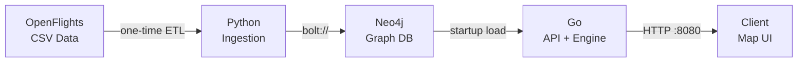

# Aircraft Route Planner

An aviation routing engine that finds all possible routes worldwide for a specific aircraft type. Input an aircraft model and an airport — get back every direct, 1-stop, and 2-stop journey operated by that exact aircraft.

---

## Problem Statement

Aviation enthusiasts and plane-spotters often want to answer a simple question: *"Where can I fly on an Airbus A380?"* or *"What routes out of London Heathrow use a Boeing 777?"*

No mainstream flight search engine filters by aircraft type. Google Flights, Skyscanner, and Kayak optimize for price, schedule, and airline — but aircraft type is buried or absent. Dedicated tools like Flightradar24 show live tracking, not route planning.

This project solves that gap: given an aircraft model and a departure (or arrival) airport, return every possible journey worldwide that is operated by that specific aircraft — including connections through hub airports.

---

## How It Works

The system models global aviation as a directed graph. Airports are nodes. Routes are edges, each tagged with the aircraft types that operate them.

**Aircraft code normalization:** Different data sources identify the same aircraft differently (IATA `388`, ICAO `A388`, name "Airbus A380-800"). A normalization layer maps all identifiers to canonical codes and groups variants into families — searching "A350" finds routes for both the A350-900 and A350-1000.

The engine supports two query modes:

- **Strict** — every leg of the route must use the specified aircraft. *"Fly A380 the whole way."*
- **Inclusive** — at least one leg must use the specified aircraft, other legs can be anything. *"Fly an A380 at least once on my journey."*

The user configures the maximum number of stops (0–3) per request. The engine traverses the graph and returns all matching paths within the hop limit.

---

## Tech Stack



| Layer | Technology |
|---|---|
| Data Ingestion | Python |
| Graph Database | Neo4j |
| API + Route Engine | Go |
| Map UI | Leaflet.js + OpenStreetMap |

See [ARCHITECTURE.md](ARCHITECTURE.md) for the rationale behind each choice.

---

## Data Source

[OpenFlights](https://openflights.org/data) — an open dataset of global aviation data.

| Dataset | Records | Key Fields |
|---|---|---|
| Airports | ~14,110 | IATA/ICAO codes, coordinates, city, country |
| Routes | ~67,663 | Origin, destination, airline, **equipment (aircraft types)** |
| Aircraft | ~246 | Name, IATA code, ICAO code |
| Airlines | ~6,000 | Name, IATA/ICAO codes, country |

The **equipment** field in routes is the core enabler — it lists which aircraft types operate each route using IATA equipment codes (e.g., `388` = Airbus A380, `77W` = Boeing 777-300ER).

**Limitations:**
- Snapshot from June 2014 — some routes and airlines no longer exist
- No frequency data (daily vs. weekly service)
- Equipment field means the aircraft *may* operate the route, not that it always does

This is acceptable for a learning project. The architecture supports swapping in a live data source later.

### Phase 2: Live Operations Pipeline (Staging)

The architecture supports a parallel staging environment powered entirely by active, free-tier data sources to gather real-world, current schedules.

| Dataset | Source | Description |
|---|---|---|
| Airports | **OurAirports.com** | Exhaustive open-data list, filtered to scheduled commercial airports (3,307 nodes; ~950 top airports are daily fetch targets). |
| Aircraft | **Mictronics / tar1090-db** | Weekly-updated CSV cross-reference for ICAO24 hex codes to canonical models (~99.7% commercial coverage). |
| Routes | **OpenSky Network** | Daily REST polling (OAuth2, credit-limited) building a rolling 60-day history of actual flights. |

Source evaluation and rationale: [ARCHITECTURE.md §13.1](ARCHITECTURE.md#131-data-source-research) (Phase 6.1, July 2026).

**Both data sources run side-by-side, fully isolated** (Phase 6 status, July 2026):

| Source | Neo4j | API | Start |
|---|---|---|---|
| OpenFlights (2014 baseline) | `:7687` (`docker compose up -d`) | `:8080` | `./scripts/run-server.sh openflights` |
| OpenSky (live pipeline) | `:7688` (`docker compose -f docker-compose.staging.yml up -d`) | `:8081` | `./scripts/run-server.sh opensky` |

The OpenSky pipeline accumulates daily (launchd agent `com.aircraft-route-planner.fetch`, 09:00). Refresh its graph any time with `python3 ingest/sources/load_graph.py`, then restart the opensky server. Full production cut-over (Phase 6.4) is deferred until the dataset matures, in two stages: the OpenSky hub subgraph ~Nov 2026 (a macOS TCC misconfiguration stalled the daily agent for 57 days, repaired 2026-08-31, see RUNBOOK §4), and Chinese and Russian routes from AeroDataBox later, ~early 2027 (ARCHITECTURE §4.1.7); when ready: `python3 ingest/sources/promote.py --yes` (wipes production Neo4j and re-ingests from the OpenSky cache; rollback via `python ingest/main.py`).

This pipeline leverages dual-script execution, saving raw API flight responses locally to SQLite. The SQLite database accumulates millions of actual flights safely, which are then aggregated offline into consolidated schedule patterns (weekly route frequency, days of week) before synchronizing with Neo4j.

**Pipeline stages (Script 2 — Graph Loader):**
- **Destination inference** — resolves ~30-40% of flights with NULL arrival airports via callsign pattern matching against known routes
- **Route validity filtering** — dual-threshold filter (minimum weekly observations + recency bias) to exclude one-off diversions and cancelled routes
- **Airline code resolution** — derives IATA airline codes from ICAO callsign prefixes (e.g., BAW → BA), with Aviationstack API as fallback
- **SQLite-backed resumability** — `fetch_log` table tracks progress across multi-week data accumulation, preventing wasted API requests on crash/restart

Full pipeline details: ARCHITECTURE.md §4.1; how the original ingestion plan maps onto it: [§13.2](ARCHITECTURE.md#132-original-ingestion-plan).

---

## API Surface

```
GET  /airports/search?q={query}                        Search airports by name, city, or IATA code
GET  /aircraft/search?q={query}                        Search aircraft types by name or IATA code
GET  /countries/search?q={query}                       Search country names for autocomplete
GET  /routes?aircraft=&from=&to=&max_hops=&mode=       Find routes between two airports for an aircraft type
GET  /routes/from?aircraft=&from=&max_hops=&mode=      Find all destinations reachable on an aircraft type
GET  /routes/countries?from=&to=&aircraft=              Find all direct routes between two countries (aircraft optional)
GET  /health                                           Service health + graph statistics
```

Full API contract with request/response schemas is in [ARCHITECTURE.md](ARCHITECTURE.md).

---

## Map UI

An interactive world map built with Leaflet.js and OpenStreetMap (free, no API key):

- Routes drawn as curved great-circle arcs between airports
- Color-coded legs: solid highlight for the target aircraft, dashed grey for connecting flights on other aircraft (inclusive mode)
- Aircraft-specific silhouette icons (curated SVGs for ~15-20 common types) displayed along each route arc
- Sidebar with search controls (aircraft, airports, max hops, mode toggle) and a clickable results list

---

## Success Criteria

| Metric | Target |
|---|---|
| Query: "A380 routes from LHR to SYD, max 2 stops" | Returns valid paths through known hubs (DXB, SIN, etc.) |
| Query: "All A380 destinations from LHR" | Returns 20+ airports |
| Pathfinding response time (2-hop, single aircraft) | < 50ms |
| Data ingestion (full OpenFlights dataset) | < 30 seconds |
| Memory footprint (Neo4j + Go server) | < 4GB combined |

---

## Running the Project

### Prerequisites

- **Docker Desktop** (Neo4j 5 Community)
- **Go 1.22+** (uses `net/http` enhanced routing patterns)
- **Python 3.10+** (ingestion only)

### 1. Configure environment

```bash
cp .env.example .env
# Defaults work for local development; edit credentials/ports if needed.
```

The `.env` file is required — `docker-compose.yml` interpolates `NEO4J_USER` and `NEO4J_PASSWORD` from it for Neo4j auth.

### 2. Start Neo4j

```bash
docker compose up -d
# Browser at http://localhost:7474 — login with NEO4J_USER / NEO4J_PASSWORD
```

### 3. Load OpenFlights data (one-time)

```bash
cd ingest
pip install -r requirements.txt
python main.py
cd ..
```

Expected: completes in under 30s, prints summary of airports / routes / aircraft loaded.

### 4. Run the API server

```bash
go run ./cmd/server
# Listens on :8080 — startup logs airport, edge, and aircraft counts.
```

### 5. Smoke test

```bash
curl 'http://localhost:8080/health'
curl 'http://localhost:8080/routes?aircraft=388&from=LHR&to=SYD&max_hops=2'
curl 'http://localhost:8080/routes/from?aircraft=388&from=LHR&max_hops=2'
```

### Configuration

| Variable | Default | Purpose |
|---|---|---|
| `NEO4J_URI` | `bolt://localhost:7687` | Neo4j Bolt endpoint |
| `NEO4J_USER` / `NEO4J_PASSWORD` | `neo4j` / `aviation` | Neo4j credentials |
| `PORT` | `8080` | HTTP listen port |
| `GRAPH_MAX_HOPS` | `3` | Hard ceiling on the `max_hops` query param. Larger values are silently clamped — see [ARCHITECTURE.md §10](ARCHITECTURE.md). |

### Tests

```bash
# Unit tests (no Neo4j required)
go test ./...

# End-to-end verification against a running server
./scripts/verify.sh
```

`verify.sh` exercises the success criteria from this README (LHR→SYD, ≥20 destinations from LHR, p50 latency) plus the Phase 4 edge-case matrix.

---

## Project Documents

| Document | Purpose |
|---|---|
| [README.md](README.md) | This file — project overview and business context |
| [ARCHITECTURE.md](ARCHITECTURE.md) | Technical design: data model, system topology, algorithms, API contract |
| [PLAN.md](PLAN.md) | Implementation phases, build order, verification checkpoints |
| [RUNBOOK.md](RUNBOOK.md) | Operational commands — starting servers, pipeline runs, cut-over/rollback |

---

## License

The project's own code is not licensed yet. The aircraft silhouettes in `web/public/assets/aircraft/` are derived from GPL-licensed projects and are distributed under GPL-3.0: see [`LICENSE`](web/public/assets/aircraft/LICENSE) and [`ATTRIBUTION.md`](web/public/assets/aircraft/ATTRIBUTION.md) in that directory.
